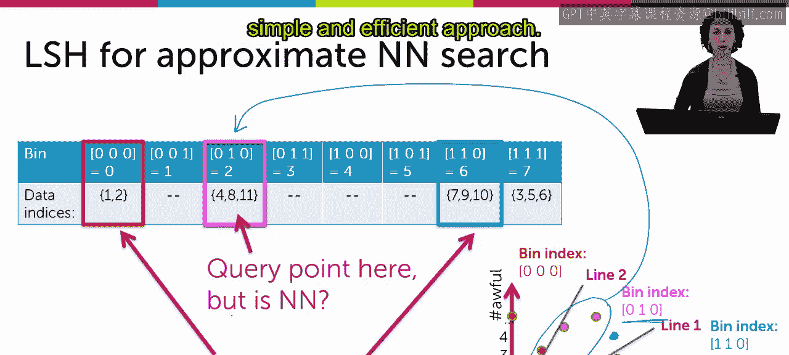

# 华盛顿大学《机器学习（分类，聚类和检索，第3-4课⧸共4课）｜Machine Learning》中英字幕 p188 66_模块1回顾.zh_en -BV1Sr421F7N7_p188-

。

Congratulations on getting to the end of the clustering and retrieval course。

 we've covered a lot of ground in this course。 and in addition， a lot of really advanced material。

 But through this course you've learned some very practical algorithms for performing clustering and retrieval and you should be able to actually go out there。

 implement these methods and deploy them on realworld problems。 but before we wrap up。

 let's spend a little time reflecting on what we've learned in this course and look ahead at what's left in a specialization well。

 what have you learned in this course to start with in module1。

 we looked at the idea of retrieval and cast that as a problem of performing nearest neighbor search and the first algorithm we looked at was something that we called one nearest neighbor search where we just look at all of our data points and look for the data point that's most similar to the query point and we explore this specifically in the context of a document retrieval task where there's a whole bunch of documents out there。

 There's an entire corpus of。😊。

That we have and we have some article that's our query article might be an article that a person is currently reading and is interested in。

 and we want to search over all the other articles to find the closest article so we presented some algorithmic details behind performing one nearest neighbors search and then we presented a very straightforward extension of one nearest neighbor search which is K nearest neighbor search where we simply return the K most similar articles are generically data points to a given query point instead of just the nearest neighbor but in both one nearest neighbor and k nearest neighbor search there are two really critical elements to the performance of the method The first is how we think about representing our data So in this case in our case study that we're considering the question is how are we going to represent our documents and then the second critical element is how are we going measure the similarity or the distance between two data points so again in our case two documents。

Well， in this course， we took a deep dive into these two critical components of nearest neighbor search and to begin with we talked about a document representation based on TFIF term frequency inverse document frequency。

 where the term frequency is simply counting words in the document so we look at our entire vocabulary we have a data representation that's exactly the length of the vocabulary and in each index of this vector we simply count how many times we saw a given word。

 but we talked about the fact that this can bias our nearest neighbor search towards emphasizing very common words。

 and so that's typically not desired， so to account for this we introduce this inverse document frequency term where that down weights words that are very commonly used globally throughout the corpus so our TFIDF representation is simply multiplying our Tf vector with this IDF vector and this trades off between。

Local frequency and global rarity。We then turned to how are we going to compute the distance between two different articles and the first approach that we talked about was using scaled Euclidean distance。

 where it's just a straightforward variant of Euclidean distance。

 and instead of having equal weights on every component of the vector。

 we can specify a set of weights。 So for example， for our documents。

 we might have a representation that separates out the title from the abstract from the main body from the conclusion and then based on this representation across these different components we could put weights that more heavily emphasize the words that are appearing in the title and the abstract than the main body and so this might be appropriate in terms of finding similarities between articles because maybe the titles and abstracts have the really key words for describing what those articles are about whereas the main body might be bogged down with lots of things that are a bit tangential to the main point of the article But when we're thinking about text data。

Re common distance metric used is cosine similarity and so we talked about how cosine similarity is just the inner product of two normalized vectors。

 one for each of our documents， and this is equivalent to computing the similarity between two articles just based on the cosine of the angle between those two documents。

 but remember this wasn't actually a proper distance metric it doesn't satisfy things like the triangle inequality but we can definitely use it to compute the distance between two different documents in our nearest neighbor search。

We then discuss the implications of using cosine similarity because it normalizes the vectors that we're looking at。

 so it ignores the scale of the individual vectors， so that could be a desirable property。

 so for example， we talked about how it ignores the length of the document。

 so longer documents don't get emphasized more than shorter documents。

 but that could also be something that we don't want， and we discussed how for example。

 it can make dissimilar objects like a tweet and a very lengthy article， very similar。

 place them on the same ground。So instead we talked about other ways of thinking about normalization where we're not actually normalizing we're simply capping the max word count and using that to account for our differences in document lengths。

 but I want to mention that cosine similarity is really commonly used when you're looking at features of text data or another applications where the overall scale of the feature vector that you're looking at isn't so critical。

 but we mentioned in contrast that in certain applications， for example。

 if you're looking at features of a house and you're looking at number of bedrooms。

 number of bathroom square feet that the raw scale of those numbers is really really critical。

 so you wouldn't want to do something like cosine similarity and instead you'd want to use something like Euclidean distance or possibly scaled Euclidean distance。

Okay， but in this module， we talked a lot about the trade offs between different choices made and different options for our data representations and our distance calculations。

But there's still one really important aspect of nearest neighbor search that we spent quite a bit of time on in this module。

 which is the complexity of search。 We mentioned that brute force search where you take a query point and then you compute the distance to every other point in the entire data can be really。

 really intensive， especially if you're going to be doing many different queries on the same data。

So instead， what we talked about first was an idea of using something called KD trees as an efficient data representation where KD trees recursively partition our feature space to create a binary tree and where the data points are stored at the leaves of this tree。

And we discussed how to form this tree。 and then we discussed how to use this tree to perform efficient nearest neighbor search。

 where the really important insight here is the fact that we can prune often a very large amount of the space by the fact that the distance to our nearest neighbor found so far is smaller than the distance to a lot of the boxes in this partitioning of the feature space。

 And that means that no point within any of these boxes could be at nearest neighbor to our query point。

 And if we don't care about performing exact nearest neighbor search。

 then we can get even larger efficiencies using kd trees by instead of pruning when the distance to a bounding boxes is greater than the distance to our nearest neighbor found so far。

 we prune more aggressively。 So we're going to basically shrink the distance to our nearest neighbor so far and prune based off of this shrunken distance。

And depending on how much we're shrinking to do this more aggressive pruning。

 this can result in significant savings in terms of our search time at fairly low cost in terms of the quality of our nearest neighbor。

 But we did mention that Kd trees can have some serious limitations。

 One is the fact that they're just not that straightforward to implement。 But the other。

 which might be more important to you if you're a really awesome hacker is the fact that Kd trees just really don't scale well to high dimensional feature spaces。

So as an alternative for performing approximate nearest neighbor search。

 we presented something called locality sensitive hashing。

 where what we do here is we simply throw down a set of lines where each line is just randomly defined in the space and if we're in more than two dimensions and we're talking about these hyperplanes that we're throwing down。

 but the point is is that now these lines， these random lines partition are feature space。

And the collection of the lines define what we're going to think of as bin indices for each of these data points。

 In particular， we talked about how these bin indices can be used within a hash table to store our data points。

 so for example。These pink points are stored in this third index of the hash table based on the binary representation of this bin index。

 and if we have a query point in this same partition。

Then what we would do in our nearest neighbor search。

 as we discussed is we'd first search the same bin as the query point。

 but then if we wanted to improve the quality of the nearest neighbor search performed。

 we know that the nearest neighbor to this point doesn't have to lie within that specific partition。

 so we'd search neighboring bins where these neighboring bins， we simply flipped。

Bits on this binary representation here to define what were the adjacent bins。

And then we just continue this until we ran out of our computational budget。

So in contrast to KaD trees， locality sensitive hashing is really， really。

 really straightforward to implement and you got some practice in your assignment in exploring the quality of the results from locality sensitive hashing。

 showing that you could get fairly high quality neighbors return using this very simple and efficient approach。

