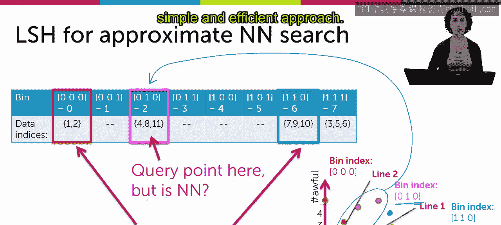

# 机器学习（分类，聚类和检索）：模块1回顾 🎯

在本课程中，我们学习了聚类和检索的基础知识。模块1重点介绍了检索任务，并将其构建为最近邻搜索问题。我们探讨了数据表示、相似性度量以及高效搜索算法等核心概念。本节将对模块1的内容进行全面回顾。

## 检索与最近邻搜索

上一节我们介绍了课程的整体目标，本节中我们来看看模块1的核心思想。我们将检索任务定义为执行最近邻搜索的问题。我们首先研究了一种称为“单最近邻搜索”的算法。

*   **单最近邻搜索**：该算法遍历所有数据点，寻找与查询点最相似的数据点。
*   **K最近邻搜索**：这是单最近邻搜索的直接扩展，它返回与给定查询点最相似的K个数据点，而不仅仅是最近的一个。

在单最近邻和K最近邻搜索中，方法的性能取决于两个关键要素：
1.  **数据表示**：我们如何表示数据。在我们的案例研究中，问题是如何表示文档。
2.  **相似性度量**：我们如何衡量两个数据点（例如两个文档）之间的相似性或距离。

## 数据表示：TF-IDF

我们深入探讨了最近邻搜索的这两个关键组成部分。首先，我们讨论了一种基于TF-IDF（词频-逆文档频率）的文档表示方法。

*   **词频**：简单地统计文档中每个词出现的次数。我们得到一个长度等于词汇表大小的向量，每个索引位置的值是相应词的出现次数。
*   **逆文档频率**：为了抵消常见词带来的偏差，我们引入了逆文档频率项，它降低了在整个语料库中普遍使用的词的权重。

TF-IDF表示法就是TF向量与IDF向量的乘积。其公式可以表示为：
`TF-IDF(t, d) = TF(t, d) * IDF(t)`
其中，`TF(t, d)`是词t在文档d中的频率，`IDF(t)`是词t的逆文档频率。这种方法在**局部频率**和**全局稀有性**之间进行了权衡。

## 距离度量：缩放欧氏距离与余弦相似度

接下来，我们转向如何计算不同文章之间的距离。我们讨论的第一种方法是使用缩放欧氏距离。

*   **缩放欧氏距离**：这是欧氏距离的一个变体。它允许为向量的每个分量指定一组权重，而不是对所有分量赋予相等的权重。例如，对于文档，我们可以为标题、摘要、正文等不同部分分配不同的权重。

然而，在处理文本数据时，一个更常用的距离度量是**余弦相似度**。

*   **余弦相似度**：计算两个归一化向量（每个文档一个向量）的内积。这等价于基于两个文档向量之间夹角的余弦值来计算相似度。其公式为：
`cosine_similarity(A, B) = (A · B) / (||A|| * ||B||)`
但请注意，余弦相似度不是一个严格的距离度量，它不满足三角不等式等性质。

我们讨论了使用余弦相似度的影响。因为它对向量进行了归一化，所以忽略了单个向量的尺度。这可能是一个理想的特性（例如，它忽略了文档长度，使长文档和短文档处于平等地位），但也可能带来问题（例如，可能使一条推文和一篇长文章显得非常相似）。作为替代方案，我们讨论了其他归一化方法，例如简单地限制最大词频来应对文档长度的差异。

需要强调的是，余弦相似度常用于文本数据特征或其他特征向量整体尺度不关键的应用。相反，在某些应用中（如房屋特征：卧室数量、浴室数量、平方英尺），原始数值的尺度非常关键，此时应使用欧氏距离或缩放欧氏距离。

## 高效搜索：KD树与局部敏感哈希

在本模块中，我们详细讨论了数据表示和距离计算中不同选择和选项之间的权衡。但还有一个非常重要的方面，即搜索的复杂度。

我们提到，暴力搜索（计算查询点到数据集中每个点的距离）的计算量可能非常大。因此，我们首先介绍了一种使用**KD树**作为高效数据结构的方法。

*   **KD树**：递归地划分特征空间以创建二叉树，数据点存储在该树的叶节点中。
*   **搜索原理**：利用“当前找到的最近邻距离”小于特征空间划分中许多包围盒的距离这一事实，可以剪枝掉大量空间区域，从而高效执行最近邻搜索。
*   **近似搜索**：如果我们不要求精确的最近邻搜索，可以通过更激进地剪枝（基于一个“缩小”的距离）来获得更高的效率。
*   **局限性**：KD树实现起来不简单，并且在处理高维特征空间时扩展性不佳。

作为执行近似最近邻搜索的替代方案，我们介绍了**局部敏感哈希**。

*   **核心思想**：在空间中随机放置一组线（或高维中的超平面），这些线将特征空间划分为多个区域（“桶”）。
*   **哈希表存储**：每个数据点根据其所在的区域获得一个“桶索引”，并存储在以该索引为键的哈希表中。
*   **搜索过程**：对于查询点，首先搜索其所在的桶。为了提高搜索质量，可以继续搜索相邻的桶（通过翻转桶索引的二进制表示的位来定义相邻桶），直到耗尽计算预算。

与KD树相比，局部敏感哈希实现起来非常简单直接。你在作业中已经实践过，并探索了其返回结果的质量，证明这种简单高效的方法能够返回相当高质量的近邻。

## 总结

在本节课中，我们一起学习了模块1的核心内容。我们从将检索定义为最近邻搜索问题开始，深入探讨了数据表示（TF-IDF）和距离度量（缩放欧氏距离、余弦相似度）这两个关键组件。接着，我们重点解决了大规模数据下的搜索效率问题，学习了两种高效算法：用于精确和近似搜索的KD树，以及特别适合高维数据和易于实现的局部敏感哈希。通过这些知识，你现在应该能够理解、实现这些方法，并将它们应用于实际问题中。