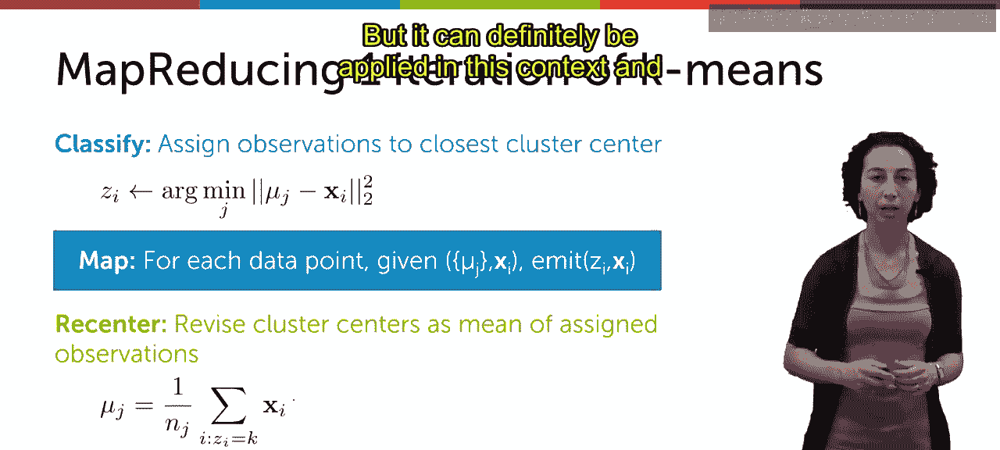
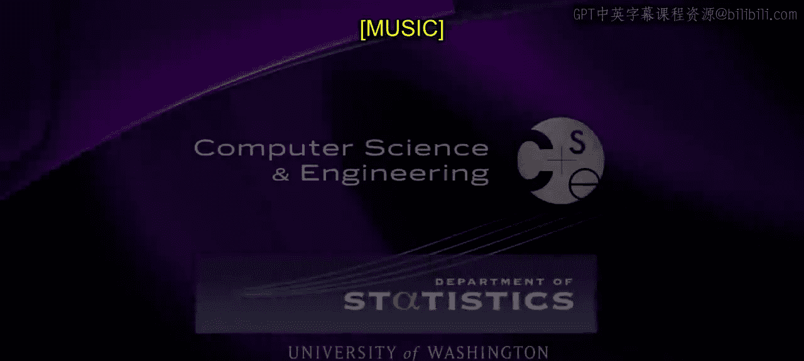

# 华盛顿大学《机器学习（分类，聚类和检索，第3-4课⧸共4课）｜Machine Learning》中英字幕 p189 67_模块2回顾.zh_en -BV1Sr421F7N7_p189-

。

So that was our deep dive into retrieval， where a lot of our focus was not only on how do we think about representing our data and computing distances which are very critical to the performance of the nearest neighbor algorithm。

 but we also focused very heavily on how we think about scaling up nearest neighbor search to really large data sets。

 thinking about using KD trees and locality sense of hashing and using both of these to perform approximate nearest neighbor search。

But for the remainder of the course， we turn to this idea of clustering。

 and in particular in our second module， we first discuss what does clustering mean and we return to our document analysis where the goal here was to discover groups of related articles。

 and the first algorithm that we presented for performing clustering was something called k means。

 And that is probably the most widely used algorithm for clustering。

 And remember that in this algorithm we somehow initialize by just placing a set of cluster centers and then the algorithm iterates between making hard assignments of data points to the nearest cluster center and then updating the cluster centers。

 And this procedure repeats until convergence。 And in particular。

 we CAca means as a coordinate descent algorithm。 And through this。

 we know that it's going to converge to a locomot of the objective。 So importantly。

 we know that we're not going to converge necessarily to the global mode。

 but the algorithm does converge just。To a local mode。

So we went through this in pictures showing that for different initializations。

 we can converge to quite different solutions， so in practice people often run multiple initializations of the algorithm and choose the best one。

 and we discussed how initialization matters really significantly for the quality of the solution found as well as the convergence rates。

But just like in our first module on retrieval in our second module。

 one of our big emphasis was on the scalability of the procedure and for this we introduced a generic framework called mapreuce for parallellyzing computations across multiple machines under certain specific setups in particular we talked about the mapreduce abstraction in terms of a map step that has to be data parallel over elements and a reduced step that perform some aggregation that has to be data parallel over keys but if your algorithm has this structure。

 then you can think about using mapreduce to parallelze and distribute the computations。

 and we showed that indeed K means has this type of structure where in particular we can think about the classified step of making the hard assignments of data points to cluster centers as data parallel over elements and the recenter step where we recompute the centers。

each of the clusters as data parallel over keys， so we have a map and reduced step here。

 but in Kmes we mentioned that we have to iterate between these steps again and again。

 which is a non-standard implementation of mapR。But it can definitely be applied in this context and give us really good scaling properties for k means。

🎼。

