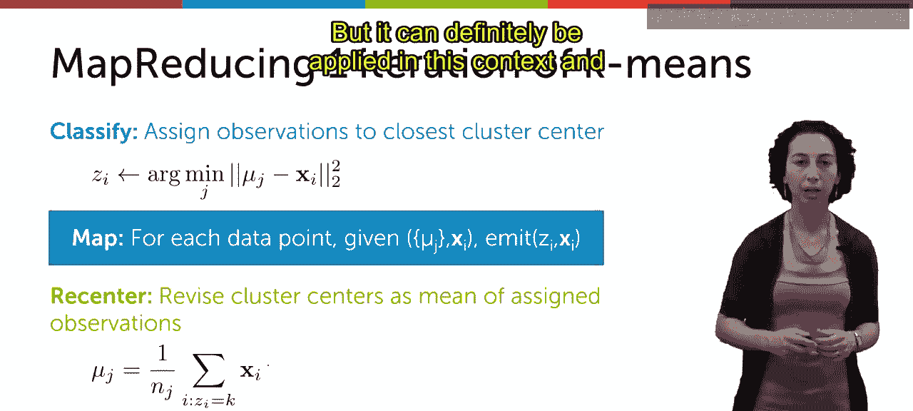
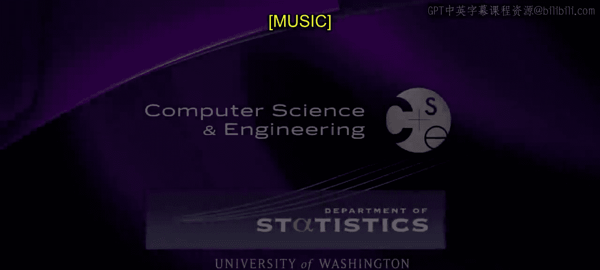

# 机器学习（分类，聚类和检索）：模块2回顾

在本节课中，我们将回顾模块二的核心内容，重点聚焦于**聚类**的概念、算法及其可扩展性实现。我们将从检索的深入探讨过渡到聚类，并详细解析K-means算法及其在大规模数据集上的应用。

---

## 🔍 检索部分回顾

上一节我们深入探讨了检索。我们的重点不仅在于如何表示数据和计算距离——这对最近邻算法的性能至关重要——还着重研究了如何将最近邻搜索扩展到超大规模数据集。

我们考虑了使用KD树和局部敏感哈希这两种方法，来实现**近似最近邻搜索**。

---

## 🧩 转向聚类

在课程的后半部分，我们将转向**聚类**这一主题。

在模块二中，我们首先讨论了聚类的含义，并回到了文档分析的例子，其目标是发现相关的文章组。

我们介绍的第一个用于执行聚类的算法叫做 **K-means**。这可能是使用最广泛的聚类算法。

以下是K-means算法的核心步骤：

1.  **初始化**：随机放置一组聚类中心。
2.  **分配步骤**：将每个数据点**硬分配**给距离最近的聚类中心。
3.  **更新步骤**：根据分配给每个簇的所有点，重新计算该簇的中心位置。
4.  **迭代**：重复步骤2和步骤3，直到算法收敛（即聚类中心不再变化）。

具体来说，我们将K-means视为一种**坐标下降算法**。因此，我们知道它会收敛到目标函数的一个**局部最优解**。重要的是，这不一定是最优的全局解，但算法确实会收敛到某个局部解。

我们通过图示展示了不同的初始化会导致收敛到截然不同的解决方案。因此，在实践中，人们通常会运行多次不同初始化的算法，并选择结果最好的一个。我们讨论了初始化对最终解的质量和收敛速度都有非常显著的影响。

---

## ⚙️ 可扩展性与MapReduce

就像在第一个关于检索的模块中一样，我们在模块二中的一个重点也是算法的**可扩展性**。

为此，我们引入了一个名为 **MapReduce** 的通用框架，用于在特定设置下跨多台机器并行化计算。我们以两个步骤来讨论MapReduce抽象：

*   **Map步骤**：必须在数据元素上并行执行。
*   **Reduce步骤**：执行某种聚合，必须在键上并行执行。

如果你的算法具有这种结构，就可以考虑使用MapReduce来并行化和分布式计算。

我们展示了K-means确实具有这种结构：
*   **分配步骤**（将数据点分配给聚类中心）可以看作是在数据元素上并行的Map操作。
*   **更新步骤**（重新计算每个簇的中心）可以看作是在簇标签（作为键）上并行的Reduce操作。

因此，K-means中包含了Map和Reduce步骤。不过我们提到，K-means需要在这两个步骤之间反复迭代，这是一种非标准的MapReduce实现方式，但它确实可以应用于此场景，并为K-means带来良好的扩展性能。

---

## 📝 总结

本节课中，我们一起学习了：
1.  从**检索**到**聚类**的过渡，回顾了近似最近邻搜索的方法。
2.  **K-means聚类算法**的核心思想、步骤及其作为坐标下降算法的特性，理解了其收敛于局部最优解的性质以及初始化的重要性。
3.  如何利用**MapReduce**框架来并行化K-means算法，以应对大规模数据集，并分析了算法步骤如何映射到Map和Reduce操作中。

通过本模块的学习，你掌握了基础且强大的聚类工具K-means，并了解了将其应用于实际大规模问题时的关键考量。