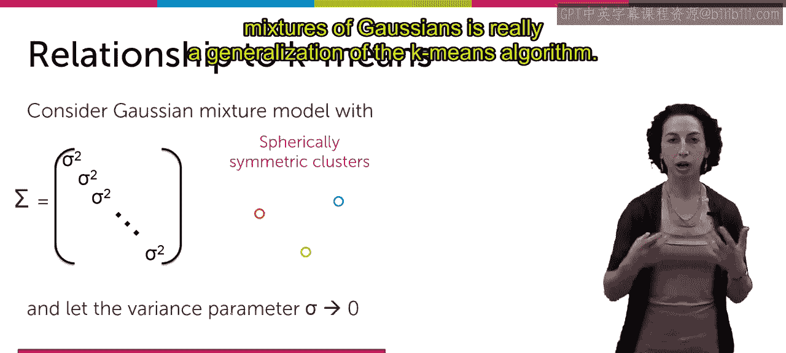

# 华盛顿大学《机器学习（分类，聚类和检索，第3-4课⧸共4课）｜Machine Learning》中英字幕 p190 68_模块3回顾.zh_en -BV1Sr421F7N7_p190-

。

In our third module， we continued this discussion of clustering。

 but within the context of probabilistic model based approaches， specifically mixture models。

 and we discuss how mixture models allow us to capture uncertainty in the assignment of data points to clusters。

 and we also motivated the use of mixture models as opposed to K means just by describing some of the failure modes of K means。

 because K means assumes these spherically symmetric clusters and computes assignments of data points to the clusters just based off of the cluster centers。

 So there are a number of scenarios in which K means just really can't capture the underlying cluster structure very well。

So in our discussion of mixture models， we used a very visually appealing application of trying to group images into related classes。

 So， for example， here we might have an unlabeled， jumbled set of images that we somehow want to group into in this case。

 images that are all sunset images， forest images and cloud images。

 But we talked about the fact that we just have this data that's all mixed together。

 And a question is， how are we going handle this。 Well， in our probabilistic approach， we're going。

Treat the observed quantity， which we represented just as this RGB vector as a random quantity and look at distributions on that vector so the distribution can have a really complicated form but because it's mixing over these different classes。

 but to think about unjumbling this mess， we talked about introducing clusterspec Gaussian components or possibly other distributions though in this application we're looking at Gaussians and then saying that our mixture model is just a weighted collection of these different components with weights based on what the relative proportions of each of these classes is。

In this data set。So more formally， we said that our mixture of Gaussian model was defined in terms of a collection of Gaussian components each defined with a specific mean and variance。

 as well as a mixture weight， so how heavily that class was going to be represented in the mixture so all of these pictures are just for one- dimensional data but we talked about how we think of defining mixtures of Gaussians in higher dimensions。

 and then we turn back to our document clustering task where here remember our document representation if we think of using TfiIDF or just simply word count vectors has a representation that has dimension equal to capital V。

 the number of words in our vocabulary， so we talked about some of the challenges of scaling our mixture models to these high- dimensionsal scenarios and in particular instead of allowing arbitrary Gaussian components in the mixture model。

 we said that in practice one would often want to specify just a。

agonal form to the Gaussian covariance matrix to dramatically reduce the number of parameters。

 but we said that this form is still much more flexible than what you have in K means and in particular we're still going to be learning the weightings on these different dimensions。

In our mixturegaussian model and then having specified our mixture Agaussian model。

 so understanding the components of this probabilistic model。

 we turn to how to do inference in this model。 So remember we're just going to present the algorithm with a data so a set of points that are unlabeled and we discuss an algorithm in particular called expectation maximization or the EM algorithm that allows us to jointly infer both the model parameters as well as these soft assignments that describe our uncertainty in the assignment of data points to specific clusters So in particular。

 this EM algorithm is an iterative algorithm where the first step。

 which is the E step forms these soft assignments。Based on our current estimate of the model parameters。

 then the second step， which is called the Mstep computes the maximum likelihood estimate of our model parameters given the soft assignments at the current iteration and then we iterate again and again and again between these steps until convergence and just like K means we show that EM can be described as a coordinate tocent algorithm so we get the same types of properties where you get convergence to a local mode of the objective so likeK means initialization matters a lot。

 and typically people rerun the algorithm many times and choose the best solution but another thing that we described was that for our mixture models we have a lot more parameters than we do for k means but we presented some ways to think about handling or at least ameliorating these issues of overfitting well in pictures we presented a set of illustrations showing EM in practice where over iterations of the EM steps we see how we're able to learn。

Soft assignments of observations to specific clusters as well as the cluster parameters where even at convergence of the algorithm。

 we can still get these uncertainties and whether a given data point is assigned to one cluster versus another cluster and this is actually something we want。

 we want these uncertainties as part of the output of this algorithm。And finally。

 at the end of the third module， we related very formally the expectation maximization algorithm for mixtures of Gaussianss 2 k means。

In particular， we said if we look at a mixture of Gaussians with spherically symmetric。Gussians。

 so diagonal covariance with same elements along the diagonal。

 and then we shrink that variance to zero。And we run our EM algorithm。

 the output is exactly the same as K means because what we're going to end up doing are making hard assignments of data points to specific clusters just based on the distance to the cluster center so indeed looking at EM for mixtures of Gaussians is really a generalization of the K means algorithm。

