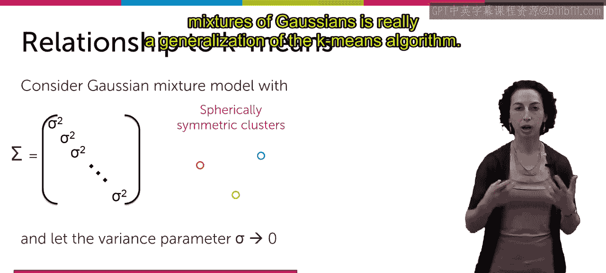

# 机器学习（分类，聚类和检索）：模块3：基于概率模型的聚类回顾 🧩

在本模块中，我们将回顾基于概率模型的聚类方法，特别是混合模型。我们将探讨混合模型如何捕捉数据点分配到不同簇的不确定性，并与K均值算法进行比较，分析其各自的优缺点。

## 概述

在模块3中，我们延续了关于聚类的讨论，但重点转向了基于概率模型的方法，即混合模型。我们讨论了混合模型如何捕捉数据点分配到簇的不确定性，并通过描述K均值算法的一些失败案例，说明了使用混合模型的动机。K均值算法假设簇是球对称的，并仅基于簇中心分配数据点，因此在许多场景下无法很好地捕捉底层的簇结构。

## 混合模型与图像分组应用

在讨论混合模型时，我们使用了一个视觉上非常直观的应用：将图像分组到相关的类别中。例如，我们可能有一组未标记、混杂的图像，我们希望将它们分组为日落图像、森林图像和云图像等类别。但问题在于，我们只有这些混合在一起的数据。那么，我们将如何处理呢？

在概率方法中，我们将观测到的量（这里表示为RGB向量）视为随机变量，并研究该向量的分布。这个分布可能具有非常复杂的形式，因为它混合了这些不同的类别。为了理清这个混乱的局面，我们引入了特定于簇的高斯分量（或其他分布，但在此应用中我们主要关注高斯分布），并说明我们的混合模型只是这些不同分量的加权集合，权重基于数据集中每个类别的相对比例。

更正式地说，我们的高斯混合模型定义为一组高斯分量，每个分量由特定的均值（**μ**）和方差（**σ²**）定义，以及一个混合权重（**π**），表示该类在混合中的比重。所有这些图示都针对一维数据，但我们讨论了如何在更高维度上定义高斯混合模型。

## 文档聚类任务与高维挑战

然后，我们回到了文档聚类任务。回想一下，如果我们使用TF-IDF或简单的词频向量来表示文档，其表示维度等于词汇表的大小（**V**）。我们讨论了将混合模型扩展到这些高维场景所面临的一些挑战。特别是，我们指出，在实践中，人们通常希望为高斯协方差矩阵指定一个**对角形式**，以显著减少参数数量。

然而，这种形式仍然比K均值灵活得多。具体来说，在我们的混合高斯模型中，我们仍然会学习这些不同维度上的权重。在指定了混合高斯模型并理解了该概率模型的组成部分之后，我们转向了如何在该模型中进行推断。

## 期望最大化算法

回想一下，我们只是向算法提供一组未标记的数据点。我们讨论了一种称为**期望最大化**的算法，它允许我们联合推断模型参数以及描述数据点分配到特定簇的不确定性的**软分配**。

具体来说，EM算法是一种迭代算法：
*   **E步**：基于当前模型参数的估计，形成软分配。
*   **M步**：给定当前迭代的软分配，计算模型参数的**最大似然估计**。

然后，我们在这些步骤之间反复迭代，直到收敛。与K均值类似，我们展示了EM可以被描述为一种**坐标上升算法**，因此具有相同的属性：收敛到目标的局部模式。因此，与K均值一样，**初始化非常重要**。通常，人们会多次运行算法并选择最佳解。

我们还描述了，对于混合模型，我们比K均值拥有更多的参数，但我们提出了一些方法来处理或至少缓解过拟合问题。

## EM算法实践与K均值的关系

在图表中，我们展示了一系列说明EM算法实践的图示。通过EM步骤的迭代，我们可以看到如何学习观测值到特定簇的软分配以及簇参数。即使在算法收敛时，我们仍然可以获得关于给定数据点是被分配到一个簇还是另一个簇的不确定性，而这实际上是我们想要的——我们希望这些不确定性作为算法输出的一部分。

最后，在模块3的结尾，我们非常正式地将高斯混合模型的期望最大化算法与K均值联系起来。具体来说，我们指出，如果我们观察一个具有**球对称高斯分布**的混合高斯模型（即对角协方差矩阵，且对角线元素相同），然后将方差**缩小到零**，并运行我们的EM算法，其输出与K均值完全相同。因为我们最终将根据到簇中心的距离，对数据点进行**硬分配**。因此，高斯混合模型的EM算法确实是K均值算法的一个**泛化**。

## 总结

在本模块中，我们一起学习了基于概率模型的聚类方法，重点是高斯混合模型。我们探讨了混合模型如何通过软分配来量化不确定性，从而克服K均值算法在假设和灵活性上的限制。我们详细介绍了期望最大化算法的原理和步骤，并将其与K均值算法联系起来，展示了EM算法是K均值的一个更一般化的形式。通过图像分组和文档聚类的例子，我们看到了混合模型在处理复杂和高维数据时的应用潜力。