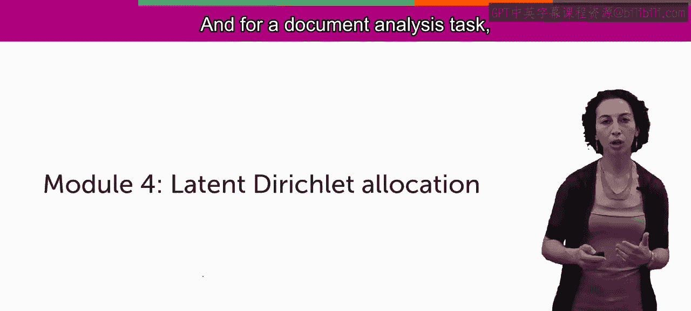
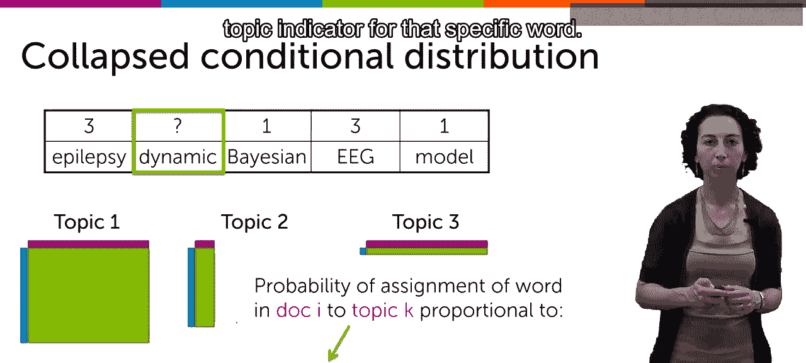
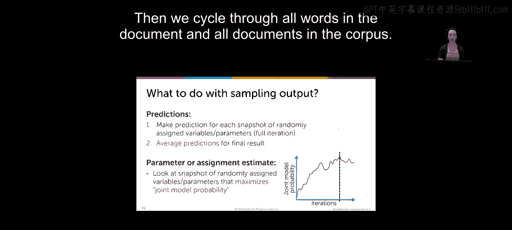
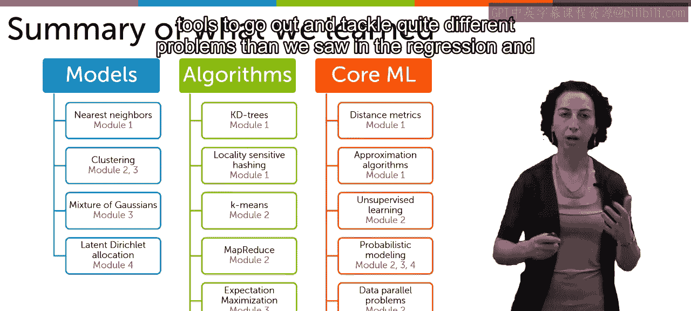

# 华盛顿大学《机器学习（分类，聚类和检索，第3-4课⧸共4课）｜Machine Learning》中英字幕 p191 69_模块4回顾.zh_en -BV1Sr421F7N7_p191-

。

And finally， in our fourth module， we looked at a probabilistic model that provided a more intricate description of our data points and the relationships between data points than our simple clustering representation。

 and in particular， we looked at something called mixed membership modeling and for our document analysis task。

 this model was called Le and Deishly allocation。

But before we presented latent Deishly allocation or LDA for shorthand。

 we presented an alternative document clustering model where we introduced a set of topicspec distributions over the words in the vocabulary。

 where remember， every topic is a different cluster。

 And then every document was assigned to a cluster just as before， but informing that assignment。

 the score of the document under the cluster was computed by just looking at a bag of words representation of the document。

 So just an unordered set of the words that appear in that document and then scoring the words under the specific topic distribution。

 And here， just like in the mixture models we described previously。

 every cluster or topic in this case has a specific prevalence in the overall corpus。

 So this is a distribution over topics that appear in the entire corpus。 So in this module。

 we compared and contrast this clustering model with the mixture of Gaussian。

Cluing model we presented in the third module。 and then we turned to the LD model itself。

 where here every word in every document had an assignment variable linking that word to a specific topic。

 So then when we think about scoring a document in LD。

 we think of scoring every word under its associated topic where these topics are defined exactly like in the alternative cluster model we just described where there's a distribution over every word in the vocabulary specific to the topic。

 But the fact that there's a topic indicator per word in the document rather than per document is not the only thing that distinguishes this model from the clustering model we just described。

 The other thing is we introduce this topic proportion vector specific to each document rather than it representing corpus wide topic proportions。

 And this is really one of the key aspects of LD because this forms our mixed membership represented。

Of every document so a document doesn't belong to just one topic。

 it belongs to a collection of topics and there are different weights on how much membership the document has in each one of these topics and in this module we describe how we can think of these topic proportions as a learn feature representation where we can use it to do things like allocating this article to multiple sections on a news website or using it to relate different articles to one another or using it to learn users' preferences over different topics and likewise。

 we talked about how we can think of looking at these topic distributions over the vocabulary to describe post facto what these topics are really about So these are the types of inferences we can draw from LDA but a question is how do we learn this structure from data。

And just like in clustering， this is a fully unsupervised task where we just provide a set of words in a set of documents in the corpus and somehow from this we want to extract out these topic vocabulary distributions and these document topic proportions and critical to doing this just like in EM is inferring the assignments of the words to specific topics but in this module we described that LD is specified as a Bayesian model and so we described a Bayesian inference procedure for learning our model parameters as well as these assignment variables and the algorithm we described what's called Gib sampling。

 and at first we presented a vanilla version of Gib sampling where we simply iterate between all these assignment variables and model parameters randomly reassigning each conditioned on the instantiated values of all the other parameters or variables so at first we can think about randomly reassigning the topics for every word in a document and then we can think about fix。

These and sampling the topic proportion vector for that specific document and then repeating these steps for all documents in the corpus and then having fixed these values that we can think about resampling the topic vocabulary distributions But then in the module we described a little bit fancier version of sampling that we can perform in LD called collapse Gib sampling where we analytically integrate out over all these model parameters。

 the topic vocabulary distributions and these document specific topic proportions and we just sequentially sample each indicator variable of a given word to a specific topic conditioned on all the other assignments made in that document and every other document in the corpus and we went through a derivation of the form of this conditional distribution specifically there are two terms one is how much a given document likes a specific topic and the other is how much。

That topic likes the specific word considered。 And we said that we multipied those two terms together。

 And then we think about renormalizing this across all possible assignments that we could make。

And then we use that distribution to sample a new topic indicator for that specific word。

 then we cycle through all words in the document and all documents in the corpus。

Finally， in this module we talked about how we can use the output of Gib sampling to do Bayesian inference where remember if we're thinking about doing predictions in the Bayesian framework。

 we want to integrate over our uncertainty and what value the model parameters can take so we talked about how we can take each one of our GiB samples form predictions from that sample and then average across those samples or alternatively in something that's very commonly done in practice is just look at the one sample that maximizes what we call joint model probability and then use that to draw inferences。

So in summary， as you've seen in just what's supposed to be a brief recap。

 we've covered just an enormous amount of topics and very， very advanced concepts。

 We looked at a bunch of different models， as well as a bunch of different algorithms and through this process。

 we learned some machine learning concepts that are very general and very useful beyond ideas of just clustering and retrieval。

 So for example， we talked about distance metrics that apply in many different domains。

 we talked about approximation algorithms， unsupervised learning task， probabilistic modeling。

 scalability through notions of data parallelism and finally。

 this idea of Bayesian models and Bayesian inference。 and having gone through this course。

 you now have a really， really extensive set of tools to go out and tackle quite different problems than we saw in the regression and classification courses。

