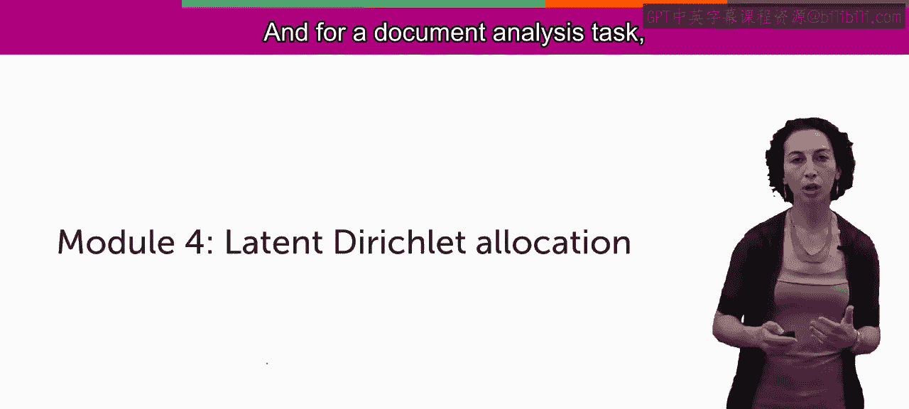
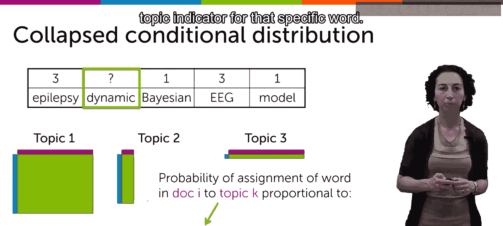
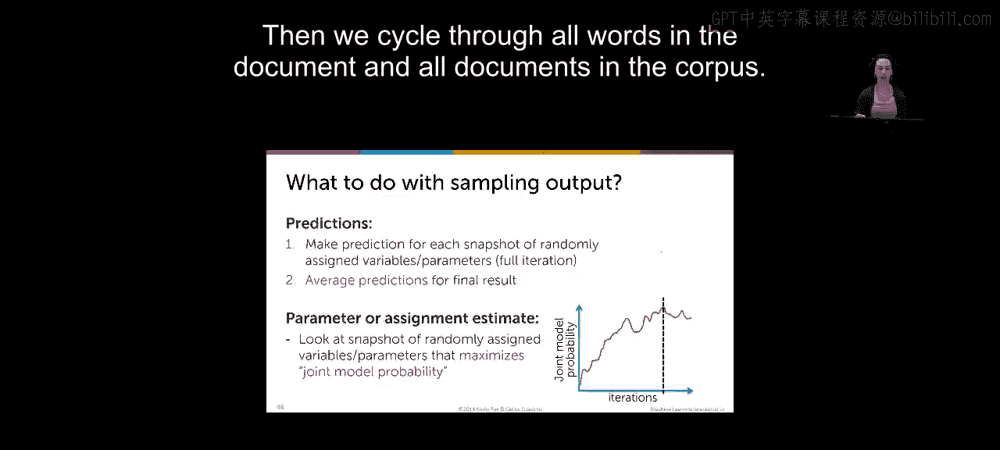
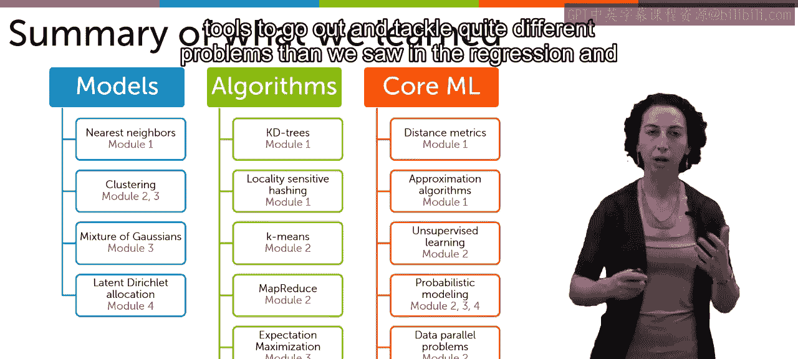

**机器学习（分类，聚类和检索）：模块4：模块回顾与总结** 🧠

在本节课中，我们将回顾和总结模块四的核心内容。模块四介绍了一种比简单聚类模型更复杂、能更细致描述数据点及其关系的概率模型。我们将重点回顾**混合成员模型**及其在文档分析中的具体应用——**潜在狄利克雷分配**模型。

---

### **从聚类模型到混合成员模型**

上一模块我们介绍了高斯混合模型等聚类方法。在本模块中，我们首先探讨了一种替代的文档聚类模型。该模型引入了一组**主题**，每个主题是词汇表上的一个概率分布，代表一个不同的“簇”。

以下是该模型的核心思想：
*   每个文档被分配到一个主题（簇）。
*   分配的依据是：计算文档在其“词袋”表示下，由该主题的词汇分布生成的概率得分。
*   与之前的混合模型类似，整个语料库中，每个主题也有一个特定的**普遍性**（即主题分布）。

这个模型与高斯混合模型在概念上形成了对比。

---

### **潜在狄利克雷分配模型**

随后，我们转向了**LDA模型**本身。LDA与上述聚类模型的关键区别有两点：

1.  **词级别分配**：在LDA中，**文档中的每一个词**都有一个分配变量，将其链接到一个特定的主题，而不是整个文档只属于一个主题。
2.  **文档特定主题比例**：LDA为**每个文档**引入了一个**主题比例向量**，而不是使用一个语料库级别的全局主题分布。这正是实现**混合成员表示**的关键。

在LDA中，一个文档不属于单一主题，而是以不同的权重（即主题比例）同时属于多个主题。这个主题比例向量可以看作是从文档中学习到的一种**特征表示**，可用于多种任务，例如将新闻文章分配到网站的多个版块、关联不同文章，或学习用户对不同主题的偏好。

同时，通过观察每个主题的词汇分布，我们可以解释这些主题的实际含义。

---

### **如何从数据中学习LDA模型？**

与聚类一样，LDA学习是一个完全无监督的任务。我们只有语料库中的文档和词汇，目标是从中提取出主题-词汇分布和文档-主题比例。

由于LDA被指定为一个**贝叶斯模型**，我们介绍了一种用于学习模型参数和分配变量的贝叶斯推断方法——**吉布斯采样**算法。

我们首先介绍了吉布斯采样的基础版本，其核心思想是在所有变量（词的主题分配、文档主题比例、主题词汇分布）之间随机迭代，根据其他变量的当前值来重新采样每一个变量。

接着，我们介绍了一种更高效的变体——**折叠吉布斯采样**。在这种方法中，我们通过分析积分将模型参数（主题词汇分布和文档主题比例）从模型中“折叠”掉，只对词的主题分配指示变量进行采样。

对于一个给定词的主题分配，其条件分布由两项的乘积决定：
1.  **文档对主题的偏好**：给定文档当前对某个主题的“喜爱”程度。
2.  **主题对词的偏好**：该主题生成当前这个词的概率。

计算公式可简化为：
`P(主题t | 其他分配) ∝ (文档d中分配给主题t的词数 + α) * (主题t中词w的计数 + β) / (主题t的总词数 + V*β)`
（其中α和β是超参数，V是词汇表大小）

我们计算所有可能主题的未归一化概率，然后归一化并从中采样一个新的主题。这个过程在所有文档的所有词上循环进行。

---

### **利用采样结果进行贝叶斯推断**

最后，我们讨论了如何利用吉布斯采样的输出进行贝叶斯推断。在贝叶斯框架中做预测时，我们需要对模型参数所有可能取值的不确定性进行积分。

我们介绍了两种常用方法：
*   **基于样本的预测**：利用采样得到的多个样本分别进行预测，然后对结果取平均。
*   **最大后验估计**：在实践中，也常采用使模型**联合概率最大**的那个样本（即MAP估计）来得出结论。

---

### **总结** 📝

本节课中我们一起回顾了模块四的丰富内容。尽管这只是一个简短的回顾，但我们覆盖了大量高级主题和概念。

我们学习了多种不同的模型和算法，并在此过程中掌握了一些超越聚类和检索的、通用且有用的机器学习概念，例如：
*   适用于多种领域的**距离度量**。
*   **近似算法**。
*   **无监督学习任务**。
*   通过**数据并行**概念实现的**可扩展性**。
*   **贝叶斯模型与贝叶斯推断**的核心思想。

完成本课程后，你现在已经拥有一套非常广泛的工具集，可以去解决与回归和分类课程中看到的截然不同的问题了。