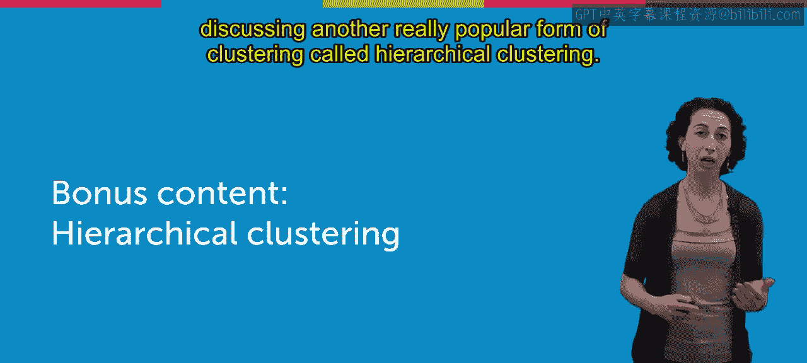
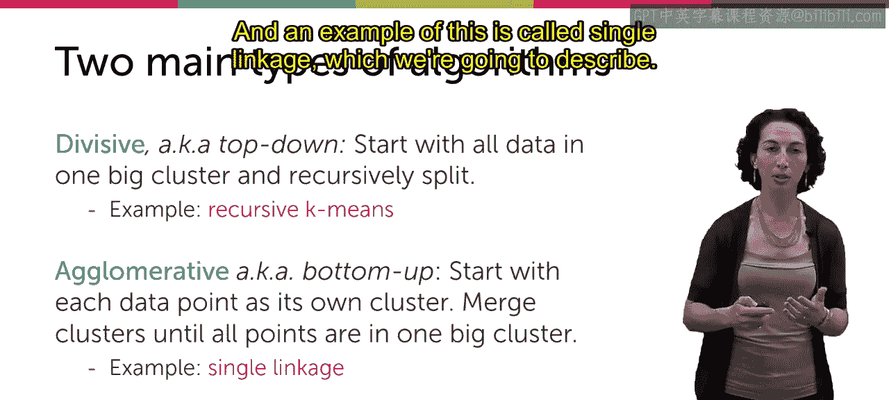

# 华盛顿大学《机器学习（分类，聚类和检索，第3-4课⧸共4课）｜Machine Learning》中英字幕 p192 70_为什么需要层次聚类.zh_en -BV1Sr421F7N7_p192-

。

Even though we plowed through just a ton of material。

 as we just reviewed in the recap of past modules， I wanted to spend some time discussing another really popular form of clustering called hierarchical clustering。

But before we delve into the specifics of hierarchical clustering。

 let's spend a little bit of time motivating why one might want to use hierarchical clustering。

And one is because it allows us to avoid that pesky problem of having to fix the number of clusters ahead of time。

Though， of course， we have to set other things instead and we'll discuss this。

But another benefit is that the denogram， which captures the results of the hierarchical clustering。

 can allow us to very quickly visualize clusterings at different granularities without having to rerun the algorithm。

Additionally， hierarchical clustering typically allows us to specify any distance metric we want for defining distances between points。

 whereas， for example， when we looked at K means， we were implicitly specifying Euclidean distance as our distance metric。

 And finally， hierarchical clustering can allow us to capture more complex shapes to our clusters。

 than the types of things that we saw with k means or mixture models， So for example， in K means。

 remember that we were implicitly assuming spherically symmetric clusters。

 and when we looked at mixtures of Gaussians were' assuming that our clusters had these elliptical shapes。

 and these can both be rather restrictive assumptions。

 But what we're going to show is that through hierarchical clustering。

 we can capture more intricate shapes such as the challenging cluster structures shown here。

 which were examples that we showed when we introduced the notion of clustering and K means and said that those algorithms would struggle with those types of challenging cluster structures。

 even though visually they just pop out at us。While there are two main classes of hierarchical clustering algorithms。

 one is called divisive or top down， where we start with all the data in one cluster。

 and then we recursively split this cluster， and one example of a divisive algorithm would be to recursively apply K means。

The other approach is called a glloorative clustering or bottom up。

 where we start with every data point in its own cluster， and then we recursively merge clusters。

 And an example of this is called single linkage， which we're going to describe。

