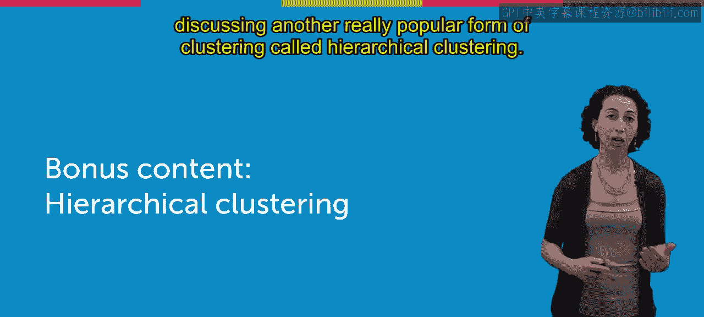
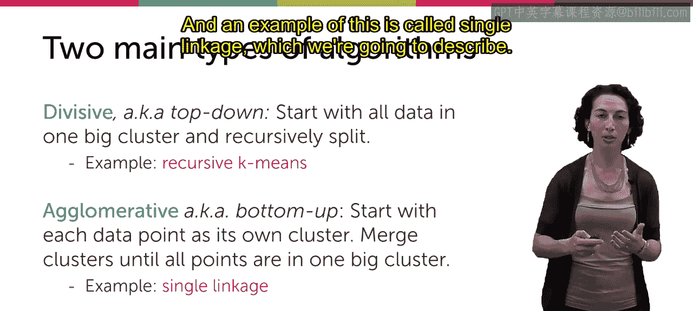

# 机器学习：3-4：为什么需要层次聚类

在本节课中，我们将探讨一种流行的聚类方法——层次聚类。我们将首先了解其动机和优势，然后简要介绍其两种主要类型。

在回顾了之前模块的大量内容后，我们想花些时间讨论另一种非常流行的聚类形式，即层次聚类。

但在深入探讨层次聚类的具体细节之前，我们先花点时间了解一下为什么可能需要使用层次聚类。

## 层次聚类的优势

以下是层次聚类的主要优点。

*   **避免预先设定聚类数量**：它允许我们避免必须提前固定聚类数量的棘手问题。当然，我们必须设置其他参数，我们稍后会讨论这一点。
*   **可视化不同粒度**：捕获层次聚类结果的**树状图**，可以让我们快速可视化不同粒度下的聚类结果，而无需重新运行算法。
*   **灵活的距离度量**：层次聚类通常允许我们指定任何想要的距离度量来定义点之间的距离。例如，在我们研究K均值时，我们隐含地指定了欧几里得距离作为距离度量。
*   **捕获复杂形状**：层次聚类可以捕获比K均值或混合模型所见类型更复杂的簇形状。例如，在K均值中，我们隐含地假设了球对称的簇；而在研究高斯混合模型时，我们假设簇具有椭圆形。这些假设都可能相当具有限制性。我们将展示的是，通过层次聚类，我们可以捕获更复杂的形状，例如这里展示的具有挑战性的簇结构。这些例子是我们在介绍聚类和K均值概念时展示过的，并指出那些算法在处理此类具有挑战性的簇结构时会很困难，尽管它们在我们视觉上非常明显。

## 层次聚类的两种主要类型

虽然层次聚类算法主要有两大类，但我们将简要介绍它们。

*   **分裂式（自上而下）**：我们从所有数据在一个簇中开始，然后递归地分割这个簇。分裂式算法的一个例子是递归应用K均值。
*   **凝聚式（自下而上）**：我们从每个数据点在自己的簇中开始，然后递归地合并簇。这种方法的一个例子称为**单连接**，我们稍后将进行描述。

本节课中，我们一起学习了层次聚类的动机、主要优势及其两种基本类型（分裂式和凝聚式）。理解这些概念为我们后续深入学习具体的层次聚类算法奠定了基础。