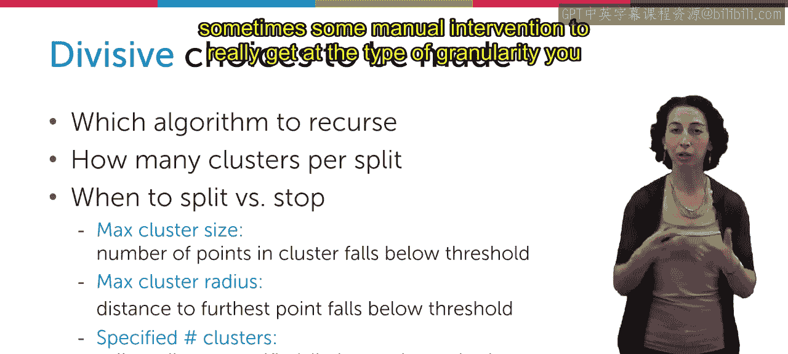
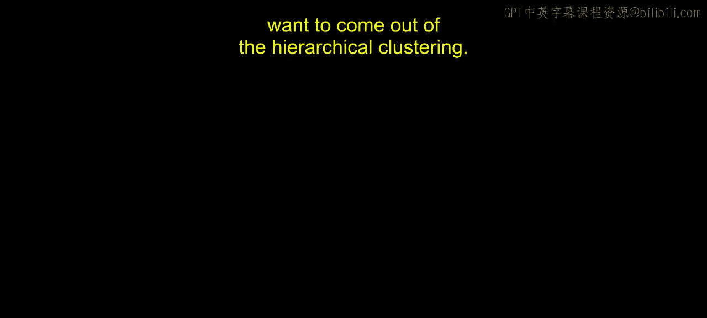

# 华盛顿大学《机器学习（分类，聚类和检索，第3-4课⧸共4课）｜Machine Learning》中英字幕 p193 71_分裂聚类.zh_en -BV1Sr421F7N7_p193-

。

To start with， let's discuss divisive clustering。 And in pictures。

 what we can think of is that at some granularity， our data can be pretty well described as a set of clusters。

 So maybe it could even be described as a set of elliptical clusters using the type of mixture models or in particular mixture Gaussians we described before。

 But then when we dig down to a finer granularity。 what we see is that each individual cluster is actually better described as a set of clusters itself。

😊，And we can keep recursing this idea where we take each cluster at a given granularity。

 dig down and specify it as a set of clusters itself。 And this is what divisive clustering does。

 So as an example， one very straightforward approach is to just recursively apply our K means algorithm。

 So one application that you're going to look at in your assignment is clustering Wikipedia articles。

 which we've looked at in past assignments。 But here we're going to take the set of all these Wikipedia articles。

 And then we're going to apply K means which is K equals to as an example。

 So just split into two clusters。And maybe at the first split。

 what we see is that Kamin separates all these articles into articles about athletes and articles about nonathlets。

 Of course， these are learn clusters。 We don't have these labels。

 These are things that we infer digging down and looking into the contents of these clusters。Okay。

 well， then we recursse this process where for each one of these clusters。

 we run K means with K equals 2 again。 And so maybe at the next level。

 we have the following set of clusters where there's a cluster for specific athletes for baseball or athletes for soccer and ice hockey。

 And then when we look at the non-aths cluster that splits into a cluster for musicians。

 artists and actors and another ones for scholars， politicians and government officials。

 And then we can think about recursing this process。 So for example。

 maybe we want to further split the cluster that's about soccer players and ice hockey players to get at a granularity that better matches what we'd like to come out of our clustering procedure。

Okay， well when we're doing divisive clustering， there are a number of choices that we have to make。

 One is we have to think about what algorithm are we going to apply at every step of this recursion。

 so the example we just walked through was applying k means at every step。

 so doing a clustering at one level， digging down into each one of those clusters。

 applying k means again and again and again and again。Well。

 another question is how many splits to be made at each level。

 so that's equivalent to saying what is the value of k we should use in our K means recursion。

In the example that we just looked at， we were using K equals 2 at every level。

 but that's a choice that we have to specify。And finally。

 we have to decide when to continue splitting or stopping this process。

 And there are a number of heuristics that people look at for the stopping criterion。

 One is to think about whether a cluster falls below a certain size so there are fewer members in that cluster than a prespecified threshold and then if that condition is satisfied you would just stop splitting that cluster。

 Another is to look at the spread of the cluster So if the distance from the cluster center to the furthest point in that cluster falls below some threshold then you say。

 okay， well， it's a compact enough cluster for what I'm hoping to get out and then you stop splitting that cluster。

Or another heuristic is to just continue splitting until the number of clusters that you've pre specifiedified is reached。

 But， of course， in this case， you get back to having to pre specify how many clusters you want。

 which might have been the thing you were trying to avoid in the first place。

But all of these are just heuristics and often a lot of application specific intuition has to come into play and sometimes a manual intervention to really get at the type of granularity you want to come out of the hierarchical cluster。

