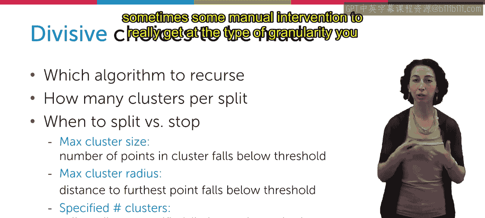
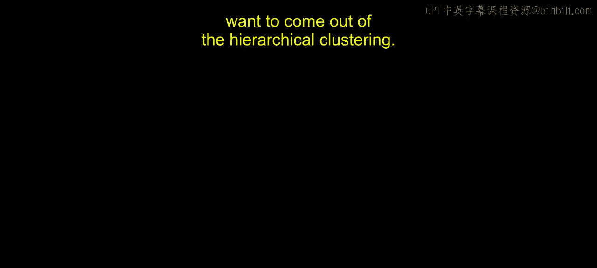

# 机器学习：3-4：分裂聚类


在本节课中，我们将要学习一种名为“分裂聚类”的层次聚类方法。我们将了解其基本思想、具体操作步骤以及在实际应用中需要考虑的关键决策。

## 概述

分裂聚类是一种“自上而下”的层次聚类方法。它从一个包含所有数据点的单一聚类开始，然后递归地将每个聚类分裂成更小的子聚类，从而形成一个树状的层次结构。这种方法特别适用于数据本身具有多层次结构的情况。

## 分裂聚类的核心思想

上一节我们介绍了层次聚类的概念，本节中我们来看看分裂聚类的具体思路。

分裂聚类的基本思想是，数据在某个粒度上可以被很好地描述为一组聚类。当我们深入观察更细的粒度时，会发现每个聚类本身又可以被更好地描述为一组更小的聚类。我们可以递归地应用这个想法。

用公式化的语言描述，如果我们有一个包含所有数据点的初始聚类 **C_0**，分裂聚类的目标是递归地将其分割，直到满足停止条件：
```
C_0 → {C_1, C_2} → {C_{1,1}, C_{1,2}, C_{2,1}, C_{2,2}} → ...
```

## 一个具体示例：递归应用K均值

为了更直观地理解，让我们看一个使用K均值算法实现分裂聚类的具体例子。

假设我们的任务是聚类维基百科文章。我们首先将所有文章视为一个大的聚类。

1.  **第一层分裂**：我们应用K均值算法，设置 **K=2**，将全部文章分裂成两个聚类。通过分析聚类内容，我们可能发现，算法将文章分成了“运动员相关”和“非运动员相关”两大类。
2.  **第二层分裂**：接下来，我们对每一个子聚类递归地再次应用K均值（**K=2**）。
    *   对“运动员”聚类进行分裂，可能得到“棒球运动员”和“足球/冰球运动员”两个子聚类。
    *   对“非运动员”聚类进行分裂，可能得到“音乐家、艺术家、演员”和“学者、政治家、政府官员”两个子聚类。
3.  **继续递归**：我们可以继续这个过程。例如，我们可以进一步分裂“足球/冰球运动员”这个聚类，以得到更符合我们期望的粒度。

这个过程构建了一个树状结构，清晰地展示了数据从粗到细的层次化组织方式。

## 实施分裂聚类时需要做的决策

在实施分裂聚类时，我们需要做出几个关键的选择。以下是需要考虑的主要方面：

*   **分裂算法**：在每个递归步骤中，我们使用什么算法来分裂一个聚类？上面的例子使用了K均值，但也可以使用其他聚类算法（如基于密度的DBSCAN）。
*   **每次分裂的数量**：这相当于决定在递归应用K均值时，**K** 的值是多少。在上面的例子中，我们始终使用 **K=2**（二分），但这只是一个选择。
*   **停止标准**：我们何时停止分裂过程？这通常需要一些启发式规则：
    *   **聚类大小**：如果某个聚类的成员数量少于预设的阈值，则停止分裂该聚类。
    *   **聚类紧密度**：如果从聚类中心到最远点的距离小于某个阈值，则认为该聚类已经足够紧凑，停止分裂。
    *   **预设聚类总数**：持续分裂，直到达到预先指定的聚类总数。但这又回到了需要预先设定聚类数量的问题，而这可能正是我们最初想避免的。

需要强调的是，所有这些标准都是启发式的，通常需要结合具体的应用场景知识和直觉，有时甚至需要人工干预，才能得到期望的层次粒度。

## 总结





本节课中我们一起学习了分裂聚类。我们了解到它是一种通过递归分割来构建层次聚类结构的方法。我们通过递归应用K均值的例子演示了其过程，并讨论了实施时需要做出的关键决策，包括选择分裂算法、确定每次分裂的数量以及制定停止分裂的标准。分裂聚类为我们提供了一种探索数据多层次结构的有效工具。