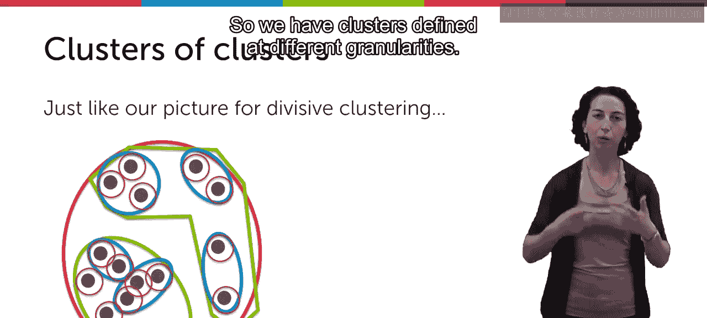

# 华盛顿大学《机器学习（分类，聚类和检索，第3-4课⧸共4课）｜Machine Learning》中英字幕 p194 72_凝聚聚类.zh_en -BV1Sr421F7N7_p194-

。

Having overviewed divisive clustering， let's now spend some time digging into a glloorative clustering。

And to do this， we're going to look at one specific example called single linkage。

 which is a really common application of a glloorative clustering。

 And here we start with every data point in its own cluster。

 and that's actually common to all a glloorative clustering approaches， not just single linkage。

 But then we have to think about how are we going to merge clusters。

 And the way we're going to do this is we're going to look at every single pair of clusters。

 And for each pair of clusters， we're going to look at the distance between these clusters。

 So we have to somehow define a distance between clusters。

 And the way we do this is through two different components。 One is the distance function。

And that's going to define a distance between pairs of individual points。

 and the other is through something called the linkage function。

And that's going to define the distance between clusters resulting in these individual pairwise distances between points。

 so in particular for single linkage， the way we specify this， you can choose。

Basically any distance metric that you want， but the linkage function is going to say。

 let's take two clusters， cluster1 and cluster2， just generically choose those two clusters and then look at all the points within those clusters and look at the minimum distance between all these points。

 so find the two points that are closest， one in one cluster one and the other cluster and define that minimum distance as the distance between those two clusters。

And so that's the form for single linkage。And then the way that we choose to merge any two clusters is based on the two clusters that have the minimum distance。

 And then we recurse this process where again， we keep taking each one of our clusters。

 which now has multiple points in it and looking at any other cluster and looking at the minimum distance between the points in this orange cluster and any one of these other clusters。

 and then we recurse this process of computing the distance between every pair of clusters at existence at that iteration of the algorithm。

 where remember that distance is the minimum distance of any set of points in the two clusters。

 And so we keep going and going and going until at some point。

 all of the data points are going to fall into one cluster。

And so what we see is just like in divisive clustering。

 a glloorative clustering defines clusters of clusters。

 so we have clusters defined at different granularities。

