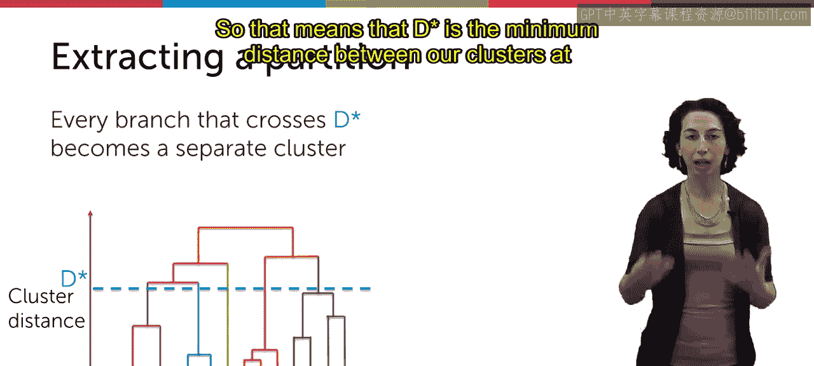

# 华盛顿大学《机器学习（分类，聚类和检索，第3-4课⧸共4课）｜Machine Learning》中英字幕 p195 73_树状图.zh_en -BV1Sr421F7N7_p195-

。

So one way to compactly represent the results of hierarchicalical clustering are through something called a dendrogram。

 And we're going to explain the dendrogram in the context of a glloorative clustering。

 even though this type of representation can be used for other hierarchicalical clustering approaches as well。

 So the dendrogram representation is as follows along the X axis。

 we're going to place each one of our data points， but carefully ordered so that we get a very nice visual coming out of this。

 And then along the y axis， what we're indicating is the distance between different clusters。

So more specifically， when we're thinking about single linkage where we're looking at the minimum distance between the set of points in any pair of clusters。

 then what the height of a specific mergege point is going to represent is the distance between those two clusters so let's describe this a little bit more where if we look at a given merge point and below that we have two separate trees。

Each one of those trees is going to represent a different cluster。

 so in this example we have this blue cluster， so all these points that are colored in blue are data points that are assigned to this blue cluster at some iteration of this algorithm and likewise we have this green cluster。

And then the height of the merge between this blue branch and this green branch indicates what was the minimum distance between。

Any point in that blue cluster and any point in that green cluster。

 and so that minimum distance is where we're going to put that merge of the blue branch with the green branch。

 so that specifies the height along the Y axis。And so throughout this tree。

 we're seeing the different clusters that are present and the distances between these clusters as different merges were made throughout the algorithm going from every data point being in its own cluster all the way to all the data points being in one cluster。

And likewise， if we look at any path down this denrogram。

What that indicates is the cluster membership of a given。

Data point throughout all the different merge steps。

 so what cluster that data point belonged to and the sequence of merges made for those clusters。

So in summary， we see that the denogram is able to capture all the critical elements of the hierarchical clustering results。

 so what are the different cluster memberships， which clusters merge with which and what were the distances between those clusters at the point at which they merged？

Well， one important thing we can think of doing from the denogram is extracting a partition because remember。

 if we run a glloorative clustering from beginning all the way to the end。

 we're starting with all data points in separate individual clusters and then ending with all data points in one cluster。

 And what we really want is we want to produce some clustering of our data points that's somewhere in between。

 not at the granularity of every point being its own cluster。

 not at this very coarse granularity of everything being one cluster。

 So this leads to a question of how do we extract some partition。

 How do we define a set of clusters to produce from this hierarchical clustering procedure。

 And one really simple approach is to perform a cut along the y axis of the dendrogram。😊。

Then every branch that crosses this line that we chose。

Is going to define a separate cluster So in this example we see we have this fusia cluster， blue。

 green， orange and gray clusters， but remember in this visualization each of these data points this just represented a different data indices in our data but what we can do is we can go back to our original feature space and visualize what the resulting clusters look like so if our data were just in 2D like all the examples we've been given because of our nice 2D slide representation this might be the clustering associated with the cut that we showed on the previous slide here。

And as we think about varying where this cut point is。

 we're looking at different possible clusterings of our data through different granularities going from really。

 really fine granularity all the way up to very coarse granularities。

So let's spend a little time thinking about what it means to cut the denogram at some level D star。

Well， what we're saying then is that for the resulting clusters produced by this cut。

 there are no pair of clusters at a distance less than D star that have not already been merged。

 So that means that D star is the minimum distance between our clusters at this level of the clustering。

