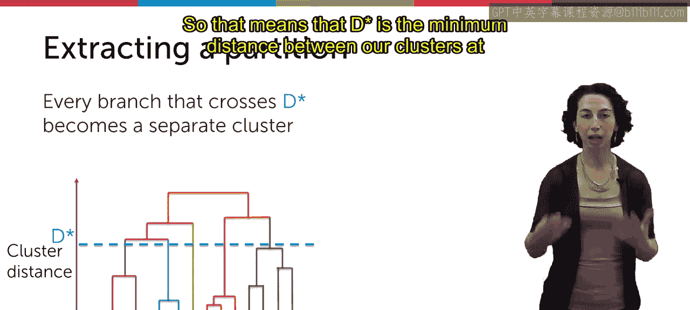

# 机器学习：分类、聚类与检索：3-4：树状图

在本节课中，我们将学习层次聚类结果的一种紧凑表示方法——树状图。我们将解释树状图在凝聚式聚类背景下的含义，并了解如何从中提取出我们想要的聚类划分。

## 树状图的结构与含义

上一节我们介绍了凝聚式聚类的基本过程，本节中我们来看看如何用一种直观的图形来展示这个过程的结果。

树状图的表示方法如下：沿着X轴，我们放置每一个数据点，但需要精心排序以获得清晰的视觉效果。沿着Y轴，我们表示的是不同聚类之间的距离。

更具体地说，当我们考虑单连接聚类（即查看任意一对聚类中点之间的最小距离）时，特定合并点的高度将代表那两个聚类之间的距离。让我们更详细地描述一下：如果我们观察一个给定的合并点，其下方有两棵独立的子树，每一棵子树代表一个不同的聚类。

在这个例子中，我们有这个蓝色聚类，所有标为蓝色的点都是在算法某次迭代中被分配到该蓝簇的数据点。同样，我们也有这个绿色聚类。然后，蓝色分支和绿色分支合并处的高度，表示的是蓝簇中**任何点**与绿簇中**任何点**之间的**最小距离**。这个最小距离就是我们将蓝色分支与绿色分支合并时放置的位置，它指定了沿Y轴的高度。

因此，在整个树状图中，我们可以看到算法从每个数据点自成一簇开始，到所有数据点合并为一簇结束的过程中，存在的不同聚类以及这些聚类在合并时的距离。

同样，如果我们沿着树状图向下看任何一条路径，它指示的是一个给定数据点在所有不同合并步骤中的簇成员关系，即该数据点属于哪个簇，以及这些簇合并的顺序。

总而言之，我们看到树状图能够捕捉层次聚类结果的所有关键要素：不同的簇成员关系是什么，哪些簇与哪些簇合并，以及它们在合并时彼此之间的距离是多少。

## 从树状图中提取聚类划分

从树状图中我们可以做的一件重要事情是提取一个划分。请记住，如果我们从头到尾运行凝聚式聚类，我们是从所有数据点各自为簇开始，到所有数据点合并为一簇结束。而我们真正想要的是产生一个介于两者之间的数据点聚类，既不是每个点自成一簇的精细粒度，也不是所有点聚为一簇的粗糙粒度。

这就引出了一个问题：我们如何从这个层次聚类过程中提取一个划分？如何定义一组要生成的聚类？

一个非常简单的方法是沿着树状图的Y轴进行切割。

以下是具体做法：
*   我们选择一个距离阈值 `d*`。
*   在树状图上画一条高度为 `d*` 的水平线。
*   每一个与该水平线相交的独立分支，就定义了一个单独的聚类。

在这个例子中，我们看到有品红色、蓝色、绿色、橙色和灰色这几个聚类。但请记住，在这个可视化中，每个数据点只是代表我们数据中不同的索引。我们可以做的是回到原始的特征空间，可视化生成的聚类看起来是什么样子。如果我们的数据像之前所有例子一样是二维的（得益于我们方便的二维幻灯片表示），那么这可能是与我们在上一张幻灯片上展示的切割相对应的聚类结果。

当我们考虑改变这个切割点的位置时，我们就在查看不同粒度下数据的不同可能聚类，从非常精细的粒度一直到非常粗糙的粒度。

## 切割深度的意义

让我们花点时间思考一下在某个水平 `d*` 处切割树状图意味着什么。

这意味着，对于这次切割产生的聚类结果，不存在距离小于 `d*` 但尚未合并的聚类对。也就是说，`d*` 是在这个聚类层次上，我们各聚类之间的最小距离。

## 总结

本节课中，我们一起学习了树状图。我们了解到树状图是层次聚类结果的一种紧凑而强大的可视化表示。它沿X轴显示数据点，沿Y轴显示聚类合并时的距离。通过沿着Y轴在特定高度进行“切割”，我们可以从完整的层次结构中提取出具有特定粒度的扁平化聚类划分。这种方法允许我们在单一框架下探索数据在不同尺度下的聚类结构。