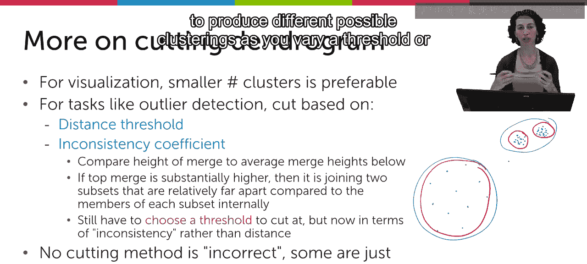
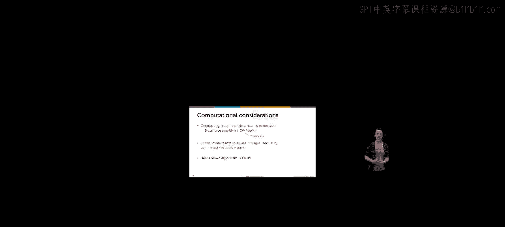
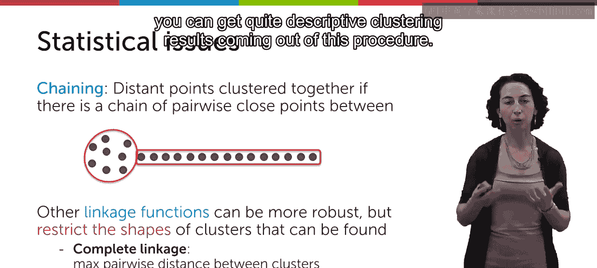

# 华盛顿大学《机器学习（分类，聚类和检索，第3-4课⧸共4课）｜Machine Learning》中英字幕 p196 74_凝聚聚类细节.zh_en -BV1Sr421F7N7_p196-

。

Finally， let's wrap up by providing a few more details on a gllom of clustering。

So one thing worth discussing are what are the choices that we have to make in aglomative clustering。

 One is what is the distance metric we're going to use to compute the pairwise distances between points。

 and then the other is what is the linkage function we're going to use to compute the resulting distances between pairs of clusters。

And for single linkage， that linkage function is just the minimum distance between any pair of points appearing in the two clusters。

And finally， another important question is where are we going to cut the denrogram。

 So one version of that question is just where would we place this horizontal cut。

 But another thing is that we don't have to make just a horizontal cut。

 We can make some weird cut through this tree。 So this is something where really the art of the method comes into play。

 and often you have to build in a lot of application specific information to think about how to cut the denrogram。

Well， if you're using hierarchcoical clustering for some task of visualization of the data。

 then often it's preferable to produce a small number of clusters。

 so that would define how you'd cut the dendrogram。But in contrast。

 if you're trying to do something like outlier detection where you want to detect some data point is very different from other data points。

 then you might want to think of other ways of defining the number of clusters or equivalently how to cut the dendrogram In this case。

 one thing you can do is just use a distance threshold。

 which is the same method that we described in the previous section。

Or you could do even fancier things like something called the inconsistency coefficient。

 where what you do is you compare the height of any given merge。

To the average height of merges below that point。Then if that height is much higher than the average heights of merges below。

 what it indicates is that that particular merge is merging clusters that are very far apart relative to what the merges were below that point。

So that might be a reason point to cut the dendrogram and keep those clusters as separate clusters。

So just as a little visualization of that， maybe we have some data points that are。fairly far apart。

 And then you have this very tightly clustered set of data points here and maybe another very tightly clustered set of points here。

Well， if we're just simply cutting the dengram based off of a threshold， you might end up。

Merging these points。And keeping these points as a cluster， but instead what you might want to do。

Based on the structure of the data is keep these as separate clusters because within that cluster。

 the distances between points are really， really small。

 whereas the distance of this particular merge between these two red clusters was much larger than the distances of merges within each cluster here。

So this cut of the denrogram could allow you to do something like the following。But to be clear。

 no cutting method is the correct cutting method， and instead， like we said。

 a lot of applicationspecific intuition or information comes into play and a lot of heuristics are often used to determine how to cut the dendrogram and the results produced by the hierarchical clustering method。

 whatevers output as the set of clusters is really sensitive， of course。

 to how you cut that dendrogram， you can get very different solutions based on that approach。

 so you have to think very carefully about that， and instead you can often think of hierarchicaling as a way to produce different possible clusterings as you vary a threshold or as you vary the way in which you cut the dendrogram。

There are also some important computational considerations when we're thinking about applying highererarchical clustering methods。

 So for a gllomative clustering， we have to compute distances between every pair of points when we're going to compute the distances between pairs of clusters。

 and this is really， really expensive， just as we explored in our nearest neighbor method for retrieval。

And you can show that a brute force algorithm for a gllomative clustering has complexity on the order of n squared log n where n is the number of data points。

But just like in nearest neighbors， we talked about KD trees and efficient ways of pruning the search space。

 well here we can also think about using the triangle inequality to rule out certain potential merge moves。

And if you do some really fancy things， the best known algorithm for performing hierarchcoical clustering has complexity order n squared instead of n squared log n。

 but that's still quite a lot if n is very large。There are other considerations based off of the structure of your data too。

 so for example， one thing that can happen in single linkage is something called chaining。

 where you can have a sequence of points where the individual distances between points is really small and so the points end up getting merged but if you look at the resulting cluster。

 you can have members that are very， very far away and in a lot of applications having this type of cluster might not be desirable。

So instead， one approach to helping fix this chaining issue is to consider other linkage functions。

 So one thing you can look at is something called complete linkage where instead of computing the minimum distance between any set of points appearing in these two clusters。

 you look at the maximum distance and in this case。

 if we had looked at the maximum distance in this really long chain。

 we wouldn't have ended up merging these clusters because that maximum distance would have been very large and as an alternative。

 you can look at something called the word criterion。

 which looks at the variance of points within a cluster。

 but both of these alternative linkage functions end up implicitly imposing in essence shape restrictions on the clusters。

 so it does help with this chaining issue， but you get back to things that look closer to things like the mixture a Gaussian type of results where you're assuming a specific form。

Cs are going to take and in essence， kind of trying to rule out some other specific shapes that might actually be what defines the cluster。

 So again， there are just a number of choices you have to make and there are implications to those choices。

 So think carefully when you're specifying exactly how you're performing the hierarchical clustering。

But in summary， hierarchical clustering can be really powerful。 It performs。

Clustering at multiple granularities， and you can get quite descriptive clustering results coming out of this procedure。

