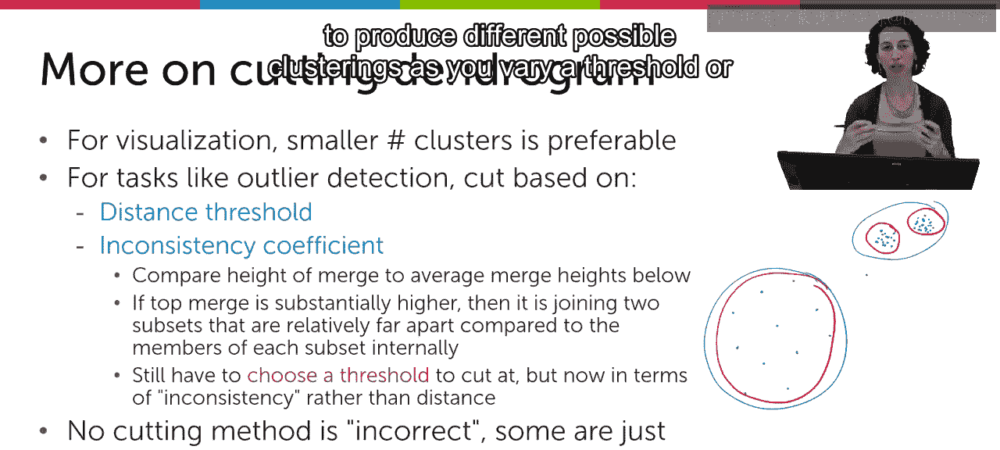
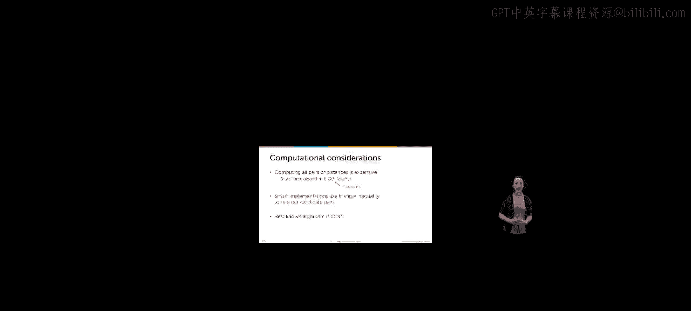
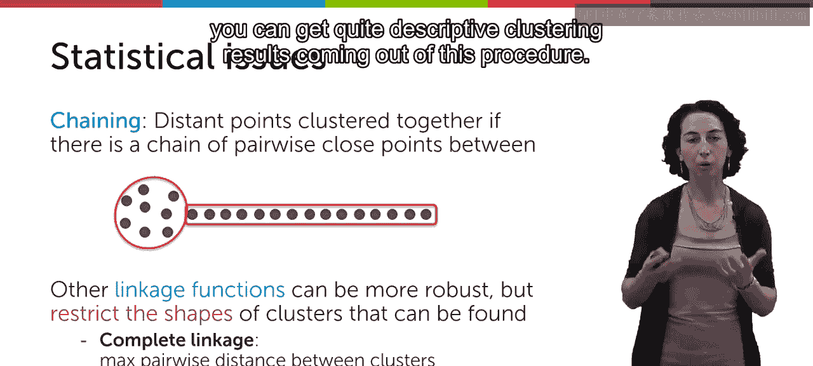

# 机器学习：3-4：凝聚聚类细节 🧩

在本节课中，我们将深入探讨凝聚聚类的具体细节。我们将了解在应用此方法时需要做出的关键选择，以及这些选择如何影响最终的聚类结果。

---

## 聚类中的关键选择

上一节我们介绍了凝聚聚类的基本流程，本节中我们来看看在具体实施时需要做出的几个核心决策。

以下是凝聚聚类中必须做出的两个主要选择：

1.  **距离度量**：用于计算数据点之间成对距离的公式。例如，欧几里得距离公式为 `dist = sqrt((x2-x1)^2 + (y2-y1)^2)`。
2.  **连接函数**：用于计算两个**簇**之间距离的函数。例如，单连接函数定义为两个簇中任意两点之间的**最小距离**。

---

## 如何切割树状图

确定了距离和连接方式后，下一个关键步骤是决定如何切割生成的树状图以获得最终的簇划分。

切割树状图并非只能进行简单的水平切割，我们可以根据数据结构和应用目标进行更复杂的切割。这通常是凝聚聚类中需要结合领域知识的环节。

以下是几种常见的切割策略：

*   **基于任务目标**：如果目标是数据可视化，通常倾向于生成少量簇，这决定了切割的高度。
*   **基于距离阈值**：与上一节描述的方法相同，设定一个距离阈值，在树状图中进行水平切割。
*   **基于不一致系数**：这是一种更复杂的方法。它比较某个合并点的高度与其下方合并的平均高度。如果该高度远高于平均值，则表明此次合并将两个相距很远的簇结合在了一起，这可能是一个理想的切割点。

为了更直观地理解，假设我们有两组内部点距非常小的紧密簇。如果仅基于固定阈值切割，可能会将它们过早地合并。而通过分析合并高度，我们可以识别出这个“大跨度”的合并，从而将这两个紧密簇保持为独立的簇。

需要明确的是，没有一种切割方法是绝对正确的。最终得到的簇集合对切割方式非常敏感，不同的切割会产生截然不同的聚类结果。因此，凝聚聚类也可以被视为一种通过调整阈值或切割方式来探索多种可能聚类方案的工具。

---

## 其他重要考量

除了上述选择，应用凝聚聚类时还需考虑计算效率和连接函数带来的影响。

在计算方面，凝聚聚类需要计算所有点对之间的距离，计算成本很高。暴力算法的复杂度约为 **O(n² log n)**，其中 `n` 是数据点数。虽然可以使用类似KD树和三角不等式等技术优化，但最佳算法的复杂度仍为 **O(n²)**，对于大规模数据依然颇具挑战。

在连接函数方面，单连接可能导致“链式效应”。即当存在一系列点距很小的点时，它们会逐步合并，最终形成一个包含相距很远的成员的细长簇，这在许多应用中并不理想。

为了解决链式问题，可以考虑使用其他连接函数：

*   **完全连接**：计算两个簇中任意两点之间的**最大距离**。在上述链式例子中，最大距离会很大，从而阻止合并。
*   **沃德准则**：关注合并后簇内点的方差增加量，旨在生成方差最小的紧凑簇。

然而，这些替代的连接函数本质上会对簇的形状施加隐含限制（例如，倾向于生成更紧凑的球形簇），这可能排除掉数据中实际存在的其他有效簇形状。因此，每种选择都有其含义，需要根据具体问题仔细权衡。

---

## 总结

本节课中我们一起学习了凝聚聚类的关键细节。我们了解到，实施凝聚聚类需要仔细选择距离度量和连接函数，并巧妙地切割树状图以获得有意义的簇。虽然存在计算成本高和参数选择敏感等挑战，但凝聚聚类能够提供多粒度的、描述性强的聚类结果，是一种非常强大的无监督学习方法。