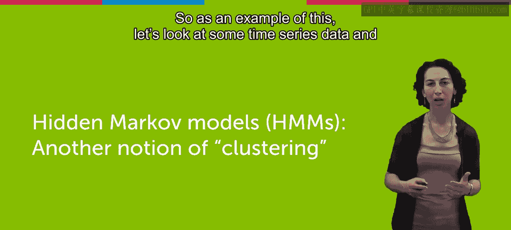
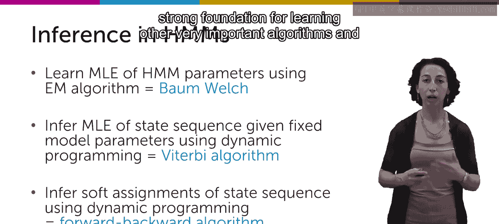
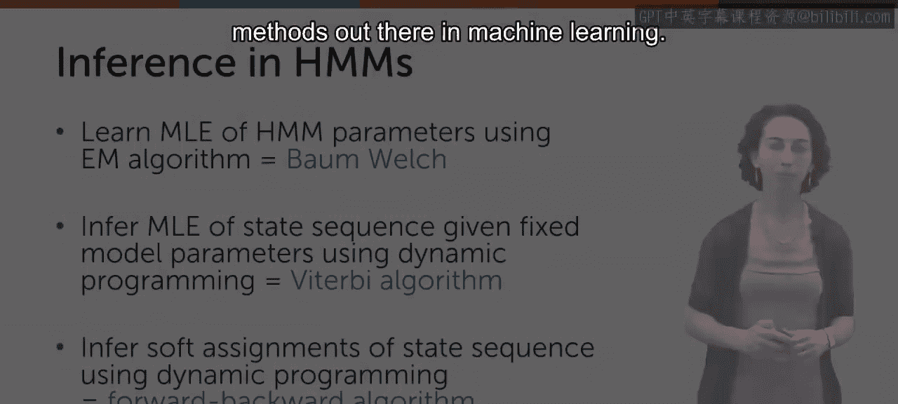

# 华盛顿大学《机器学习（分类，聚类和检索，第3-4课⧸共4课）｜Machine Learning》中英字幕 p197 75_隐马尔可夫模型.zh_en -BV1Sr421F7N7_p197-

。

We see clustering arising in lots of different areas， so as an example of this。

 let's look at some time series data and something called the hidden Markov model。

So just remember that in the clustering we've looked at so far。

 we've looked at methods where the index of a given data point plays no role in the resulting clustering of that data point。

 so that is we could simply permute all our data indices。

And cluster that permed data and we would get out exactly the same results。

 but what if the order of the data points actually mattered， like in time series。

 where the label that in particular， the timestamp associated with each data point is really critical to the analysis of that data。

So for example， here， we're looking at just a unitivari time series。

 so the value of the observation is along the Y axis and the timetamp of the observation is along the X axis。

And here， maybe our goal might be to parse this time series into what I'll call different dynamic states。

 so we can think of this as just different clusters appearing in the dataset set over time。

 So maybe there's a green cluster， a blue cluster and a red cluster。

 and this time series is switching between each of these different states。Well。

 if we ignored the timestamps associated with these data points。

 so think about just taking this plot and scrunching it along the X axis。

 so ignoring time the timetamp and just looking at points along a one dimensionional y axis and try to cluster those observations。

 we'd have a really hard time， because the range of values that the time series takes when it's in this green state。

Overlapped quite a lot with the set of values that the time series takes when it's in the blue and the red states。

 so all these values would be very overlapped and without tons and tons of data。

 it would be really hard to distinguish the fact that there are three different clusters here。

But instead。The structure of this data across time can actually help us uncover this pattern which appears rather immediately obvious from looking at this plot。

 in particular， we have the fact that in this data set if we're currently in a green state。

 it seems like we're very likely to keep being in a green state。

 and then maybe there are certain other transitions between states between green and blue or blue and red。

 that might be more likely than other transitions and this type of information can help us extracted the clustering that we're desiring from this time series data。

 so in the context of time series we can think of this as a segmentation task。

To make this more concrete， let's look at the dance of a honeybee。

 because when a honeybee is in the beehive， it switches between three different dances in order to communicate the location of food sources to other bees in the hive。

 So it switches between this wagle dance， a turn right dance and a turn left dance and it keeps repeating specific patterns of these dances to communicate with the other bees。

 And so here what we're showing are three different dance sequences that were segmented into the wagle dance。

 which is the red color turn right， which is the green color and turn left， which is the blue color。

 But the question is， can we think of automatically extracting this information just from observations of the honeybee's body position and head angle as it's moving around in this hive。

😊，So in particular， when we're looking at these dances。

 we can make a plot of what dance the honeybee is in at every time step。

 And this will indicate the persistence in certain dances and the switches between them between this wagle turn right and turn left dance。

 And what we see from this state is that there are indeed patterns we see persistence in the different dances。

 because if you're currently doing one type of dance are likely to continue doing that dance And then we also see certain transitions are more likely than others。

 So， for example， if I'm currently in a red dance， it's very likely I'll go to a green dance or from a green dance to a red dance。

 though obviously， other transitions are possible as well。

 And this type of notion of switching between different dynamic states appears in lots of different applications。

Luckily， not just the study of honeybees。 So， for example。

 maybe we have conference audio of people taking turns speaking in a conference meeting。

 and we want to be able to segment that audio into who is。😊，king when during the meeting。

 or maybe we have observations of a person doing a set of exercise routines。

 and we want to be able to segment out， okay this person is doing jumping jacks or running and squats and so on。

 and typically when people do different exercise routines。

 they switch between a set of behaviors again and again and again。 And likewise。

 when we're looking at stock data， this is a really common type of approach for thinking about this data where maybe this stock indices are switching between regimes of high volatility or low volatility or medium volatility or obviously different levels of volatility。

 So given the broad set of applications where we see this type of structure。

 let's spend a little bit of time talking about a model that can allow us to extract this type of information from data。

 and this model is called a hidden markov model or an HMM for short。 And an HMM is very， very。

 very similar to the type of mixture models we describe。Earlier in this course。

 so just like in a mixture model， every observation is associated with a cluster indicator。

 so here we're referring to things as clusters when you talk about HMs。

 Often the cluster is described as a state we talked about these dynamic states。

 So we'll use the two interchangeably here just to draw connections with the mixture models that we described before。

 okay but the point is every observation has a cluster assignment associated with it。

 and that's unknown to us。 all we get is the observed value。And then also。

 just like in our mixture model， every cluster or state has a distribution over observed values。

 So remember in our mixture model， we said that each component would maybe be a Gaussian with defining a distribution over the blue intensity in an image。

 and that would be different if we're thinking about images about clouds versus sunsets versus forest。

 And so those would be the different clusters present。 Well， here we have different dynamic states。

 But given a specific assignment to one of these states or clusters。

 then we have the same type of distribution over the observed value within that state。

 But the really critical difference is the fact that the probability of a given cluster assignment depends on the value of the cluster assignment for the previous observation。

 And this is how we're going to capture the time dependency。

 This is how we're going to capture things like。😊，The fact that if we're currently in a state like the Wgggle dance。

 we're more likely to be in that state at the next time step。

 or maybe if we're currently in this red state， we're more likely to be in the green state at the next time step。

 than a transition to the blue state and so it's through this structure of dependency in the cluster assignment variables across time that we're able to extract this type of time dependent clustering。

And finally， HMs have really clever inference algorithms building on the types of methods we describe for mixture models。

 but with the added challenge of the time dependence in the cluster assignment variables。

 So for example， you can compute the maximum likelihood estimate of your HM parameters using an EM algorithm very similar to what we talked about for mixture models。

 but in this context it's called the bomb Welsh algorithm for historical reasons。

 it was developed separately for HMs。 and then later the connection was drawn with expectation maximization And another thing you can do in HMs is you can compute。

The most likely state sequence， given your model parameters。

 so you fix your model parameters and you look at the most likely sequence of states or cluster assignments。

And for that， you can use something called the Vetubi algorithm。

 which is an example of something called dynamic programming。

 which allows you to efficiently do this search over a set of states。

And you can also use dynamic programming to form soft assignments of the cluster variables using something called the For backward algorithm。

 and these as soft assignments， play a role in the bomb Welsh algorithm。

 just like the soft assignments played a role in the standard EM algorithms for mixture models we described earlier in the course。

So what we've seen in this section， just using HMs to kind of motivate this idea is the fact that the methods that we learned in this course really lay a very strong foundation for learning other very important algorithms and methods out there in machine learning。

