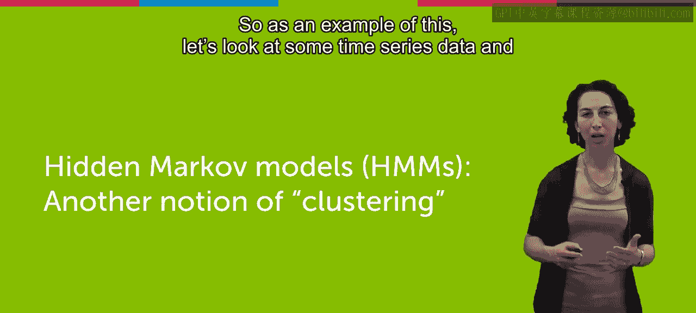
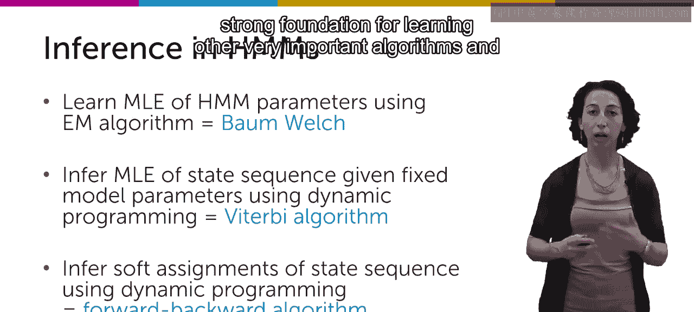
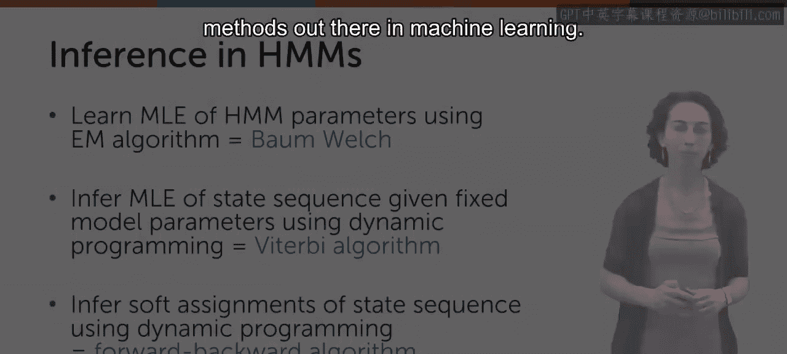

# 机器学习（分类，聚类和检索）：第3-4课：隐马尔可夫模型 🐝

在本节课中，我们将要学习一种专门用于处理时间序列数据的聚类模型——隐马尔可夫模型。我们将了解它如何利用数据点之间的时间顺序信息，来发现数据中随时间变化的动态状态或“簇”。

---

## 时间序列中的聚类挑战

上一节我们介绍了不考虑数据顺序的聚类方法。本节中我们来看看当数据点顺序至关重要时的情况，例如在时间序列分析中。

在之前讨论的聚类方法中，每个数据点的索引（如其在数据集中的位置）对最终的聚类结果没有影响。这意味着我们可以随意打乱所有数据的顺序，聚类结果将保持不变。

然而，在时间序列数据中，每个数据点关联的时间戳对于分析至关重要。例如，下图展示了一个单变量时间序列，Y轴是观测值，X轴是时间戳。

我们的目标可能是将这段序列解析为不同的“动态状态”，可以将其理解为随时间出现在数据集中的不同“簇”。图中可能包含绿色、蓝色和红色三种状态，时间序列在这些状态之间切换。

如果我们忽略这些数据点的时间戳，将所有数据点压缩到Y轴上进行一维聚类，将会非常困难。因为时间序列处于绿色状态时的取值范围，与处于蓝色和红色状态时的取值范围有很大重叠。如果没有海量数据，很难区分出这里存在三个不同的簇。

相反，数据在时间上的结构可以帮助我们揭示这种模式。具体来说，数据中存在这样的规律：如果当前处于绿色状态，那么下一时刻很可能继续保持绿色状态；同时，某些状态间的转换（如从绿到蓝或从蓝到红）可能比其他转换更有可能发生。这类信息可以帮助我们从时间序列数据中提取出期望的聚类结构。

在时间序列的背景下，我们可以将此视为一个**分割任务**。

---

## 具体应用：蜜蜂舞蹈分析

为了使概念更具体，让我们观察蜜蜂的舞蹈。当蜜蜂在蜂巢内时，它会在三种不同的舞蹈之间切换，以向其他蜜蜂传达食物源的位置。这三种舞蹈分别是：摇摆舞（红色）、右转舞（绿色）和左转舞（蓝色）。蜜蜂会不断重复这些舞蹈的特定模式来与其他蜜蜂交流。

下图展示了被分割成三种舞蹈的三段不同舞蹈序列。

问题是，我们能否仅通过观察蜜蜂在蜂巢内移动时的身体位置和头部角度，来自动提取出这些信息？

具体来说，当我们观察这些舞蹈时，可以绘制出蜜蜂在每个时间步处于哪种舞蹈的图表。这将显示出特定舞蹈的持续性以及它们之间的切换（摇摆舞、右转舞、左转舞）。

从这种状态图中，我们确实能看到一些模式：不同舞蹈具有持续性（如果你正在跳一种舞蹈，很可能继续跳这种舞蹈）；同时，某些状态转换比其他转换更有可能发生。例如，如果当前处于红色舞蹈状态，那么下一时刻很可能切换到绿色舞蹈状态，或者从绿色舞蹈切换到红色舞蹈。当然，其他转换也是可能的。

这种在不同动态状态之间切换的概念出现在许多不同的应用中，而不仅仅是研究蜜蜂。

以下是几个例子：
*   **会议音频分割**：在会议中，人们轮流发言，我们希望将音频分割成会议期间谁在何时发言。
*   **运动动作识别**：观察一个人进行一系列锻炼，我们希望分割出这个人是在做开合跳、跑步还是深蹲等。通常，当人们进行不同的锻炼时，他们会反复在一组行为之间切换。
*   **股票数据分析**：这是一种非常常见的方法，用于分析股票数据，其中股票指数可能在“高波动性”、“低波动性”或“中等波动性”等不同状态之间切换。

---

## 隐马尔可夫模型简介

鉴于这种结构在广泛的应用中出现，让我们花点时间讨论一个可以从数据中提取此类信息的模型，这个模型被称为**隐马尔可夫模型**，简称 **HMM**。

HMM 与我们之前在本课程中描述的**混合模型**非常相似。

与混合模型一样，HMM 中的每个观测值都与一个**簇指示器**（或称为**状态**）相关联。在讨论 HMM 时，通常将“簇”描述为“状态”，即我们之前提到的动态状态。这里我们将交替使用这两个术语，以便与我们之前描述的混合模型建立联系。关键点是，每个观测值都有一个与之关联的簇分配，但这个分配对我们来说是未知的，我们只能得到观测值本身。

同样，与混合模型类似，HMM 中的每个簇或状态都有一个定义在观测值上的**分布**。回想一下，在我们的混合模型中，每个混合成分可能是一个高斯分布，定义了图像中蓝色强度的分布，并且这个分布在云、日落和森林的图像中是不同的。在 HMM 中，我们有不同的动态状态，但给定一个特定的状态或簇分配，我们在该状态内的观测值上也有相同类型的分布。

然而，一个**关键的区别**在于：在 HMM 中，给定观测点的簇分配概率，**取决于前一个观测点的簇分配值**。正是通过这种方式，我们捕捉到了**时间依赖性**。我们通过簇分配变量在时间上的这种依赖结构，来提取这种与时间相关的聚类信息。

例如，这可以捕捉到这样的事实：如果我们当前处于摇摆舞状态，那么下一时刻更有可能保持在该状态；或者如果我们当前处于红色状态，那么下一时刻切换到绿色状态的可能性，比切换到蓝色状态的可能性更大。

---

## HMM 的推理算法

最后，HMM 拥有非常巧妙的推理算法，这些算法建立在我们为混合模型描述的方法之上，但增加了处理簇分配变量时间依赖性的挑战。

以下是 HMM 中常用的算法：
*   **鲍姆-韦尔奇算法**：你可以使用一种非常类似于混合模型中所讨论的 **EM 算法**，来计算 HMM 参数的**最大似然估计**。在这个背景下，由于历史原因，它被称为鲍姆-韦尔奇算法。它最初是为 HMM 独立开发的，后来才与期望最大化算法建立了联系。
*   **维特比算法**：在 HMM 中，你还可以在给定模型参数的情况下，计算**最可能的状态序列**（即最可能的簇分配序列）。为此，你可以使用**维特比算法**，它是**动态规划**的一个例子，允许你高效地在状态集合上进行搜索。
*   **前向-后向算法**：你还可以使用动态规划，通过**前向-后向算法**来形成簇变量的**软分配**。这些软分配在鲍姆-韦尔奇算法中扮演着角色，就像软分配在我们课程早期描述的标准混合模型 EM 算法中扮演的角色一样。

---

## 总结

在本节课中，我们一起学习了隐马尔可夫模型。我们了解到，HMM 是一种专门用于时间序列数据的聚类模型，它通过引入状态间的转移概率来捕捉数据在时间上的依赖关系。我们探讨了其核心思想，即当前状态的概率依赖于前一个状态，这使得 HMM 能够识别数据中随时间变化的动态模式。我们还简要介绍了 HMM 相关的关键推理算法，如鲍姆-韦尔奇算法、维特比算法和前向-后向算法。

通过 HMM 这个例子，我们可以看到，本课程中学到的方法为学习机器学习中其他非常重要的算法奠定了非常坚实的基础。

