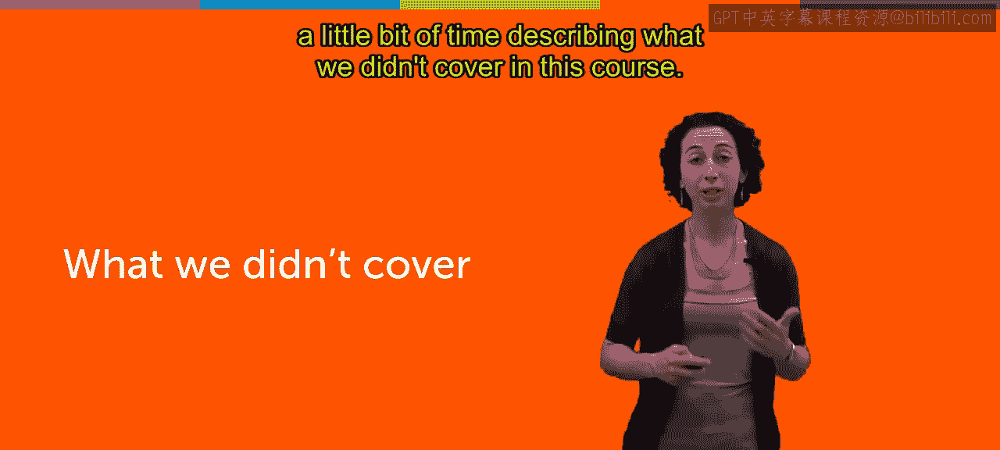
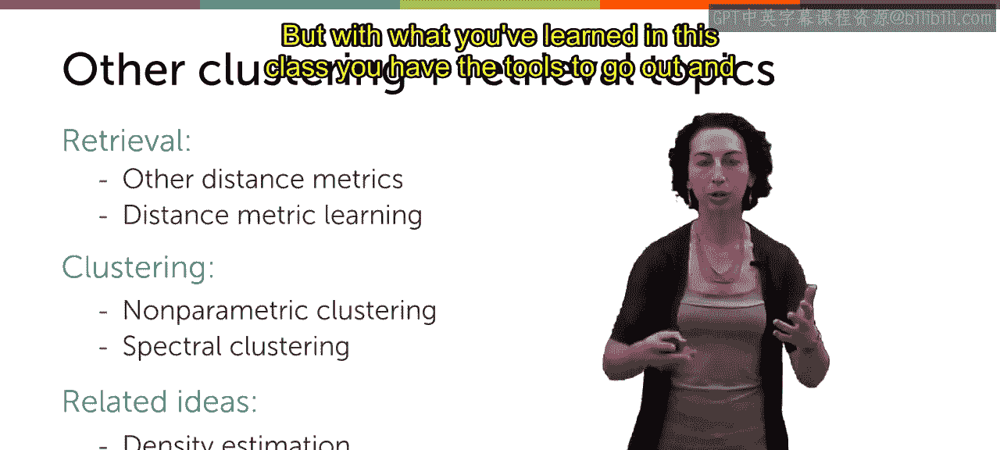

# 华盛顿大学《机器学习（分类，聚类和检索，第3-4课⧸共4课）｜Machine Learning》中英字幕 p198 76_我们没有涵盖的内容.zh_en -BV1Sr421F7N7_p198-

。

Now that we've gone through even more material on clustering。

 let's spend a little bit of time describing what we didn't cover in this course so in this course we tried to focus on the methods that we believe are the most practical and most widely used tools out there for performing retrieval and clustering。

 but there were still some other important topics that we didn't cover in this course so for example。

 in retrieval there are lots of other distance metrics that we could have described we listed some of these in the module but we didn't actually describe these in any detail。

Another thing we didn't cover was something called distance metric learning。

 where these are procedures that allow you to actually learn metrics that are useful for the task at hand。

Then for clustering， we didn' talk about things like nonparametric clustering。

 actually our hierarchical clustering methods can be used for non-parametric clustering。

 but we didn't describe this very explicitly。 so nonparametric clustering these are methods where the complexity of the models or the description of the clustering can grow as you get more and more data points。

 another method is called spectral clustering that can be robust to different cluster shapes like the Swiss roll type images we showed in the second module when we're motivating clustering and talking about some of the limitations of the methods we are going to describe where we have to actually specify the shape of the clusters。

 but unfortunately spectral clustering methods don't tend to have very good scalability properties to large data sets and then there are a set of ideas that are related to things that we talked about but not specifically for retrieval or clustering so as an example。

 mixtures of Gaussians are commonly used for。Something called density estimation so we showed this picture of this histogram over the blue intensity of all the images in our data set and we talked about the distribution on those intensities so we can think of that as a density over intensities and try and estimate the form of that density explicitly rather than thinking about mixture a Gaussians as a means of clustering data points so they're hand in hand the same tool but different tasks。

And then within the context of density estimation， you can start talking about things like anomaly detection。

 where this is a question of you get some new data point and does it look significantly different than the data points that you've seen so far。

 but with what you've learned in this class， you have the tools to go out and learn these other methods。

