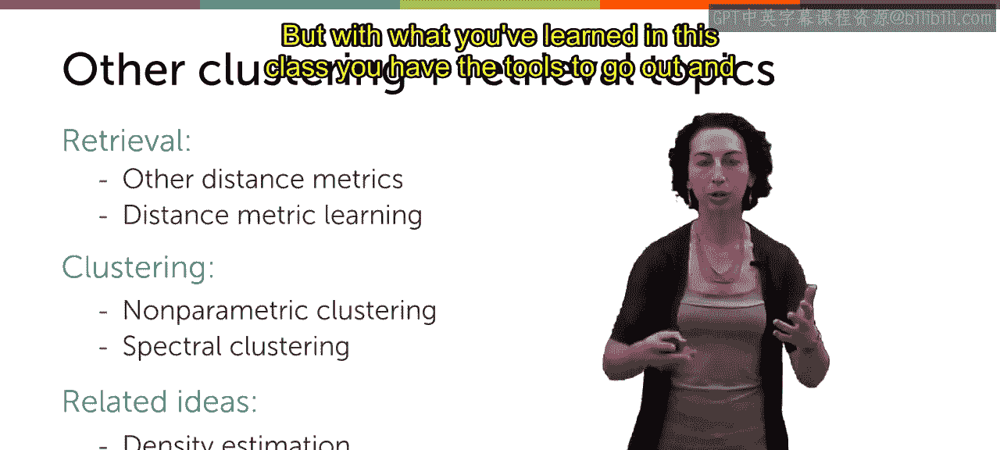

# 机器学习（分类，聚类和检索）：第3-4课：未涵盖内容概览

在本节课中，我们将回顾并总结课程中未详细涵盖的一些重要主题。我们已经学习了聚类、检索等核心方法，但机器学习领域广阔，仍有许多其他有价值的工具和概念。本节将简要介绍这些未涵盖的主题，帮助你了解更广阔的知识领域，并为后续学习指明方向。

## 检索中的其他距离度量

上一节我们介绍了聚类方法，本节中我们来看看检索领域的一些扩展内容。在检索模块中，我们提到了多种距离度量，但并未深入探讨其细节。

以下是课程中列出但未详细描述的其他距离度量示例：
*   马氏距离
*   余弦相似度
*   杰卡德相似系数

## 距离度量学习

除了预定义的距离度量，还存在一种称为**距离度量学习**的技术。这类方法允许算法根据手头的具体任务，自动学习出最有效的距离度量公式。

## 非参数化聚类与谱聚类

在聚类部分，我们主要讨论了K-Means和层次聚类等方法。我们未涵盖**非参数化聚类**。虽然层次聚类方法可以用于非参数化场景，但我们没有明确阐述这一点。非参数化聚类是指模型的复杂度或聚类的描述能力可以随着数据点的增加而增长的方法。

另一种重要的方法是**谱聚类**。该方法对于处理不同形状的簇（例如我们在第二模块中展示的瑞士卷型数据）可能更加鲁棒。谱聚类方法通常不具备良好的大规模数据集可扩展性。

## 密度估计与异常检测

还有一些概念与我们讨论的内容相关，但并非专门针对检索或聚类。例如，**高斯混合模型**常被用于**密度估计**。

我们可以将数据集中所有图像的蓝色强度直方图视为强度的密度分布，并尝试显式地估计该密度的形式，而不仅仅是将高斯混合模型视为数据点聚类的手段。它们是同一工具，服务于不同任务。

在密度估计的框架下，可以进一步探讨**异常检测**。其核心问题是：给定一个新的数据点，判断它是否与已观测到的数据点存在显著差异。

## 总结

本节课中我们一起学习了本课程未涵盖的一些机器学习主题，包括检索中的其他距离度量、距离度量学习、非参数化与谱聚类，以及密度估计和异常检测等相关概念。尽管课程内容有限，但你所掌握的工具和知识足以支持你进一步探索和学习这些更高级的方法。