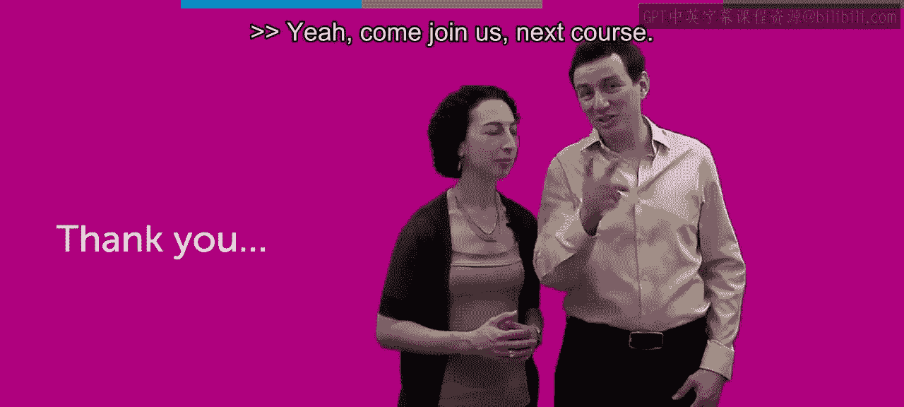

# 华盛顿大学《机器学习（分类，聚类和检索，第3-4课⧸共4课）｜Machine Learning》中英字幕 p199 77_谢谢.zh_en -BV1Sr421F7N7_p199-

。

Hey， it's Carlos， it's Carlos。Where have you been？Vaccation， I guess vacation。 nice。 Well， well。

 you've been on vacation。 We've been working really hard。 Well， you've been working really hard。

 And as a part of it， you've learned a lot of really important methods for clustering and retrieval。

 And not only have you learned algorithms and models and methods。

 but you've learned ways to think about scaling up these methods to really large data sets。😊。

The techniques we discussed here in this course are used in most applications today from retrieving documents on the web all the way to dealing with images。

 on your phone， on your watch， on any device today， which watch。No what。 Okay， well， he's a very。

 very device heavy person here。The key here is that you didn't just learn the very basics。

 but you learn really lots of advanced concepts like how to scale to large data sets with things like Kd3 and LSH。

 These are really cool techniques that are super useful in practice and super useful in the real world。

😊，LD is also pretty cool。Pretty cool。 no， But in summary， these were very advanced concepts。

 lots of hard work that you guys did。 and lots of exciting things left to do in this specialization。

 So we look forward to seeing you in the next course。 Yeah， come join us。 next course。😊。

See you。 See you。