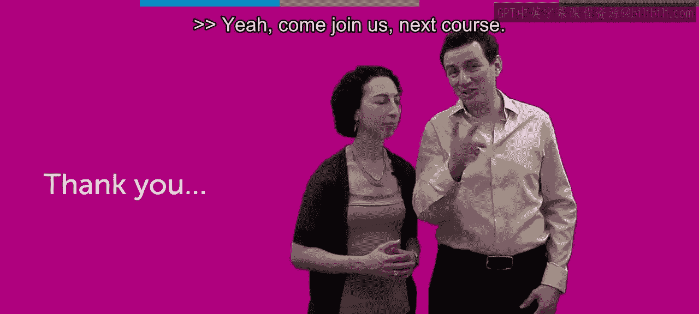

# 机器学习（分类，聚类和检索）：第3-4课：课程总结与展望 🎓

在本节课中，我们将对华盛顿大学《机器学习（分类，聚类和检索）》第3-4课的核心内容进行总结，并展望后续的学习方向。课程重点回顾了聚类与检索的关键方法，并强调了将这些方法扩展到大型数据集的重要性。

---

上一节我们介绍了课程的核心内容，本节中我们来看看具体的总结与未来展望。

卡洛斯提到了一个重要事实：在课程中，大家不仅学习了算法、模型和方法，还掌握了如何将这些方法扩展到真正的大型数据集。😊

以下是课程中涵盖的关键技术要点：
*   这些技术被广泛应用于当今大多数应用中。
*   应用范围从网页文档检索，一直到处理手机、手表等各类设备上的图像。

卡洛斯与另一位对话者进行了简短的互动，后者提到自己是一个“设备重度使用者”。这引出了课程的关键价值所在：学习者并非只掌握了最基础的知识。

以下是课程中涉及的高级概念：
*   学习了如何通过诸如 **Kd树** 和 **局部敏感哈希（LSH）** 等技术扩展到大型数据集。
*   这些是非常酷且在实践中、在现实世界中超级有用的技术。
*   **潜在狄利克雷分配（LDA）** 也相当不错。

总之，这些是非常高级的概念，大家付出了大量的努力。在这个专业课程中，还有许多令人兴奋的内容有待探索。

因此，我们期待在下一门课程中与大家相见。欢迎大家加入后续课程的学习。😊

---

本节课中我们一起回顾了聚类与检索的核心方法，特别是扩展到大规模数据集的先进技术（如**Kd树**和**LSH**），并鼓励大家继续参与专业课程的后续学习。