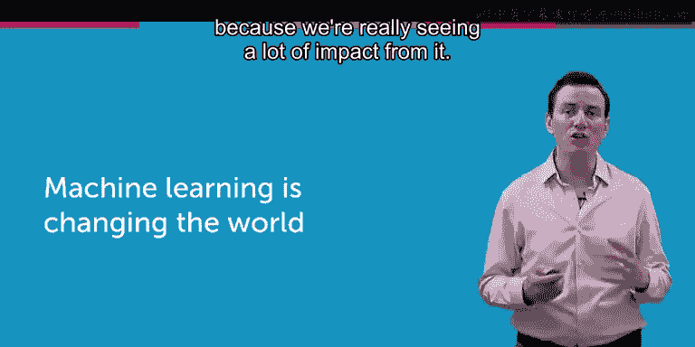
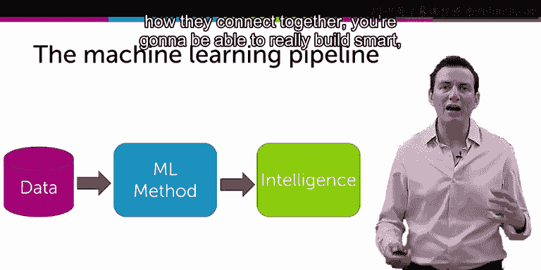

# 机器学习基础课程（第1课/共4课）：机器学习如何改变世界 🌍

在本节课中，我们将探讨机器学习如何从学术研究演变为驱动现代智能应用的核心技术，并理解其在不同行业中的实际影响。

---

我从事机器学习已有很长时间。当前是从事机器学习非常令人兴奋的时期，因为你正亲眼目睹它带来的巨大影响。

但这并非我最初接触机器学习的方式。如果几年前你与我交谈，我对机器学习的看法截然不同。那时，你从一些数据开始，将这些数据输入某个神奇的机器学习算法，然后展示我的曲线比你的曲线更好，最后向机器学习会议提交一篇论文。

😊

这就是我一直以来对机器学习的看法。

然而，这并非我最初进入这个领域的原因。我为何投身于机器学习？

当我还是个孩子时，我阅读了许多书籍，尤其是科幻小说。我非常想建造真正智能的机器人，它们能思考世界、推理事物，也就是我今天所说的智能应用。真正酷且令人兴奋的是，如今我们看到许多使用机器学习的智能应用产生了巨大影响。

😊

事实上，如果你观察一个又一个行业，当今成功的公司——那些被称为颠覆者的公司——它们进入一个市场并彻底改变它。它们的差异化优势通常来自于以机器学习为核心的智能应用或智能。

例如，早期，亚马逊通过在其网站引入产品推荐系统，真正颠覆了零售市场。我们看到谷歌通过利用机器学习精准投放广告，预测用户点击行为，从而颠覆了广告市场。你看到Netflix这家电影发行公司彻底改变了电影的观看方式。我们不再去商店租借电影，而是上网流媒体观看。Netflix的核心改变在于其推荐系统，它帮助我从其提供的成千上万部电影中，找到我喜欢、适合我的电影。

😊

你还会看到像Pandora这样的公司，它们提供音乐系统和音乐推荐系统，让我找到喜欢的音乐，并为我推荐适合清晨困倦时或夜晚准备入睡时聆听的音乐流，为我找到真正的好音乐。

😊

这种现象出现在许多地方、许多行业。你看到Facebook将我与我可能想结交的人联系起来。你甚至看到像Uber这样的公司，通过实时优化如何连接司机与乘客，颠覆了出租车行业。

因此，在所有这些领域，机器学习都是核心技术之一，是使这些公司产品真正与众不同的技术。所以，在这个专项课程中，我们将真正讨论机器学习的各个方面，让你准备好构建类似的智能应用。

我们将反复看到一个流程：从数据开始，引入机器学习方法，对数据进行新型分析，而这种分析将赋予你智能——例如，我现在可能购买什么产品。通过理解这个流程，并在各种场景、各种应用、使用多种算法中实践，真正理解如何将它们连接起来。

😊

你将能够真正构建属于自己的智能应用。

---

**本节课总结**

本节课中，我们一起学习了机器学习角色的演变：它从一个侧重于算法性能和学术论文的领域，发展成为驱动现代智能应用和颠覆性商业产品的核心技术。我们看到了机器学习在亚马逊、谷歌、Netflix、Pandora、Facebook和Uber等公司中的实际应用，并介绍了构建智能应用的核心流程：**数据 -> 机器学习分析 -> 智能**。这为我们后续深入学习机器学习的各个方面奠定了基础。