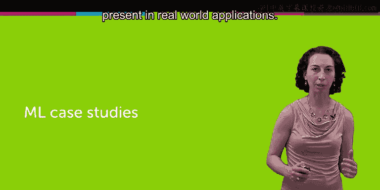
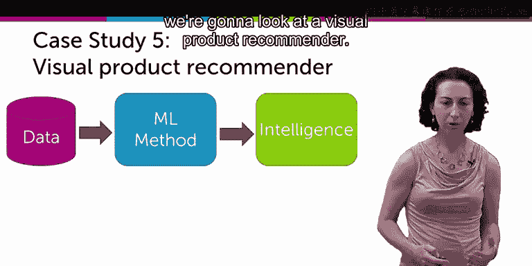

# 机器学习基础（第1课/共4课）📚：案例研究方法导论

在本节课中，我们将学习如何通过一系列具体的案例研究，来理解从数据到智能的完整流程。这些案例将把抽象的机器学习方法，建立在真实世界的应用场景之上，这也是本课程的一大特色。

## 为什么采用案例研究方法？🤔

上一节我们提到了课程的整体目标，本节中我们来看看实现这一目标的具体方法。

我们将通过研究一系列案例来学习从数据到智能的流程。这些案例将把我们要介绍的方法，建立在真实世界的应用基础之上。这是本课程一个非常独特的特点。

## 案例研究概览 📋

以下是本课程将探讨的五个核心案例，每个案例都对应一种关键的机器学习方法。

### 案例一：房价预测

我们将首先研究预测房价的案例。我们要获取的智能，是与某个未上市房屋相关联的价值。我们不知道它的价值，希望从数据中学习得到。

我们的数据是其他房屋的信息。我们将查看其他房屋的销售价格，以此来推断我们感兴趣的房屋的价值。除了销售价格，我们还会查看房屋的其他特征，例如卧室数量、浴室数量、平方英尺数等。

我们将使用的机器学习方法，是建立房屋属性与销售价格之间的关系模型。如果我们能从房屋层面的特征与观察到的销售价格之间学习到这个模型（这种关系），那么我们就可以用它来预测新房屋。我们获取新房屋的属性，并预测其销售价格。这种方法被称为**回归**。

### 案例二：情感分析

在第二个案例中，我们将探索一个情感分析任务。我们有一些餐厅的评论。

例如，有一条评论说：“寿司很棒，食物很棒，但服务很糟糕。”我们希望处理这条评论，并能够将其分类为具有积极情感（好评，竖起大拇指）还是消极情感（差评，竖起大拇指）。

我们将通过查看大量其他评论来实现这一点。我们将查看评论的文本和评分，以理解文本与情感分类之间的关系。

例如，在这个案例中，我们可能会分析这条评论的文本，统计它使用了多少次“awesome”这个词，以及使用了多少次“awful”这个词。根据我们已有的其他评论，我们将学习一个基于这些词语使用频率的决策边界，来判断评论是正面还是负面。我们从这些其他评论中学习的方法，是基于与文本相关联的评分。这种方法被称为**分类**方法。

### 案例三：文档检索

在第三个案例中，我们将进行一个文档检索任务。这里，我们要获取的智能是一篇读者可能感兴趣的文章或书籍。

我们拥有的数据是一个庞大的可能推荐文章的集合。

在这种情况下，我们将尝试基于相关文章组在数据中寻找结构。例如，可能有一组关于体育、世界新闻、娱乐和科学的文章。如果我们找到了这种结构，并用这些类型的标签来标注我们的语料库（文档集合）——这些标签我们事先并没有，而是试图从数据中推断出来——那么我们就可以用它来进行非常快速的文档检索。

因为如果我正在阅读一篇关于世界新闻的文章，那么当我想检索另一篇文章时，我已经知道应该搜索哪些文章了。这种类型的方法被称为**聚类**。

### 案例四：协同过滤

在第四个案例中，我们将做一个非常有趣的事情，叫做协同过滤，在过去十年中对许多领域产生了巨大影响。

具体来说，我们将研究产品推荐。你根据过去的购买记录，尝试使用这些记录来推荐一组你可能感兴趣购买的其他产品。

在这种情况下，我们将用于获取产品推荐智能的数据是：我们希望理解你过去的购买记录与你未来可能购买的产品之间的关系。为此，我们将使用其他用户的购买历史记录，以及可能包含的这些用户的特征。

但这里的关键思想是，我们将获取这些数据，并将其排列成一个“顾客 × 产品”矩阵。这里的方格表示顾客实际购买的产品，即该顾客喜欢的产品。

从这个矩阵中，我们将学习关于用户的特征和关于产品的特征。一旦我们从所描述的数据中学习了这些关于用户和产品的特征，我们就可以考虑使用这些特征来查看用户的喜好（用户喜欢的各种属性）与产品是否真正具备这些属性之间的一致性程度。

在我展示的这个例子中，也许一个作为母亲的用户具有某些特征，这些特征与其他也是母亲的用户相似。由此，我们可以推断出关于产品的信息，例如，哪些婴儿产品的属性是母亲们感兴趣的。我们利用这些信息来形成我们的推荐。这种从“顾客 × 产品”矩阵到学习用户和产品特征的方法，被称为**矩阵分解**。

### 案例五：视觉产品推荐

在我们的最后一个案例研究中，我们将研究一个视觉产品推荐器。

这里，我们的数据是：某人将访问网页，他们输入的不是文本，而是一张图片。他们会输入一张图片，比如一双黑色鞋子、黑色靴子、高跟鞋、某种船鞋或跑鞋的图片。他们想要的是一组可能也感兴趣的结果，即与他们拥有的图片在视觉上相似的鞋子。他们希望能够搜索这些结果来购买商品。

为了实现从一张图片到一组相关图片的转换，我们需要拥有关于该图片的非常好的特征，以找到其他相似的图片。我们将获取这些非常详细特征的方法，叫做**深度学习**。

具体来说，我们将研究这些神经网络，其中神经网络的每一层都提供越来越具描述性的特征。在我们展示的小例子中，第一层可能只检测图像中的不同边缘，而当我们到达第二层时，我们开始检测角落和更复杂的特征。随着在这些层中越走越深，你会得到更精细的特征出现。

## 总结 📝

本节课中，我们一起学习了本课程的核心教学方法。

正如你所看到的，我们将通过一系列真实世界的案例研究（真实世界的问题和真实世界的解决方案）来学习机器学习。通过这种方式，我们将探索一系列功能强大的方法，这些方法将使你能够在新的问题上（即使不是我们使用的确切案例）开发和部署新的机器学习技术。这些案例研究将使我们能够将所描述的方法建立在非常易于理解的事物之上。