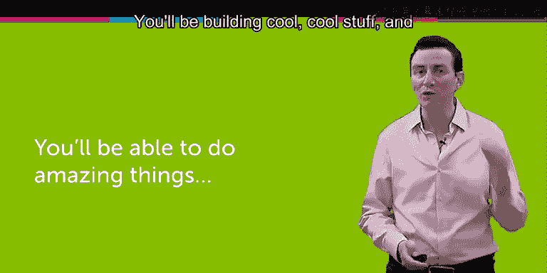
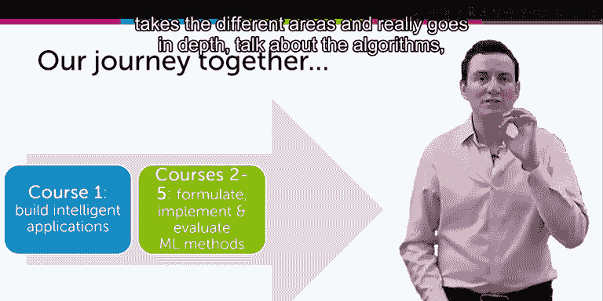

# 机器学习基础篇（第1课）：你将能够做什么 🚀

在本节课中，我们将了解完成这门课程及整个专项课程后，你将能够运用机器学习实现哪些令人惊叹的应用。课程不仅关注最终成果，更强调在整个学习过程中逐步构建智能应用。

---

现在你已经了解了这门课程以及整个专项课程的内容概览。

你会发现，通过机器学习，你将能够实现令人惊叹的应用。

在整个学习过程中，你将构建真正智能的应用，而不仅仅是在课程结束时。

在整个专项课程中，你将构建非常酷的项目，并学习广泛的概念和算法。

第一门课程的核心是**使用预先构建的机器学习算法**来开发一系列智能应用。

后续的第二到第五门课程则深入探讨不同领域，详细讲解其背后的算法、方法和核心技术。

现在，让我们回到顶点项目的讨论。

顶点项目将非常令人兴奋，你将构建一个**运用机器学习的、非常酷且令人印象深刻的应用**。

---

## 课程内容与结构 📚

上一节我们概述了课程目标，本节我们来详细看看课程的具体安排和你能获得的技能。

以下是课程的核心组成部分：

*   **第一门课程（基础篇）**：重点在于应用。你将学习如何使用现有的、强大的机器学习工具和库（例如 `scikit-learn` 或 `TensorFlow` 中的高级API）来快速解决实际问题。
*   **后续深入课程（第2-5门）**：这些课程将分模块深入机器学习的不同核心领域，如监督学习、无监督学习、深度学习等。你将不再只是调用API，而是深入理解算法背后的数学原理（例如**梯度下降公式**：`θ = θ - α · ∇J(θ)`）和实现细节。
*   **顶点项目**：这是整个专项课程的实践高潮。你需要综合运用所学知识，独立或协作完成一个完整的、有挑战性的机器学习项目，从而巩固你的技能并丰富你的作品集。

---

## 学习路径与收获 🎯

了解了课程结构后，我们来看看你的学习路径和最终能获得的成果。

以下是你将经历的学习旅程：

1.  **从应用到原理**：你将从实际应用入手，快速获得成就感，再逐步深入到支撑这些应用的理论基础。
2.  **构建项目组合**：在整个学习过程中，你会持续动手实践，积累一系列可以展示的项目。
3.  **掌握核心能力**：最终，你将不仅知道如何**使用**机器学习算法，更能理解它们**为何**有效，以及如何根据问题**选择和调整**合适的算法。

---

## 总结

本节课中，我们一起学习了华盛顿大学机器学习专项课程（基础篇）的目标与结构。

我们明确了第一门课侧重于使用预建算法进行应用开发，后续课程将深入算法原理，而整个专项课程将以一个综合性的顶点项目作为终点。

通过这条学习路径，你将逐步获得构建智能机器学习应用所需的理论知识和实践技能。