# 9：顶点项目与智能应用示例 🎯

在本节课中，我们将深入探讨一个顶点项目。我们将一起构建一个智能的产品推荐系统，该系统将结合文本、图像、情感分析和深度学习技术。

在详细介绍这个令人兴奋的顶点项目之前，我们先通过一个快速演示，来了解一个结合了文本与图像数据、并以深度学习为核心的推荐系统可以如何工作。

## 一个智能推荐应用的故事 📖

让我从一个故事开始。我的姐姐是一位时装设计师，她的生日即将到来，我想送她一条裙子作为礼物。但对我来说，选择一条她喜欢的裙子非常困难。

如果我使用标准的关键词搜索，比如搜索“裙子”，结果会像下图右侧所示，出现各式各样的裙子。我很难用语言描述我姐姐喜欢的裙子风格。

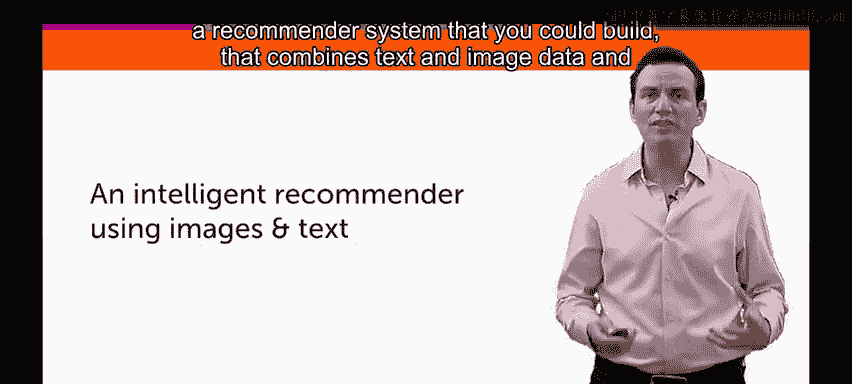
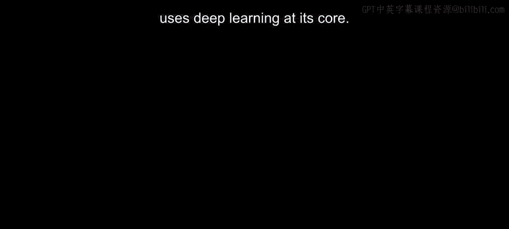
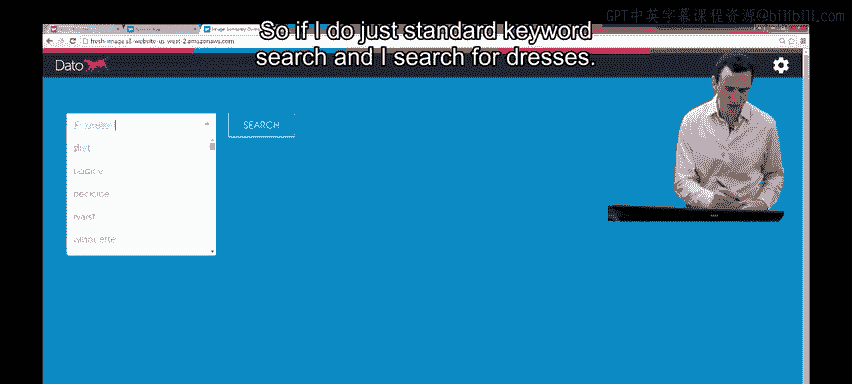

例如，我知道她穿过一些碎花裙。我可以组合关键词“裙子”和“碎花”进行搜索，系统会浏览裙子的描述来寻找碎花裙。但即使都是碎花裙，它们的风格也千差万别。

那么，问题来了：我该如何描述哪种风格适合我姐姐呢？

以这条裙子为例，它有着温暖的日落色调，看起来不错。我们可以通过文本分析来了解它的描述，但更重要的是它的视觉观感。问题是：我们能否利用视觉线索来找到其他看起来类似的裙子？

在你的顶点项目中，你将实现类似的功能。当我点击这条裙子时，系统将使用一种名为**深度学习**的技术来寻找视觉上相似的裙子。你将在本课程中学到这项技术，并在实践中应用它。

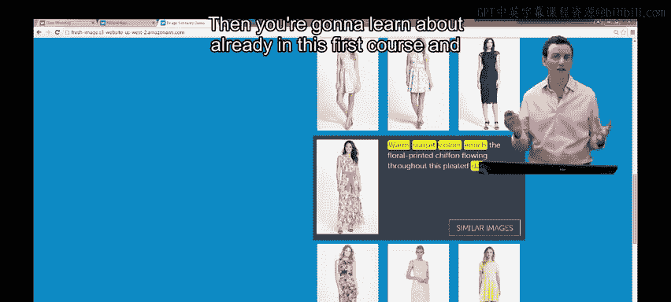

当我点击这条裙子后，右侧会显示一系列在视觉上与它相似的裙子。

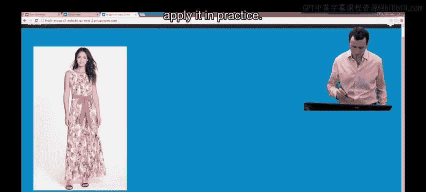

你可以看到，这些裙子大多是碎花风格，色调和颜色也相似。即便如此，描述我姐姐的喜好仍然困难。但我可以看着中间这条裙子，觉得它的图案有趣、颜色多样，也许这正是我姐姐喜欢的。

如果我点击它，系统会继续寻找与这条裙子视觉相似的款式，这些裙子通常拥有更有趣的图案和多种颜色。当我滚动浏览时，可能会被某一条吸引，觉得它很适合我姐姐。

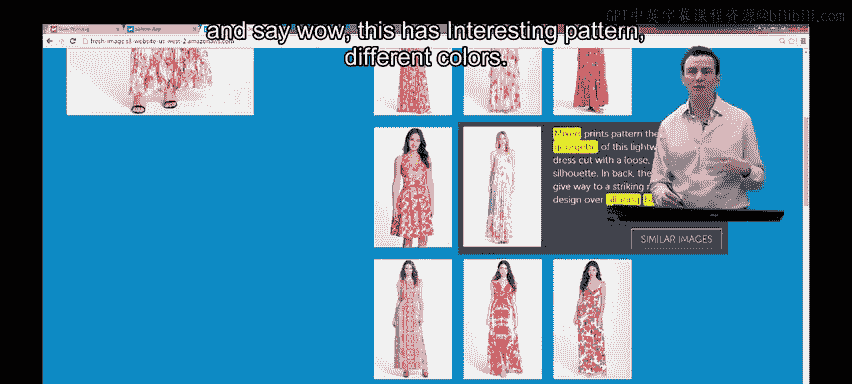
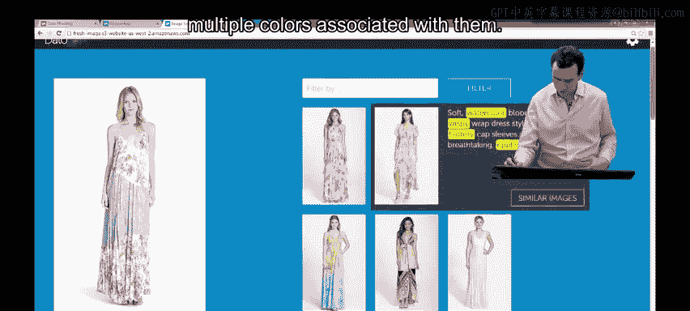
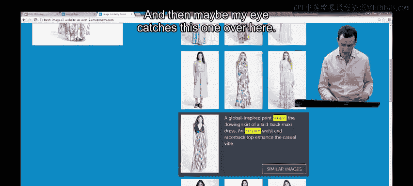

我可能会想：“我为你找到了一条很棒的裙子，就是这条。”

## 需求的变化与探索 🔄

假设我打电话给姐姐，她看起来有点像这位模特。她看了之后说：“这条看起来还行，但我要去参加一个鸡尾酒会，你不如帮我找一条鸡尾酒裙吧？”

于是我需要重新开始，为她寻找一条鸡尾酒裙。

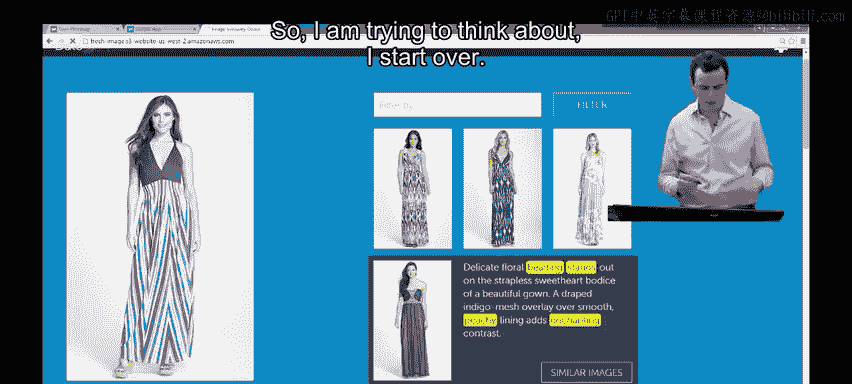

鸡尾酒裙是参加正式派对时穿的，看起来像这样，有各种颜色。也许她对黑色的鸡尾酒裙感兴趣。

如果仅基于“黑色鸡尾酒裙”这样的关键词搜索，会得到类似的结果，但仍然难以描述她的具体喜好。我可能会问她，她说：“我想要一条有趣、带一点颜色的鸡尾酒裙。”

作为一名时装设计师，她会如何描述呢？我浏览结果，发现左边第一条裙子有点意思。查看它的关联关键词，我看到了“爵士风”这个词。也许她对爵士风格的裙子感兴趣。

那么爵士风的裙子是什么样的呢？当我点击这个从文本中发现的“爵士风”关键词时，会看到其他爵士风裙子，它们很有趣，但又不完全是鸡尾酒裙的风格。

让我点击其中一条，然后寻找视觉上相似的鸡尾酒裙。

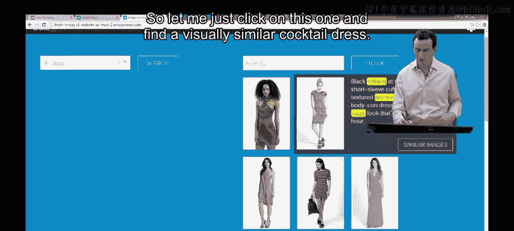

现在你看到的是一系列鸡尾酒裙，它们往往带有更有趣的图案。这些裙子更特别，更符合她的描述。

如果我滚动浏览：

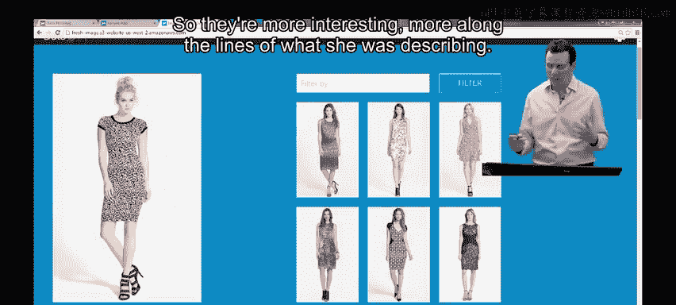

我觉得这条蓝色的，中间带些颜色的，可能就是她想要的。我点击它，但发现它对于鸡尾酒会来说不够正式。不过，当我向下滚动时：

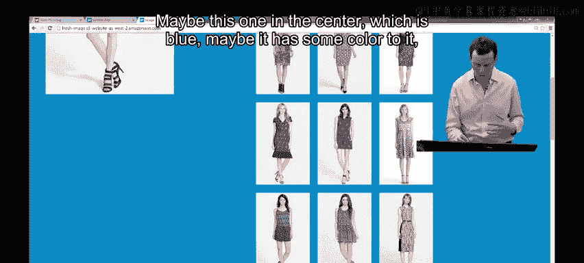

我可以找到像这样一条裙子：它足够正式，符合鸡尾酒裙的要求，带有一点颜色，设计有趣，很可能正是她会喜欢穿的那种。

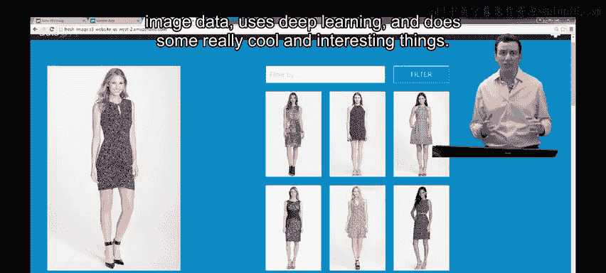

至此，我们看到了一个智能应用的示例，它分析文本数据、图像数据，运用深度学习，完成了一些非常酷且有趣的事情。

## 你的顶点项目：构建更强大的系统 🚀

我们刚刚看到了一个用于视觉产品推荐的深度学习演示。但在你的顶点项目中，你将完成更酷、更有趣的任务。

你将综合运用在本课程中学到的多种技术来构建推荐系统：

以下是你在项目中将要完成的核心任务列表：
*   **构建推荐系统**：搭建一个完整的推荐系统框架。
*   **进行文本分析**：处理和分析产品相关的文本信息。
*   **实施情感分析**：提取并分析用户对产品的评论，理解其中的情感倾向。
*   **运用计算机视觉**：从视觉上理解产品图像。
*   **应用深度学习**：利用深度学习技术，大幅提升计算机视觉任务的准确性。
*   **部署为Web服务**：将你的系统部署成一个类似我刚才演示的网页那样的Web服务。

最终，你将拥有属于自己的智能产品推荐Web服务。你可以与之交互，完成有趣的推荐任务，并向众人展示你是如何为这项服务创造智能的。

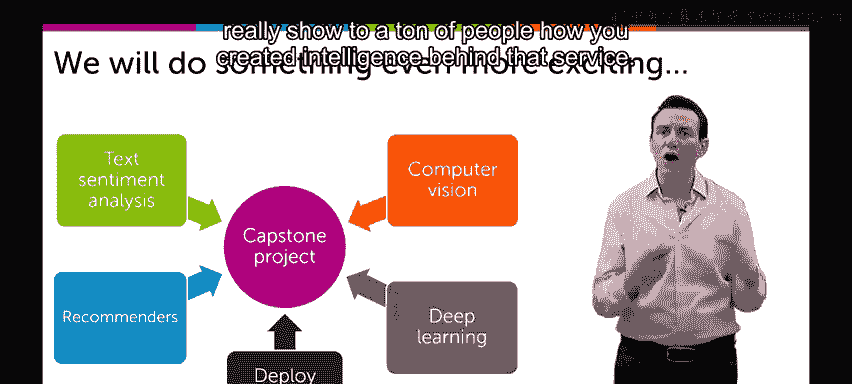

## 总结 📝

本节课中，我们一起探讨了顶点项目的构想。我们通过一个为姐姐挑选裙子的故事，演示了一个结合文本、图像和深度学习的智能推荐应用是如何工作的。我们了解到，仅靠关键词搜索的局限性，以及利用视觉相似性和深度学习进行探索的强大之处。最后，我们概述了你在顶点项目中将要完成的任务：构建一个集推荐系统、文本分析、情感分析、计算机视觉和深度学习于一体的完整智能Web服务。这将是展示你机器学习技能的综合实践。