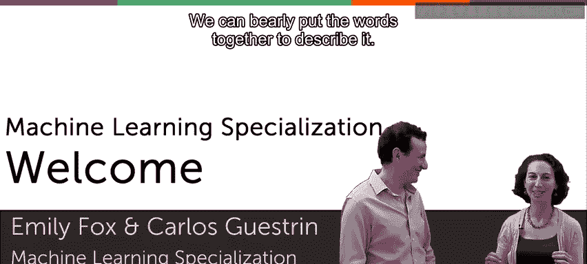

# 第一部分 1：概述 👋

## 课程概述

在本节课中，我们将要学习机器学习专项课程的第一门课，即机器学习的基础知识。我们将一起探索机器学习的应用、如何构建机器学习系统，以及其背后的算法原理与实现方法。

## 欢迎与介绍

欢迎来到机器学习专项课程，以及这门关于机器学习基础的第一门课。

我们非常高兴能与您一同踏上这段学习旅程。

我是卡洛斯，我是艾米丽。

我们将共同学习机器学习的应用、如何构建机器学习系统、其背后的算法如何工作，以及如何构建这些算法。

我们对这门课程和整个专项课程充满热情，现在让我们正式开始学习。

---

## 总结

本节课中，我们一起学习了机器学习专项课程的入门介绍，明确了本课程的目标是理解机器学习的基础知识、应用与算法构建。在接下来的课程中，我们将逐步深入这些核心主题。