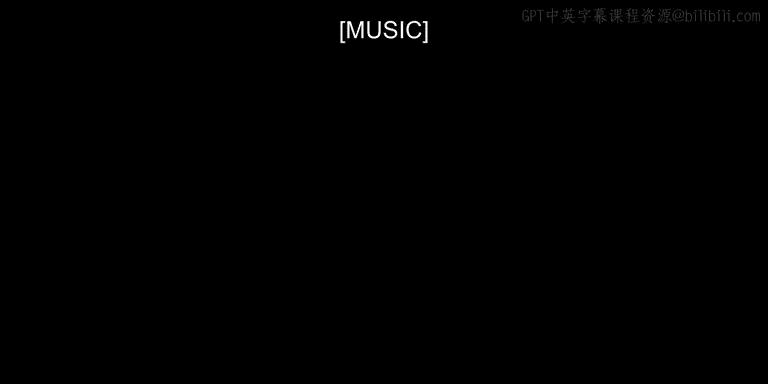
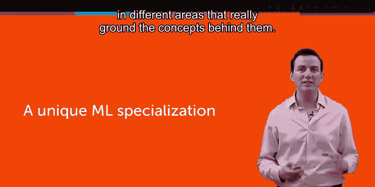
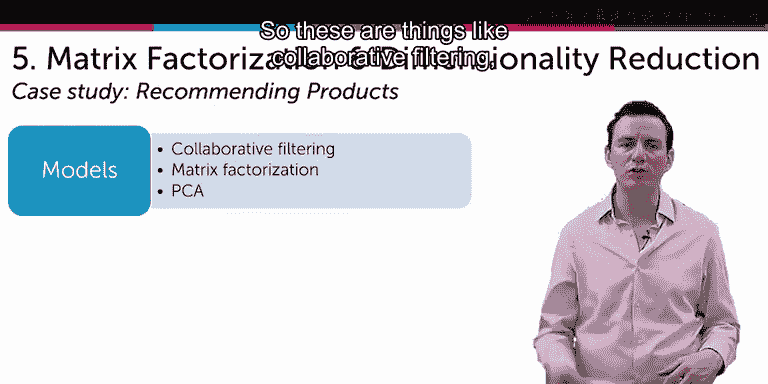

# 第一部分 5：从案例出发 🚀

在本节课中，我们将一起了解华盛顿大学《机器学习（基础篇）》专项课程的整体结构与核心理念。本课程将通过一系列实际案例来讲解机器学习，帮助初学者理解概念，并最终构建智能应用。

---

正如Emily所讨论的，我们将通过不同领域的广泛案例研究来学习机器学习。这种方法能真正夯实概念背后的基础。

其他机器学习课程可能更像一份算法和方法的清单。例如支持向量机、核方法、逻辑回归、神经网络等。它们只是方法的罗列。这种方法的弊端在于，从算法开始学习，最终接触到的用例或应用往往过于简化，与现实脱节。

因此，在这个专项课程中，我们采取了截然不同的方法。Emily和我在华盛顿大学创建了一门关于大规模数据机器学习的课程，并率先采用了这种案例教学法。在那门课程中，我们收到了大量积极的反馈，学员们真正理解了这些概念。

所以，在第一门课程中，我们将从实际用例开始。通过从用例出发，你将能够真正掌握关键概念和技术，从而构建、衡量质量并判断你的智能应用是否运行良好。最终，你将构建一系列这样的智能应用。

要构建此类智能应用，通常需要考虑几个问题：我要解决什么任务（例如情感分析问题）？我将使用什么机器学习模型（例如支持向量机或逻辑回归）？我将使用什么方法来优化该模型的参数？然后我会问：这真的能提供我所期望的智能吗？我们如何衡量该系统的质量？

在这个专项课程中，我们将把如何描述模型和优化模型的核心部分放到后续课程中。第一门课程将专注于帮助我们弄清楚要解决什么任务、哪些机器学习方法合适以及如何衡量它们。通过将算法视为**“黑箱”**，我们将能够共同构建一系列真正智能、酷炫的应用。我们实际上会编写代码、构建它们，并以多种方式演示。

整个专项课程包含四门核心课程和一个顶点项目，它们将在不同领域深入探讨。

以下是我们在整个专项课程中将深入学习的几个快速示例。

---

## 回归分析 📈

上一节我们介绍了课程的整体思路，本节中我们来看看第一门核心课程：回归分析。

回归课程将讨论预测实数值的各种模型。例如，根据房屋特征预测房价。我们将讨论线性回归技术，以及像**岭回归（Ridge Regression）**和**套索回归（Lasso）**这样的高级技术，它们能帮助你选择最适合问题的特征。我们将讨论优化技术，如**梯度下降（Gradient Descent）**和**坐标下降（Coordinate Descent）**，以优化这些模型的参数。同时，还会涉及一些关键的机器学习概念，如损失函数、偏差-方差权衡、交叉验证等。你需要了解这些概念才能真正运用这些方法、改进它们并用它们构建应用。

---

## 分类技术 🗂️

在了解了如何预测连续值后，我们进入下一个核心领域：分类。

第二门关于分类的课程，我们将构建Emily提到的情感分析用例。以下是本课程将涵盖的主要内容：
*   **模型**：从线性分类器到更高级的方法，如逻辑回归、支持向量机，并加入核方法和决策树来处理非线性复杂特征。
*   **优化方法**：讨论大规模处理这些技术和构建集成模型（如提升法Boosting）的优化方法。
*   **核心概念**：帮助你掌握分类器、扩展并将其应用于不同方法的底层机器学习概念。

---

## 聚类与检索 🔍

掌握了预测和分类后，我们来看看如何发现数据中的内在结构，特别是在文档背景下。

第三门课程将专注于聚类和检索。以下是本课程的核心内容：
*   **基础与高级技术**：讨论最近邻等基础技术，以及混合高斯模型、潜在狄利克雷分配等高级文本分析聚类技术。
*   **算法与扩展**：探讨支撑这些技术的算法，以及如何使用KD树、采样和期望最大化等技术来扩展它们。
*   **分布式计算**：核心概念围绕如何扩展这些方法、如何衡量质量，以及如何利用MapReduce等技术将其编写为分布式算法（在Hadoop等系统中实现）。在第四门课程中，你将实际编写一些用于分布式机器学习的MapReduce代码。

---

## 矩阵分解与降维 🧩

在学习了处理文档数据的方法后，我们转向一种广泛适用的技术，尤其用于推荐系统。

第四门技术课程将专注于矩阵分解和降维技术。以下是本课程的重点：
*   **应用与技术**：这些技术应用广泛，尤其适用于推荐产品的推荐系统，例如协同过滤、矩阵分解、主成分分析。
*   **优化方法**：优化这些技术的底层方法，如交替最小二乘法、奇异值分解。
*   **核心概念**：一系列非常有用的核心机器学习概念，特别是在推荐领域，例如如何选择多样化的推荐集，以及如何将其扩展到大型问题。

---

## 顶点项目 🏆

最后，在掌握了各核心模块后，我们将通过一个综合性的顶点项目来整合所学。

顶点项目将非常令人兴奋。在本模块结束时，我会回过头来更详细地介绍这个顶点项目。先给你一点提示：你将构建一个极其酷炫的项目，可以向所有朋友和潜在雇主展示。你会发现，你可以围绕推荐系统，结合文本数据、图像数据、情感分析和深度学习，构建一个真正智能的应用程序。这将非常酷。

---

本节课中我们一起学习了华盛顿大学机器学习专项课程的整体框架。我们从实际用例出发，概述了四门核心课程（回归、分类、聚类与检索、矩阵分解）分别关注的重点，以及一个综合性的顶点项目。这种学习方法旨在帮助你理解核心概念、掌握实用技术，并最终能够构建和评估自己的智能应用。