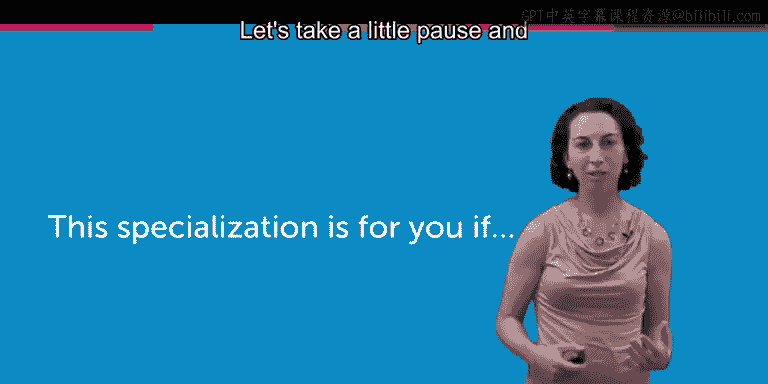
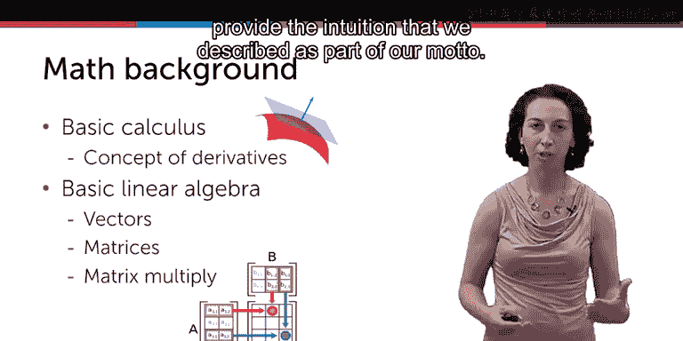
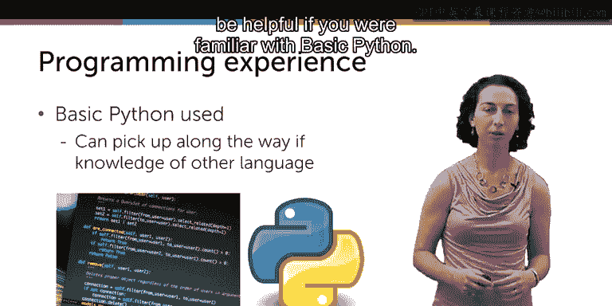
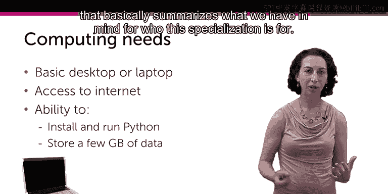

# 第一部分 7：课程适合人群与预备知识 📚

在本节课中，我们将了解这门机器学习专项课程的定位、目标人群以及学习所需的预备知识。我们将明确课程的设计理念，并详细说明学习前需要具备的数学和编程基础，以及必要的计算环境。

---

## 课程定位与目标 🎯

首先需要强调的是本专项课程的难度级别和教学内容。我们将教授非常重要的机器学习方法，并将这些方法建立在真实世界的应用案例之上，正如我们在案例研究中看到的那样。我们的座右铭是：**将艰深的概念变得直观且可应用**。

因此，这门课程不会专注于定理证明，而是致力于在非常直观和实用的层面上，理解一些非常重要的机器学习算法，并思考如何将它们部署到新的问题中。

为了实现这个目标，我们的宗旨是：**在最小化理解课程内容所需先修知识的同时，最大化您在实际感兴趣的新问题上开发和部署这些方法的能力**。在呈现概念时，我们将以这些案例研究为基础，采用非常直观、易懂的方式。

---

## 目标受众 👥

以下是本课程主要面向的人群：

*   **软件工程师**：对机器学习感兴趣的软件工程师。
*   **科研人员**：希望转型为数据科学家的科研人员。
*   **数据爱好者**：拥有一定数学和编程经验，希望分析数据并从中获得乐趣的广大人群。他们渴望了解更多关于机器学习的知识，以及如何从数据中获取智能。

---

## 预备知识详解 🔧

之前提到，我们假设您具备一定的数学和编程背景。现在让我们更详细地讨论这一点。

### 数学背景要求

在数学背景方面，我们假设您具备以下基础知识：

*   **基础微积分知识**：理解导数的概念及其计算方法。
*   **基础线性代数知识**：您需要知道什么是**向量**、什么是**矩阵**以及如何进行矩阵乘法。

我们将尽可能以最直观的层面呈现内容。即使我们可以用矩阵和矩阵乘法的形式写出方程，我们也会尝试提供尽可能多的视觉辅助工具来帮助您建立直觉。因此，如果您对这些概念只是略有了解，我们建议您复习一下。但请放心，我们会努力提供符合我们座右铭的直观解释。

### 编程背景要求

在编程经验方面，本专项课程将使用**基础的Python**进行编程。

如果您不熟悉Python，具备基础的Python知识当然会很有帮助。但我们认为，如果您具备其他编程语言的知识，也可以掌握本课程所需的重要工具。

---

## 计算环境需求 💻

最后，本课程对您的计算环境有何要求？

我们假设您拥有一台可以访问互联网的基础台式机、笔记本电脑或能够使用这样的设备。这当然很重要，因为您需要观看这些精彩的视频。

除此之外，为了完成作业，您需要能够安装和运行Python。此外，您还需要能够存储几GB的数据。

---

## 总结 📝

本节课中，我们一起学习了华盛顿大学机器学习基础专项课程的定位。我们明确了课程旨在将复杂的机器学习概念变得直观且实用，适合具备基础数学和编程背景的软件工程师、科研人员和数据爱好者学习。课程要求学习者了解基础的微积分和线性代数，并能使用Python进行编程，同时需要准备好能够运行Python和存储数据的计算环境。希望您符合这些条件，并准备好开始这段学习旅程。