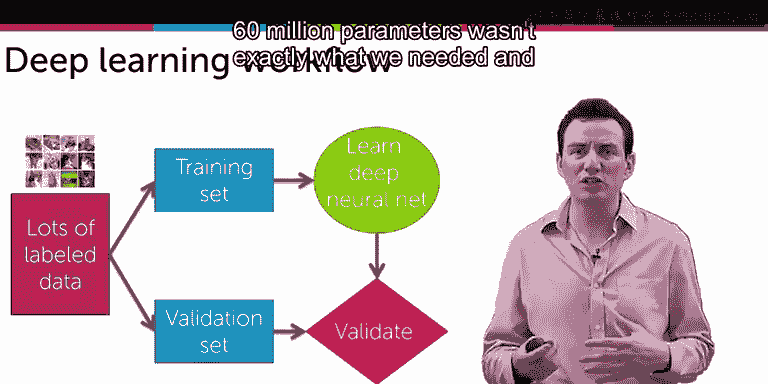

# 第一部分 100：深度学习的挑战 🧠

在本节课中，我们将探讨深度学习，特别是神经网络，在带来革命性成果的同时所面临的主要挑战。我们将了解其工作流程、优势以及实际应用中需要克服的困难。

---

神经网络确实能提供令人兴奋的成果，但它们也伴随着一些挑战。

在优势方面，神经网络使你能够表示这些非线性的复杂特征，并取得令人印象深刻的结果。这不仅体现在计算机视觉领域，还体现在其他一些领域，如语音识别。例如，手机上的Siri等系统在幕后也使用深度神经网络，以及一些文本分析任务。它在更广泛的领域具有产生更大影响的潜力。

现在，它们确实带来了一些挑战。为了理解这些挑战，我们需要讨论训练神经网络的工作流程。

你需要从海量的数据开始，并且这些数据必须被标注。每张图像都必须知道其中是什么狗：是拉布拉多犬、贵宾犬、金毛寻回犬，还是吉娃娃等等。这需要大量的人工标注，可能很困难。我们从大量图像开始，将其分割成我们讨论过的训练集和测试集（或验证集）。然后我们学习一个深度神经网络，这可能要花费相当长的时间。一旦我们进行验证，可能会意识到那个拥有6000万个参数的复杂八层结构并不完全是我们所需要的。我们需要修改它，或者需要调整参数，改变学习方式，并且必须一次又一次地迭代。

事实上，为了获得那个获胜的神经网络（即AlexNet），他们确实需要连接具有不同表示形式的各层，并在学习算法中加入大量复杂性，所以这很困难。

因此，尽管神经网络（深度神经网络）有一些巨大的优点，但它们也伴随着一些缺点。它们需要大量数据才能获得出色的性能。即使在有GPU的情况下，它们的计算成本也很高，并且极难调优。你在使用什么层、使用多少层或参数方面有很多选择，这可能相当困难。

所以，如果你将计算选择和成本与如此多需要调优的因素结合起来，最终会得到一个极其困难的过程，用于确定该使用什么样的神经网络。

---

**本节课总结**

本节课中，我们一起学习了深度学习的双面性。我们了解到，神经网络虽然能建模复杂特征并在多个领域取得突破，但其成功依赖于**海量的标注数据**、**高昂的计算成本**以及**极其复杂的模型调优过程**。这些挑战使得设计和训练一个有效的深度神经网络成为一个需要反复迭代和大量资源的艰巨任务。