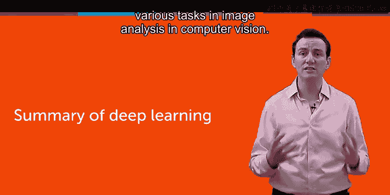
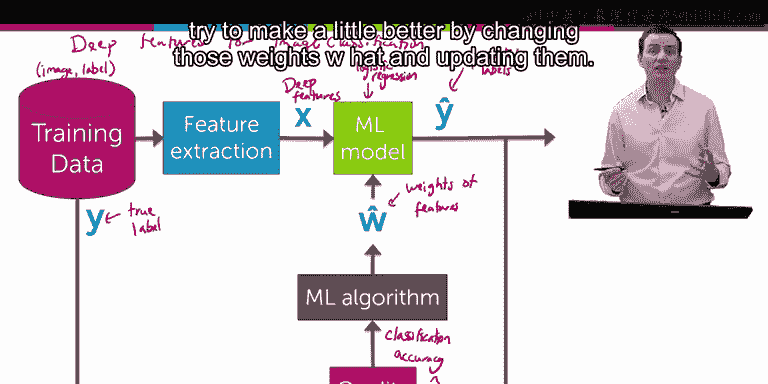

# 第一部分 102：深度学习模块图解析 🧠

在本节课中，我们将学习深度学习在计算机视觉任务中的应用，特别是如何利用深度特征进行图像分类。我们将回顾一个总结回归、分类及其他机器学习任务的模块图，并探讨其在深度学习和计算机视觉中的具体应用。

---

## 深度特征与图像分类 🖼️

上一节我们介绍了深度学习在图像分析中的广泛应用及其高精度表现。本节中，我们来看看如何利用深度特征进行图像分类。

输入数据是图像及其标签的配对。标签表示图像中的对象类别，例如猫、狗、房屋或其他物体。

以下是处理流程：

1.  **特征提取**：使用深度学习模型作为特征提取器，处理输入图像。
2.  **特征输出**：为每张图像生成一组“深度特征”。
3.  **分类模型**：将深度特征输入一个机器学习模型，例如逻辑回归分类器。
4.  **预测输出**：模型输出预测的标签。
5.  **质量评估**：将预测标签 `Y_hat` 与真实标签 `Y` 进行比较，使用分类准确率等指标评估模型质量。
6.  **参数优化**：模型参数 `W_hat`（即逻辑回归的权重）通过机器学习算法进行调整，目标是提高分类准确率。

核心公式与代码描述：
*   **逻辑回归示例**：`Y_hat = sigmoid(W_hat * X + b)`，其中 `X` 代表深度特征。
*   **质量评估（分类准确率）**：`accuracy = (number of correct predictions) / (total number of predictions)`

---

## 总结与展望 🚀

本节课中，我们一起学习了深度学习在计算机视觉任务中的强大能力。我们看到了如何将深度神经网络和深度特征应用于图像分类与检索，并通过实践了解到构建此类模型并应用于实际任务（例如寻找特定款式的鞋子）是相对直接的。

掌握这些知识后，你将能够构建令人兴奋的智能应用程序，运用当今机器学习领域最受追捧的技术之一——深度学习。