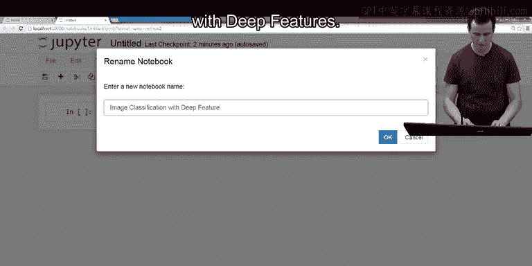
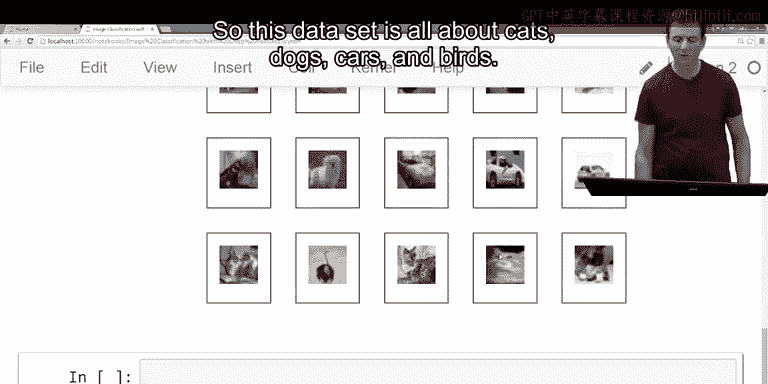

# 第一部分 103：使用深度特征进行图像分类 🖼️


在本节课中，我们将学习如何利用深度特征进行图像分类。我们将加载一个图像数据集，探索其内容，并了解如何为后续的分类任务准备数据。

---


## 加载图像数据



上一节我们介绍了深度学习的两个应用：图像分类和图像检索。本节中，我们来看看如何为图像分类任务加载和准备数据。

首先，我们需要导入必要的库并加载数据集。

```python
import graphlab
```

以下是加载数据集的步骤：

1.  我们将使用一个名为CIFAR-10的基准数据集。
2.  我们从中选择一个子集，只包含四个类别的物体。
3.  该数据集已预先分为训练集和测试集，这是计算机视觉领域的常见做法，以确保研究结果的可比性。

```python
# 加载训练数据
image_train = graphlab.SFrame(‘train_data’)

# 加载测试数据
image_test = graphlab.SFrame(‘test_data’)
```

---

## 探索数据集

数据加载完成后，我们需要对其内容有一个初步的了解。我们将配置可视化工具，以便在笔记本中直接查看图像。

```python
# 设置画布目标为当前笔记本
graphlab.canvas.set_target(‘ipynb’)
```

现在，让我们查看训练数据。我们主要关注的是包含图像数据的列。

```python
# 显示训练数据中的图像列
image_train[‘image’].show()
```

为了更清晰地查看图像，我们可以临时调整显示设置。观察图像，我们可以看到数据集中包含鸟、猫、狗和汽车这四类物体。

---

## 总结




本节课中我们一起学习了图像分类任务的第一步：加载和探索图像数据集。我们导入了GraphLab Create库，加载了CIFAR-10数据集的子集，并初步查看了其中的图像内容。这些数据将作为我们后续构建图像分类模型的基础。