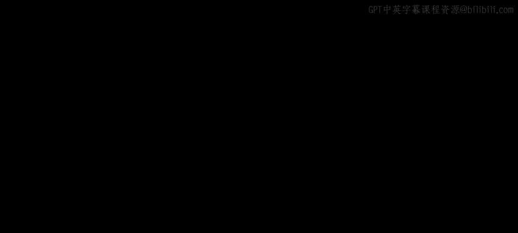
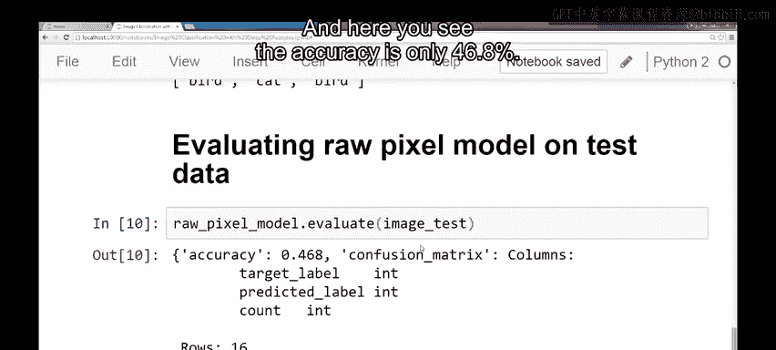
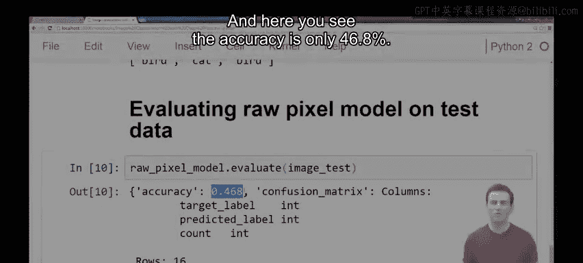
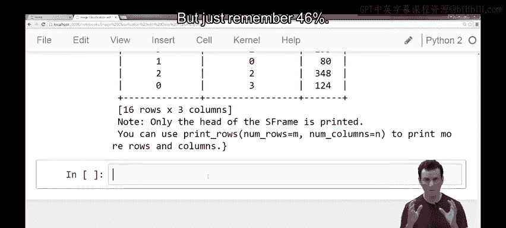

# 第一部分 104：使用原始图像像素训练并评估分类器 🖼️🔍



在本节课中，我们将学习如何使用图像的原始像素值作为特征，来训练一个基础的分类器，并评估其性能。我们将使用逻辑回归模型，并在CIFAR-10数据集的一个子集上进行实践。

---

## 训练基于原始像素的分类器

上一节我们介绍了数据集。本节中，我们来看看如何使用最基础的图像信息——原始像素——来构建一个分类模型。

我们首先不使用任何复杂的特征提取方法，而是直接将图像的像素值作为特征输入分类器。我们将训练一个逻辑回归分类器。

以下是训练分类器的步骤：

1.  **准备数据**：使用训练数据集 `image_train`。
2.  **指定目标**：目标变量是数据集中的 `label` 列，它包含了每张图像的标签。
3.  **指定特征**：特征数据是 `image_array` 列，它存储了图像的原始像素数组。
4.  **创建模型**：使用 `graphlab.logistic_classifier.create()` 函数来创建逻辑回归分类器。

对应的核心代码如下：
```python
raw_pixel_model = graphlab.logistic_classifier.create(
    dataset=image_train,
    target='label',
    features=['image_array']
)
```
我们称这个模型为原始像素模型。执行这段代码后，模型就训练完成了。但需要提醒的是，我们预期仅使用原始像素的分类性能不会很高。

---

## 对模型进行预测

模型训练完成后，我们可以用它来进行预测。让我们看看它在测试集的前几张图片上表现如何。

我们从测试集 `image_test` 中选取前三张图像进行可视化，并查看它们的真实标签。

以下是操作步骤：

1.  选取测试集的前三张图像：`image_test[0:3]['image']`。
2.  调用 `.show()` 方法显示这些图像。可以看到，它们分别是一只猫、一辆汽车和另一只猫。
3.  查看这些图像对应的真实标签：`image_test[0:3]['label']`。确认标签是“猫”、“汽车”、“猫”。

现在，让我们使用训练好的原始像素模型对这三张图像进行预测：
```python
raw_pixel_model.predict(image_test[0:3])
```
预测结果是“鸟”、“猫”、“鸟”。与真实标签（猫、汽车、猫）对比，模型将两只猫都预测成了鸟，将汽车预测成了猫，三张图片全部预测错误。

当然，这只是对少数样本的定性观察，可能存在偶然性。为了全面评估模型性能，我们需要进行定量分析。

---

## 在测试集上评估模型

为了获得模型性能的客观度量，我们需要在整个测试集上对其进行评估。

我们使用模型的 `.evaluate()` 方法，传入测试数据集 `image_test`。这个方法会计算包括准确率在内的多种评估指标。

核心评估代码如下：
```python
raw_pixel_model.evaluate(image_test)
```
评估结果显示，模型的分类准确率仅为 **46.8%**。考虑到我们处理的是4分类问题（数据子集），随机猜测的准确率是25%。虽然模型表现优于随机猜测，但46.8%的准确率仍然非常不理想。

评估输出中还包含了混淆矩阵等更详细的信息，可供进一步分析。但核心结论是明确的：仅使用原始像素特征，分类器的性能有限。

---



## 课程总结



本节课中我们一起学习了如何使用图像的原始像素值作为特征来训练一个逻辑回归分类器。我们完成了从模型训练、样本预测到整体评估的完整流程。



实践表明，在这个图像分类任务上，原始像素模型仅取得了46.8%的测试准确率。这说明了对于像图像这样的复杂数据，直接使用原始像素作为特征信息可能不够有效，为后续课程中引入更高级的特征提取方法（如深度学习特征）做好了铺垫。