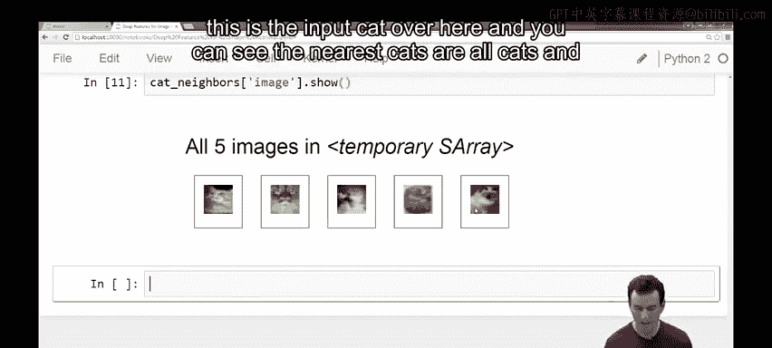

# 第一部分 108：使用最近邻模型检索相似图像 🖼️🔍

在本节课中，我们将学习如何利用已训练的最近邻模型，根据深度特征来检索与给定查询图像相似的图像。我们将通过一个具体的例子——查找与一张猫图片相似的图像——来演示整个过程。

---

## 模型应用概述

上一节我们介绍了如何构建和训练最近邻模型。本节中，我们来看看如何实际使用这个模型进行图像检索。

现在我们可以使用这个基于深度特征的图像检索模型来寻找相似的图像。

## 步骤一：选择查询图像

首先，我们需要从训练数据集中选择一张特定的图像作为查询起点。以下是具体操作：

*   我们从图像训练数据中选取第18张图像。
*   为了明确其内容，我们使用 `cat_image.show()` 来显示这张图像。
*   我们将画布目标设置为在笔记本中显示。

执行上述操作后，我们得到了一张猫的图片。对于熟悉猫品种的人来说，这是一只虎斑猫。图片尺寸虽小，但足以识别。

## 步骤二：查询最近邻

现在，我们可以为这张猫图片寻找最近的邻居（即最相似的图像）。

我们使用训练好的K最近邻模型，并以猫图片作为输入进行查询。查询完成后，模型会返回一系列图像的索引编号，例如384、690、60、910等。

然而，仅凭这些数字索引很难直观地看到对应的图像。因此，我们需要一个辅助函数来将这些索引转换为实际的图像进行展示。

## 步骤三：创建图像检索辅助函数

为了便于查看结果，我们将共同创建一个新的Python函数。这个函数的作用是根据查询返回的索引ID列表，从数据表中获取对应的图像数据。

我们将这个函数命名为 `get_images_from_ids`。它的工作原理如下：

1.  输入参数是查询结果（即索引ID列表）。
2.  函数内部对训练数据表进行操作，使用 `filter_by` 方法筛选出那些行ID与查询结果中`reference_label`列相匹配的数据行。
3.  最终，函数返回所有匹配ID的图像数据。

定义这个函数后，我们就不必每次都手动执行这些步骤了。

## 步骤四：显示相似图像结果

让我们使用这个新函数来获取并显示猫的相似图像。

我们调用 `get_images_from_ids` 函数，并将KNN模型对猫图片的查询结果作为输入。我们将返回的结果存储在变量 `cat_neighbors` 中。

最后，我们通过 `cat_neighbors[‘image’].show()` 来展示这些相似的图像。结果显示，与输入猫图片最接近的图像都是猫，并且很多都是类似的虎斑猫。

---

## 课程总结

本节课中，我们一起学习了如何应用最近邻模型进行图像检索。我们完成了从选择查询图像、执行模型查询，到创建辅助函数并可视化相似结果的全过程。通过这个实践，你掌握了利用预训练模型根据内容寻找相似图像的基本方法。