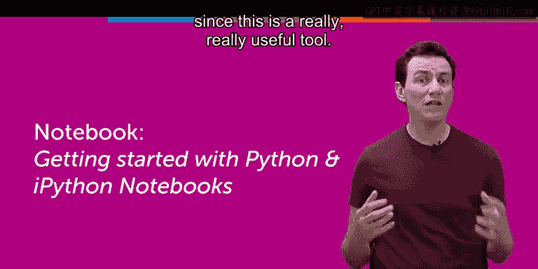
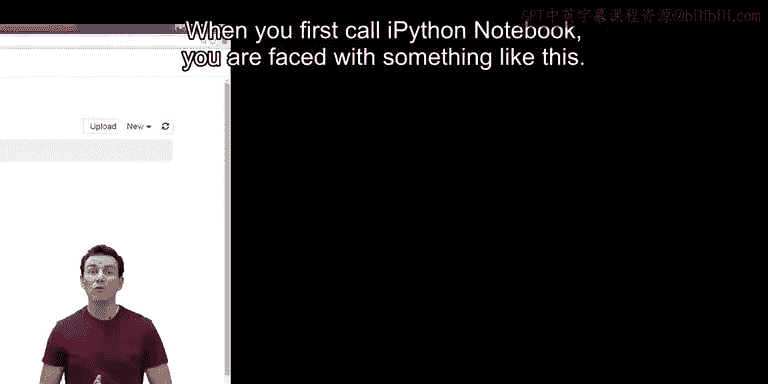
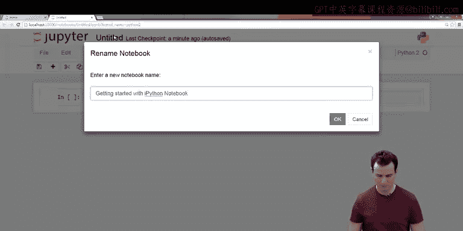
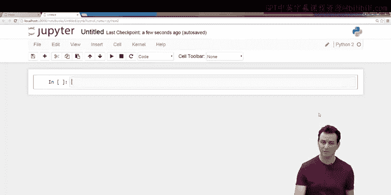
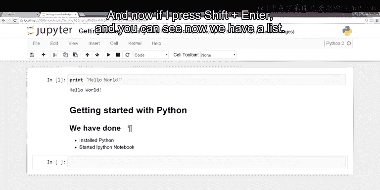

# 第一部分 11：启动与使用Jupyter Notebook 🚀


在本节课中，我们将学习两种用于编程机器学习算法和数据科学的强大工具：**Python编程语言**和**Jupyter Notebook**。我们将从启动Jupyter Notebook开始，逐步了解其界面和基本功能，并编写第一个Python程序。

---

## 启动Jupyter Notebook

上一节我们介绍了本课程将使用的核心工具。本节中，我们来看看如何启动Jupyter Notebook。

假设你已经在系统中安装了Python。启动Jupyter Notebook后，你会看到一个类似文件浏览器的界面，其中列出了当前目录下的所有文件，包括数据文件和已有的笔记本文件。


要创建一个全新的笔记本，请选择“New” -> “Python 2”（或其他Python版本）。这个工具结合了Python脚本语言和Wiki页面的优点，使得编写算法和与他人交流变得非常方便。






---

## 认识Jupyter Notebook界面

现在我们已经创建了一个新笔记本，本节我们来熟悉其用户界面。

界面顶部是笔记本的标题，你可以点击它进行修改。例如，我们可以将其改为“Getting started with Python Notebook”。





这个笔记本就像一个Python控制台，但它允许你保存生成的页面，并在其中包含文本和图像。顶部菜单栏提供了保存、加载、编辑、复制和添加新单元格等功能。

---


## 编写第一个Python程序

了解了界面后，我们现在可以开始编写代码了。以下是创建和运行第一个Python程序的步骤。

首先，点击一个单元格（这类似于控制台中的一个输入行）。然后，输入你的第一个Python函数。我们将使用`print`函数来打印一个字符串。

```python
print('Hello World')
```

要执行这个单元格，请按 `Shift + Enter`。执行后，单元格下方会显示输出结果：“Hello World”。

---

## 在笔记本中使用文本和Markdown

Jupyter Notebook的强大之处在于它能混合代码和格式丰富的文本。本节我们学习如何添加和格式化文本。

有两种方式可以创建文本单元格。第一种是点击菜单栏中的“Cell” -> “Cell Type” -> “Markdown”。然后，你可以在单元格中使用Markdown语法编写文本。

例如，输入以下内容可以创建标题和列表：

```markdown
# Getting Started with Python

## What We Have Done So Far

我们已完成以下步骤：
* 安装了Python编程语言
* 启动了Jupyter Notebook
```

按 `Enter` 可以换行。要渲染Markdown文本，请按 `Shift + Enter`。之后，你将看到格式清晰的标题和项目符号列表。




---

## 总结


本节课中，我们一起学习了Jupyter Notebook的基本使用方法。我们启动了Jupyter Notebook，熟悉了其界面，编写并执行了第一个Python程序，还学会了如何使用Markdown单元格来添加格式化的文本说明。这些是使用Jupyter Notebook进行机器学习和数据科学项目的基础。