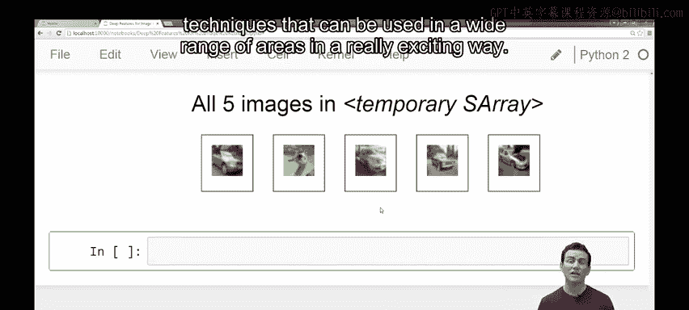

# 第一部分 119：使用Python Lambda函数进行图像检索示例 🖼️🔍


在本节课中，我们将学习如何利用Python的lambda函数和预训练的深度学习模型，构建一个简单的图像检索系统。我们将通过一个具体的例子，展示如何查询一张图片，并找到数据集中与它最相似的其他图片。

---

上一节我们介绍了如何使用深度学习特征进行基本的图像检索。本节中，我们将通过编写一个简洁的lambda函数，将这个流程封装起来，以便更灵活、便捷地对任意图片进行相似性查询。

以下是创建这个图像检索lambda函数的步骤：

1.  **定义函数**：我们将创建一个名为 `show_neighbors` 的lambda函数。
2.  **指定输入**：该函数接受一个参数 `i`，代表数据集中某张图片的索引。
3.  **执行查询**：在函数内部，它将执行我们之前见过的检索流程：获取查询图片的特征，并在特征空间中寻找其最近邻。
4.  **展示结果**：最后，函数会调用一个展示函数，将查询图片及其最相似的邻居图片一并显示出来。

这个lambda函数的代码如下：

```python
show_neighbors = lambda i: do_show_neighbors(get_images_from_ids(query=image_train[i:i+1]))
```

创建了这个函数后，我们可以用它进行一些有趣的尝试。现在，只需调用 `show_neighbors` 并传入图片索引，就能立即看到检索结果。

---

让我们用几个例子来测试这个函数。

首先，查询索引为8的图片（一辆红色汽车）：
```python
show_neighbors(8)
```
执行后，系统会返回并显示与这辆红色汽车最相似的其他图片。

接着，尝试查询索引为26的图片（一辆蓝色汽车）：
```python
show_neighbors(26)
```
结果会显示这辆蓝色汽车及其相似车辆。

然后，查询索引为1222的图片：
```python
show_neighbors(1222)
```
这次查询的是一只鸟，系统成功地找到了其他姿态相似的鸟类图片。

最后，尝试查询索引为2000的图片：
```python
show_neighbors(2000)
```
在这次查询中，系统出现了一次误判（将一只鸵鸟识别为汽车），但其余返回的图片都是正确的汽车类别。

---



本节课中我们一起学习了如何利用Python的lambda函数快速构建一个图像检索工具。通过封装检索流程，我们能够便捷地探索数据集中图片的相似性关系。尽管在少数例子中出现了误判，但基于深度特征的方法在未经目标数据集专门训练的情况下，依然展现出了令人印象深刻的检索性能。这项技术简单而强大，可以广泛应用于各种需要图像匹配和检索的场景。