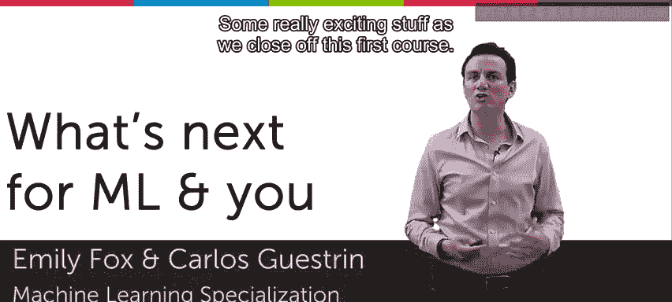

# 第一部分 111：回顾与总结 🎯

在本节课中，我们将回顾并总结机器学习基础课程的核心内容，探讨如何将所学概念部署到实际生产系统中，并展望后续课程与机器学习领域的整体发展方向。


---

## 课程回顾与总结 📚

上一节我们介绍了课程的整体框架，本节中我们来看看本课程所涵盖的核心内容。

Emily和我衷心希望您到目前为止已经享受了这门课程。我们广泛探索了机器学习的基础知识，涉及多个领域和不同的应用场景。课程深入探讨了部署和构建机器学习系统时遇到的许多实际问题。

以下是本课程涵盖的主要领域：

*   监督学习与非监督学习的基本概念
*   特征工程与数据预处理
*   模型训练、评估与选择
*   过拟合与正则化等实际问题

---

## 部署机器学习系统 🚀

在掌握了基础概念后，下一步是了解如何将这些想法应用到实际的生产环境中。

在本课程的最后模块，我们将总结所学的一些核心概念，讨论如何将这些理念部署为生产环境中的机器学习系统。

部署过程通常涉及以下关键步骤：

1.  **模型固化**：将训练好的模型保存为可复用的格式，例如使用 `pickle` 或 `joblib` 库。
    ```python
    import joblib
    joblib.dump(trained_model, 'model.pkl')
    ```
2.  **构建预测服务**：创建API或服务来接收新数据并返回模型预测结果。
3.  **监控与维护**：持续监控模型在生产环境中的性能，并定期进行更新或重新训练。

---

## 展望未来 🔮

了解当前基础后，让我们看看机器学习领域的后续发展方向。

接下来，我们将探讨专项课程以及机器学习整体的未来前景。在结束这第一门课程时，有一些非常令人兴奋的内容。

机器学习领域正在快速发展，未来的重点可能包括：

*   **自动化机器学习（AutoML）**：旨在自动化模型选择、超参数调优等过程。
*   **可解释AI（XAI）**：提高复杂模型（如深度学习）的透明度和可理解性。
*   **持续学习与在线学习**：使模型能够适应不断变化的数据流。



---


## 总结 ✨

本节课中我们一起学习了机器学习基础课程的核心要点。我们回顾了从基础概念到实际应用的全过程，探讨了将模型部署到生产系统的关键步骤，并展望了机器学习领域充满潜力的未来发展方向。希望这些知识能为您后续的学习和实践打下坚实的基础。