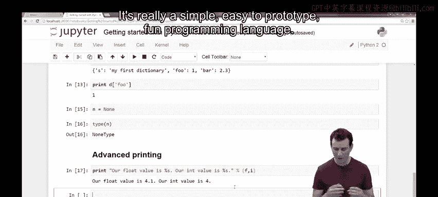

# 第一部分 12：Python变量创建 🐍


在本节课中，我们将学习如何在Python中创建和使用变量。Python是一种脚本编程语言，它使得创建变量和原型设计变得非常简单。我们将从基本数据类型开始，然后介绍一些更高级的数据结构，最后了解如何进行格式化输出。

---

## 基本数据类型

上一节我们了解了Python作为脚本语言的特点。本节中，我们来看看Python中最基础的几种数据类型。

以下是创建基本数据类型变量的示例：

*   `i = 4`：创建一个整数变量。在Python中，注释可以用井号 `#` 开头，例如 `# int`。
*   `f = 4.1`：创建一个浮点数变量。
*   `b = True`：创建一个布尔变量。
*   `s = "This is a string"`：创建一个字符串变量。字符串可以用单引号或双引号定义。

你可以使用 `type()` 函数来查看任何变量的类型，例如 `type(i)` 会返回 `<class 'int'>`。

---

## 高级数据类型

了解了基本类型后，我们来看看Python中一些更常用和强大的高级数据类型。

以下是两种常见的高级数据类型：

*   **列表**：列表可以包含任意类型的元素，例如数字、字符串等。创建列表的语法是使用方括号 `[]`。
    ```python
    L = [3, 1, 2]  # 一个整数列表
    ```
*   **字典**：字典是一种键值对集合，类似于哈希表。创建字典的语法是使用花括号 `{}`，键和值之间用冒号 `:` 分隔。
    ```python
    D = {'foo': 1, 'bar': 2.3, 's': 'My first Dictionary'}
    ```
    你可以通过键来访问字典中的值，例如 `D['foo']` 会返回 `1`。字典中的元素是无序的。

此外，Python还有一个特殊的类型叫 `None`，表示空值或无值。
```python
n = None
type(n)  # 返回 <class 'NoneType'>
```

---

## 格式化输出

我们已经学会了如何创建变量，现在让我们看看如何更灵活地打印它们，将变量值嵌入到字符串中。

在Python中，可以使用 `%` 操作符进行基本的字符串格式化。在字符串中，`%s` 是一个占位符，表示此处将插入一个值。在字符串末尾使用 `%` 并跟上要插入的变量（通常放在元组中），即可完成替换。

以下是一个格式化输出的例子：
```python
print("Our float value is %s, and our integer value is %s" % (f, i))
```
这行代码会输出：`Our float value is 4.1, and our integer value is 4`。第一个 `%s` 被变量 `f` 的值替换，第二个 `%s` 被变量 `i` 的值替换。

Python还支持更多高级的字符串格式化方法，值得你自己去探索，这非常有趣且实用。

---




本节课中我们一起学习了Python变量的创建。我们从整数、浮点数、布尔值和字符串这些基本类型开始，然后探索了列表和字典这两种强大的数据结构，最后了解了如何使用格式化输出来更清晰地展示信息。Python以其简洁易用的语法，成为了快速原型设计和机器学习的绝佳工具。