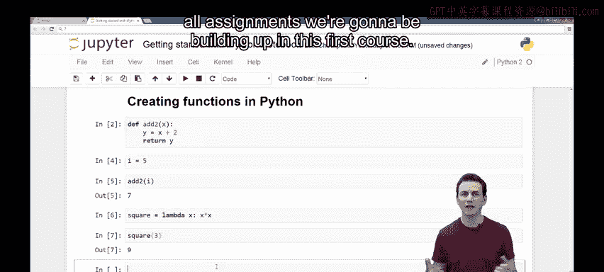

# 第一部分 14：在Python中创建函数和lambda表达式 🐍


在本节课中，我们将要学习如何在Python中创建函数。函数是组织代码、实现代码复用的核心工具。我们将介绍两种定义函数的方法：使用 `def` 关键字和 `lambda` 表达式。

希望前面的内容能帮助你开始使用Python编程语言、IPython笔记本以及控制台。反复使用控制台是一种管理数据、与数据交互的简单有趣的方式。在Python生态中，有大量用于可视化、导航和进行机器学习的工具，因此它对我们来说是一门非常出色的编程语言。

事实上，近期有很多调查显示，Python是数据科学领域的首选编程语言，这也是我们为本课程选择它的原因。

作为最后一步，让我们来讨论如何在Python中创建函数。在Python中创建各种函数实际上相当容易，而且非常自然。有两种方法可以实现，让我们开始学习。

## 使用 `def` 关键字定义函数

第一种方法是使用 `def` 命令来定义函数。这允许我们创建具有名称和明确逻辑结构的可重用代码块。

以下是使用 `def` 定义函数的基本步骤：
1.  以 `def` 关键字开头，后跟函数名和括号。
2.  在括号内列出函数的参数（例如 `x`，也可以是 `x, y, z` 等）。
3.  在参数列表末尾加上冒号 `:`。
4.  像处理循环一样，将函数体代码缩进（通常是一个制表符或4个空格）。
5.  在函数体内编写要执行的代码，并使用 `return` 语句返回结果。

例如，我们可以定义一个名为 `add2` 的函数，它接受一个参数 `x` 并返回 `x + 2` 的结果。

```python
def add2(x):
    y = x + 2
    return y
```

定义好函数后，我们就可以调用它了。假设我们有一个变量 `i` 等于5，那么调用 `add2(i)` 将返回7。

```python
i = 5
result = add2(i)  # result 的值为 7
```

## 使用 `lambda` 表达式定义函数

上一节我们介绍了如何使用 `def` 关键字定义标准函数。本节中我们来看看第二种方法：使用 `lambda` 表达式。`lambda` 适用于定义简单的、单行的匿名函数，在很多需要简单转换的场景中非常有用。

`lambda` 表达式的语法更简洁。它使用 `lambda` 关键字，后跟参数列表、一个冒号 `:`，以及一个单一的返回值表达式。

例如，我们可以用 `lambda` 快速定义一个计算平方的函数 `square`：

```python
square = lambda x: x * x
```

这行代码定义了一个函数，它接受输入 `x` 并返回 `x * x` 的结果。现在，我们可以像使用普通函数一样使用 `square`。例如，计算3的平方：

```python
result = square(3)  # result 的值为 9
```

## 总结

本节课中我们一起学习了在Python中创建函数的两种核心方法。

*   我们首先学习了使用 **`def` 关键字**来定义具有名称和完整逻辑的函数，这是构建复杂功能的基础。
*   接着，我们探讨了使用 **`lambda` 表达式**来快速创建简单的匿名函数，这种方法代码简洁，适用于简单的数据转换场景。



掌握这两种定义函数的方式，你就具备了利用Python进行基础编程和完成本课程所有作业所需的核心技能。函数是模块化代码和实现复杂算法的基石，请务必多加练习。