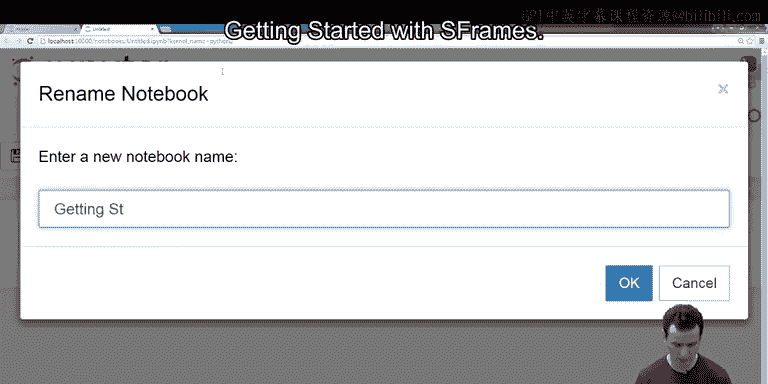
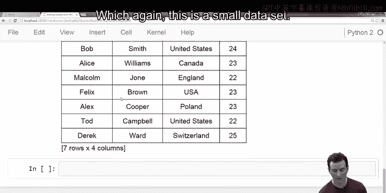

# 第一部分 15：启动Turi Create与加载SFrame 🚀


在本节课中，我们将学习如何启动Turi Create（原GraphLab Create）并加载SFrame，这是处理大规模表格数据的核心工具。我们将通过简单的步骤，了解如何导入库、加载数据以及查看数据的基本信息。

---

## 启动Turi Create

上一节我们介绍了本课程将使用的Python工具。本节中，我们来看看如何启动Turi Create。


首先，我们需要导入`graphlab`库。这个库提供了SFrame数据结构和本课程中将用到的多种机器学习算法。

```python
import graphlab
```



执行上述代码后，Turi Create的所有工具，包括SFrame和机器学习算法，便可供我们使用。

---

## 加载数据

成功启动Turi Create后，下一步是从磁盘加载数据集。加载表格数据到SFrame非常简单。

我们将加载一个CSV格式的文件，这是一种常见的逗号分隔值文件格式。假设文件`people-example.csv`位于当前工作目录中。

以下是加载数据的代码：

```python
sf = graphlab.SFrame('people-example.csv')
```

执行这行代码后，SFrame会解析文件并将其内容加载到变量`sf`中。控制台会显示解析过程的日志信息。

---

## SFrame基础操作

现在数据已加载完毕，让我们学习一些SFrame的基础操作，以便查看和理解数据内容。

以下是查看数据的基本方法：

*   **查看表格前几行**：直接输入SFrame变量名或使用`.head()`方法。
    ```python
    sf
    # 或
    sf.head()
    ```
*   **查看表格后几行**：使用`.tail()`方法。
    ```python
    sf.tail()
    ```

对于小型数据集，这些命令可能会显示所有行。`.head()`和`.tail()`在查看大型数据集的开头和结尾时尤其有用。

---

## 总结

本节课中，我们一起学习了机器学习实践的第一步：**启动Turi Create并加载数据**。我们掌握了三个关键操作：
1.  使用`import graphlab`启动Turi Create。
2.  使用`graphlab.SFrame('filename.csv')`加载CSV格式的数据。
3.  使用`sf.head()`和`sf.tail()`查看数据的前几行和后几行。



这些是构建后续所有机器学习应用的基础。在下一课中，我们将学习如何探索和操作SFrame中的数据。