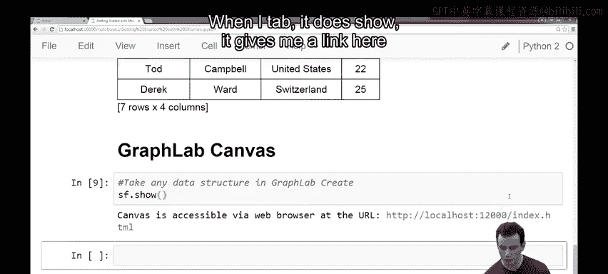
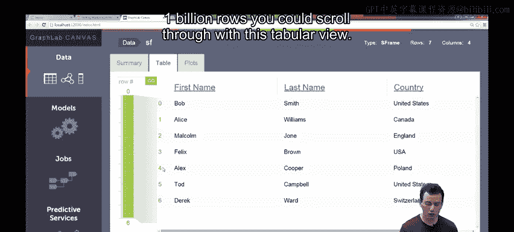
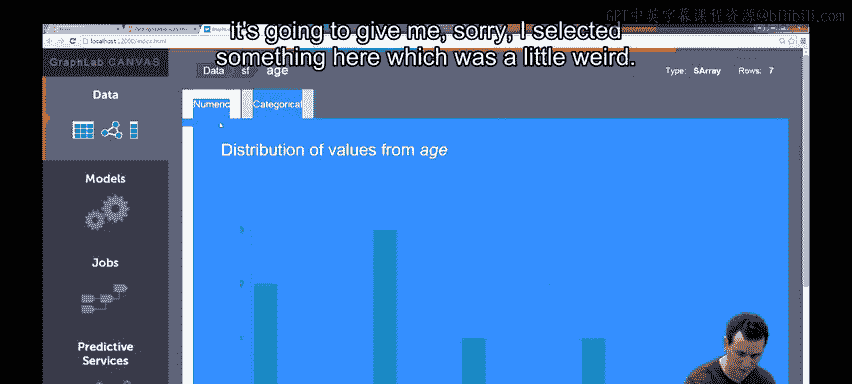
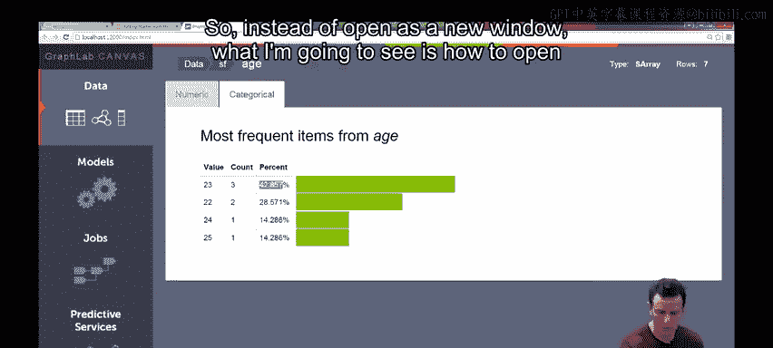
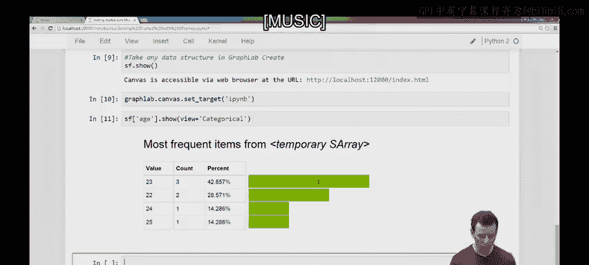

# 第一部分 16： 数据可视化画布 📊

在本节课中，我们将学习如何使用GraphLab Create的数据可视化画布（Canvas）来直观地探索和展示数据集。我们将从启动画布开始，逐步学习如何查看数据、分析列信息，以及如何将可视化结果嵌入到Python笔记本中。

---

我们已经快速浏览了数据集，现在让我展示一个非常实用的功能。

接下来介绍GraphLab Create的**画布（Canvas）**。

我们拥有表格数据、图数据、文本数据和图像数据等多种数据类型，可视化方式也多种多样。GraphLab Create内置了一个数据可视化工具，能以多种方式查看数据。

对于GraphLab Create中创建的任何数据结构，只需在其后输入`.show()`即可启动画布，并提供该数据结构的可视化视图。

以这个简单的数据集为例，输入`.show()`后，画布会生成一个链接，指向展示数据的新网页。

我将稍微减小字体大小，可以看到这个数据集包含四列：名、姓、国家以及年龄。数据显示，最大年龄为25岁，平均年龄为22岁，中位数为23岁，众数为23岁（占比42.857%）。

点击“表格视图（Tabular View）”，可以实际查看数据。这个功能非常强大，即使你有百万行数据，也能轻松滚动浏览，理论上甚至能处理十亿行数据。

现在，如果我点击任意一列，例如年龄列，它会提供该列的分析视图。刚才我误操作了，重新加载一下。

如果选择“分类（Categorical）”视图，数据会按最常见值排序。可以看到，最常见的年龄是23岁，共有3人，占数据的42%。你应该多尝试使用画布，以各种方式可视化数据。

对于我们现在录制的笔记本教程，画布在新窗口中弹出会使得来回切换不太方便。因此，我将展示如何将画布或可视化结果直接嵌入到Python笔记本中。

我将调用一个命令：`graphlab.canvas.set_target(‘ipynb’)`。这个命令会将后续所有可视化的目标设置为当前的IPython笔记本。

让我们再次可视化年龄列，但这次是在笔记本内部进行。操作很直观：我选取这个SFrame（`sf`），使用方括号`[]`来选择特定列（这里选择‘age’列），然后在其后输入`.show()`，并指定我想要“分类排序（sorted categorical）”视图。

结果出来了：我们可以看到23岁是最常见的年龄，有3人，占数据的42%。

至此，我们已经学习了如何使用GraphLab Create进行初步的数据可视化。在本课程中，我们还将看到GraphLab Create及其他工具提供的更多可视化方法。

---

**本节课总结**

本节课我们一起学习了：
1.  如何启动并使用GraphLab Create的**数据可视化画布（Canvas）**。
2.  如何通过`.show()`方法查看数据集的整体概况和统计信息。
3.  如何利用画布的**表格视图（Tabular View）** 浏览大量数据。
4.  如何通过点击列名，查看特定列（如年龄）的详细分析（如**分类视图/Categorical View**）。
5.  如何使用`graphlab.canvas.set_target(‘ipynb’)`命令，将可视化结果**嵌入到Jupyter Notebook**中，方便在教程或分析中直接查看。
6.  掌握了通过`sf[‘column_name’].show()`语法对单列数据进行快速可视化的方法。

通过这些步骤，你可以开始以直观的方式探索和理解你的数据，这是机器学习工作流程中至关重要的一步。