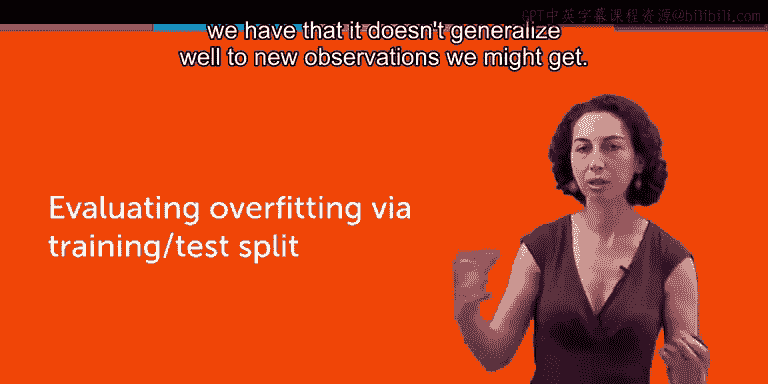
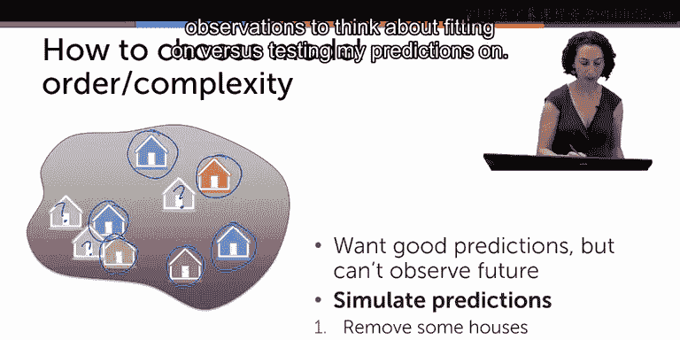
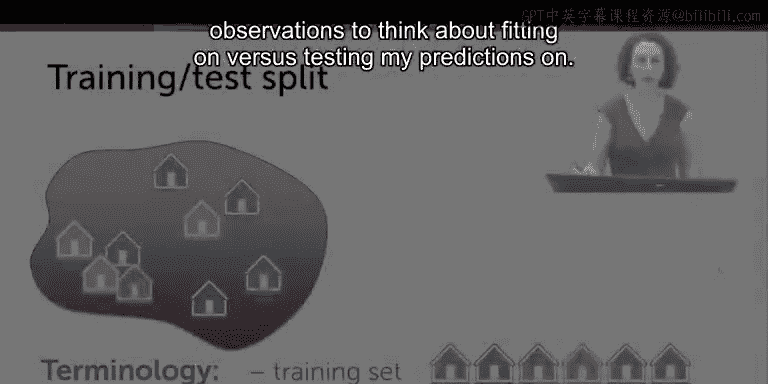
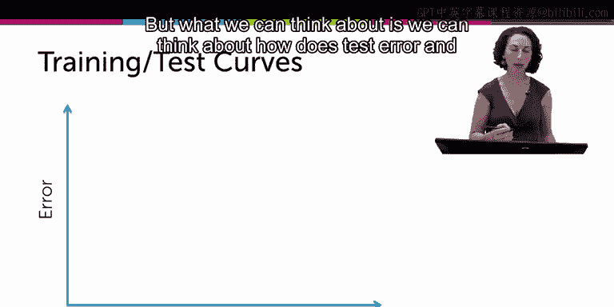
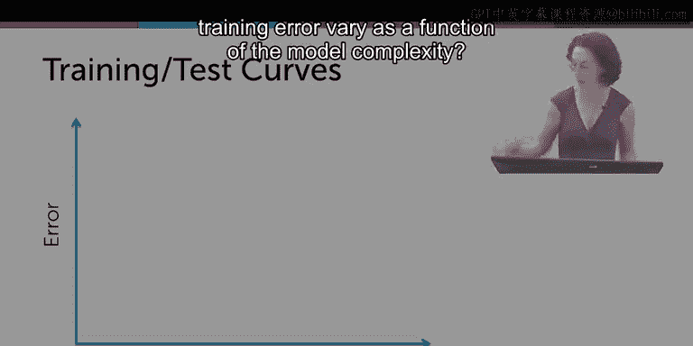

# 第一部分 23：通过训练/测试集分割评估过拟合 📊

在本节课中，我们将学习一个机器学习中的核心问题——**过拟合**，并介绍如何使用**训练集**和**测试集**分割的方法来评估模型的好坏，从而选择更合适的模型复杂度。

---

## 过拟合问题

上一节我们介绍了使用高次多项式拟合数据可能带来的问题。我们面临的问题被称为**过拟合**。具体来说，我们采用了一个模型，并使其极度精确地贴合了我们的实际观测数据。但这个模型不能很好地推广到新的预测上。

这个问题实际上超出了仅仅做出奇怪预测的范畴。我们将在回归课程中更详细地讨论这一点。但需要指出，这是任何机器学习模型或统计模型都可能面临的真实问题。在这些情况下，我们希望将模型拟合到数据上，但我们不希望模型过于专门针对我们拥有的这一个数据集，以至于它不能很好地推广到我们可能获得的新观测数据上。

## 评估模型合理性

让我们回到这个13次多项式拟合。一个问题是：我们真的相信这个模型吗？我们认为这可能是一个对数据的合理拟合吗？正如之前提到的，答案很可能是否定的。尽管它最小化了残差平方和，但它最终导致了非常糟糕的预测。

我在这里思考，我们之前得到的二次拟合，即使它没有像13次多项式那样最小化我的残差平方和，我的直觉仍然认为这在某种程度上是一个更好的模型。那么问题来了：这里发生了什么？我们如何思考选择正确的模型阶数或模型复杂度？

我们当然想要好的预测，这是我们的目标。但我们实际上无法观测未来。所以，在我们真正进行预测之前，我们无法实际观测到我们想要做出的预测，并判断我们是否做得好。因此，当我们在思考选择模型时，我们只能利用我们已有的数据。那么，在这种情况下，我们如何思考尝试选择一个好模型呢？

我们可以做的是**模拟预测**。

## 模拟预测：训练集与测试集

我们将取我们拥有的数据集，并移除其中一些房屋。这些被灰化的房屋将被暂时移除。

我们将使用剩余的房屋来拟合我们的模型。我们将使用之前讨论过的完全相同的方法来拟合模型。然后，我们将进行预测。我会擦掉这些“x”标记，换上问号。然后问：从我刚刚在圈出的房屋上学到的模型中，我对这些问号预测了什么值？接着，我可以与实际的观测值进行比较，因为这些房屋就在我的数据中。

这样，我可以将其作为对尚未收集的数据进行真实预测的替代方法。当然，这种方法只有在有足够多的观测数据用于拟合和测试预测时才能很好地工作。

## 术语定义

让我们引入一些术语。我们用来拟合模型的房屋，我们称之为**训练集**。我们用作预测代理的房屋，即我们预留的那些，我们称之为**测试集**。

## 训练误差与测试误差

让我们更深入地探讨如何进行这种分析。首先，我们可以查看所谓的**训练误差**。

我们将检查测试数据集中的每一栋房屋。我们的训练房屋在这里用蓝色圆圈表示。在定义训练误差时，我们只关注这些房屋。具体来说，我们将查看在这些房屋上产生的误差。这仅仅是训练数据集中房屋的残差平方和，被称为**训练误差**。具体来说，训练误差看起来与我们之前计算残差平方和时完全一样，但我们只包含训练数据集中的房屋。

那么，对于任何给定的模型，例如线性拟合、二次拟合等，我们可以做的是，将估计模型参数视为那些最小化训练误差的参数。这等同于我们之前讨论的最小化残差平方和，但这里我们只关注训练数据集中的房屋。这样，我们就得到了估计的模型参数 **Ŵ**。

但我们接下来要做的是，取这些估计的模型参数，并评估我们的表现如何。记住我们说过要做什么：我们将查看我们预留的观测数据。这些灰色圆圈是测试集中的房屋。这些房屋没有被用来拟合这个模型。我们要问：我们预测这些实际房屋销售情况的效果如何？

我们的预测是什么？回想一下，当我们考虑进行预测时，我们只使用了拟合值，即直线上的点。

为了评估我们预测这些预留观测数据（即测试数据）的效果，我们将查看一个看起来也完全像残差平方和的东西，但它被称为我们的**测试误差**。我们取这些估计的模型参数 **Ŵ**，并对测试数据集中所有房屋的残差平方和进行求和。这就是我们的测试误差。

我们可以思考的是：测试误差和训练误差如何随着模型复杂度的变化而变化？

---

## 总结

本节课中，我们一起学习了**过拟合**的概念，即模型过于复杂，完美拟合了训练数据但无法泛化到新数据。为了解决这个问题，我们引入了**训练集**和**测试集**分割的方法。通过将数据分为两部分，一部分用于训练模型（训练集），另一部分用于评估模型在未见数据上的表现（测试集），我们可以计算**训练误差**和**测试误差**。通过观察这两种误差随模型复杂度变化的趋势，我们可以更好地选择既能拟合数据又能良好泛化的模型，避免过拟合。