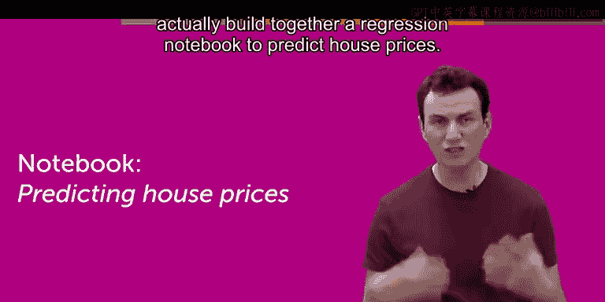
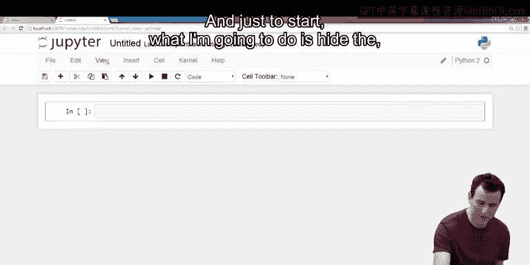
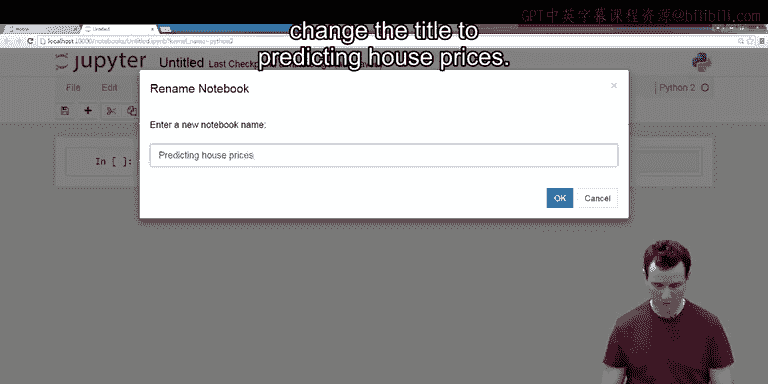
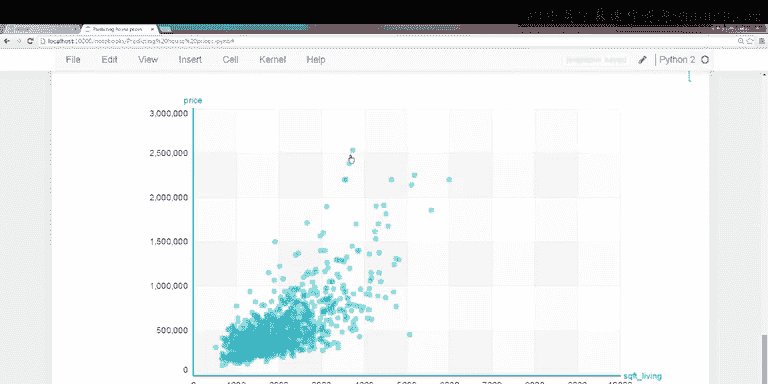

# 第一部分 28：加载并探索房屋销售数据 🏠


在本节课中，我们将学习如何使用Python和GraphLab Create来加载并探索真实的房屋销售数据，为后续的房价预测模型做准备。



---



## 启动环境与加载数据



上一节我们介绍了回归分析的基本概念。本节中，我们将动手操作，使用King County（美国西雅图所在区域）的公开房屋销售记录数据，共同构建一个用于预测房价的iPython Notebook。

首先，我们需要启动GraphLab Create工具，并加载数据。

以下是启动GraphLab Create的代码：

```python
import graphlab
```

接下来，我们加载房屋销售数据。我们将使用GraphLab Create中的SFrame数据结构来存储这些表格数据。

```python
sales = graphlab.SFrame('home_data.gl/')
```

执行上述代码后，数据将被加载到名为`sales`的变量中。我们可以通过输入变量名来查看数据内容。

数据包含了每笔房屋交易的多个特征，例如：
*   交易ID
*   销售日期
*   销售价格
*   卧室数量
*   卫生间数量
*   房屋居住面积（平方英尺）
*   土地面积（平方英尺）
*   楼层数
*   房屋是否有景观
*   房屋所在坡度等级

---

## 数据探索与可视化

加载数据后，下一步是进行初步探索，以理解数据特征和变量之间的关系。我们将使用GraphLab Canvas进行可视化。

为了将图表直接显示在Notebook中，我们需要设置Canvas的目标输出。

```python
graphlab.canvas.set_target('ipynb')
```

设置完成后，我们可以创建散点图来探索两个关键变量之间的关系：房屋居住面积和销售价格。

```python
sales.show(view='Scatter Plot', x='sqft_living', y='price')
```

生成的散点图以房屋面积为X轴，价格为Y轴。通过观察图表，我们可以发现以下规律：
*   总体上，房屋面积越大，其销售价格也倾向于越高。
*   大多数房屋的面积集中在1000到3000平方英尺之间。
*   数据中存在一些异常值。例如，一个面积约为1910平方英尺的房屋售价高达150万美元，而另一个面积相近（约1700平方英尺）的房屋仅售14.9万美元。
*   数据集中最大的房屋面积约为3730平方英尺，售价为250万美元。

---

## 总结



本节课中，我们一起学习了如何启动GraphLab Create环境、加载真实的房屋销售数据集，并通过可视化工具初步探索了数据特征，特别是房屋居住面积与销售价格之间的关系。这为下一节课构建具体的回归预测模型打下了基础。