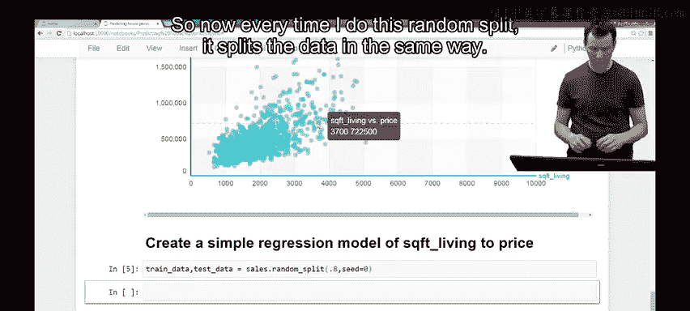
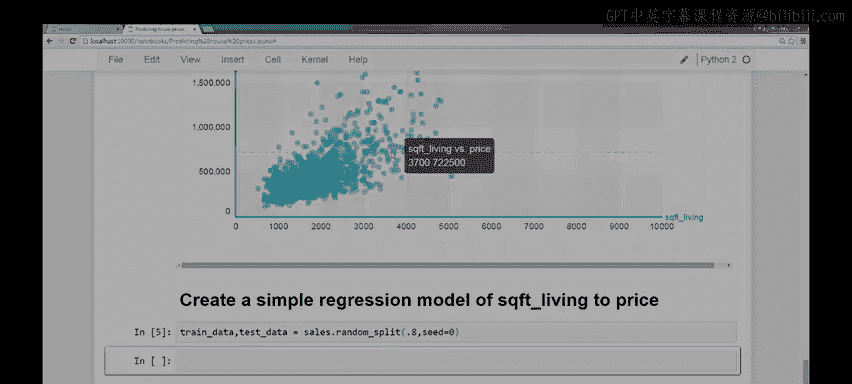

# 第一部分 29：将数据分为训练集和测试集 📊


在本节课中，我们将学习构建简单回归模型的第一步：如何将数据集划分为训练集和测试集。这是机器学习工作流程中至关重要的一环，能帮助我们评估模型的真实性能。

---

## 数据探索与模型目标

我们已构建了一个简单的散点图，对数据分布有了初步了解。

现在的问题是：能否利用这个散点图，根据居住面积来预测销售价格？我们将构建一个简单的回归模型来实现这个目标。

---

## 划分数据集的重要性

在开始对数据进行任何建模操作之前，首先要做的是将其划分为训练集和测试集。

请记住，**永远不要在测试数据上进行训练或学习**。所有训练和参数调整都应仅在训练数据上进行，测试数据仅用于最终评估模型在未见数据上的表现。

---

## 执行数据划分

接下来，我们将数据分割为训练数据和测试数据。具体方法是调用一个名为 `random_split` 的函数。

以下是执行步骤：

1.  对数据框（例如`sales`）应用`.random_split`方法。
2.  指定分割比例，例如`0.8`，这意味着80%的数据用于训练，20%用于测试。
3.  （可选但推荐）为随机分割设置一个种子值，以确保结果可重现。

**代码示例：**
```python
train_data, test_data = sales.random_split(0.8, seed=0)
```

**关于代码的说明：**
*   `0.8` 参数指定了训练集的比例。
*   `seed=0` 设置了随机数生成器的种子。种子可以是任意数字（如2015）。设置种子后，每次运行代码都会得到完全相同的随机划分结果，这在家庭作业和需要复现实验时非常有用。

---



## 本节总结



本节课中，我们一起学习了机器学习建模的预备步骤：**划分训练集与测试集**。我们理解了为何要这样做（避免在测试集上训练），并掌握了使用 `random_split` 函数进行划分的具体方法，同时通过设置 `seed` 参数确保了结果的可重现性。这是构建可靠评估模型的基础。