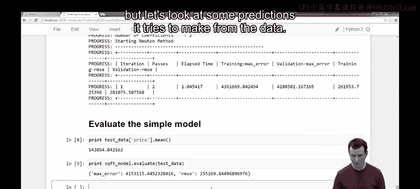
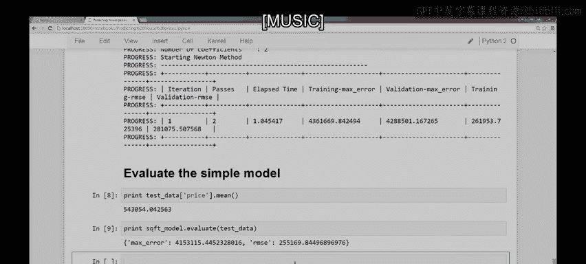

# 第一部分 31：评估简单模型的误差（RMSE）📊


在本节课中，我们将学习如何评估一个已训练的简单线性回归模型。我们将使用测试数据集，计算模型的预测误差，并重点理解**均方根误差（RMSE）** 这一核心评估指标。

---

上一节我们介绍了如何训练一个基于房屋面积的线性回归模型。本节中，我们来看看如何评估这个模型的性能。

首先，我们需要使用测试数据。请记住，我们之前已经将数据分割为训练集和测试集。让我们先了解一下测试数据的基本情况。

以下是查看测试数据中房价基本统计信息的步骤：

```python
# 计算测试数据中房价的平均值
average_price = test_data['price'].mean()
print(average_price)
```

执行上述代码后，我们得到西雅图测试数据中房屋的平均价格约为 **543,000美元**。这表明该地区的平均房价相当昂贵。

现在，我们已经建立了基于面积的模型，接下来需要在这个测试集上评估它。

我们将调用一个评估函数。该函数可以接收测试数据集，并计算、返回一系列反映模型拟合效果的统计量。

以下是评估模型的具体操作：

```python
# 使用评估函数计算模型在测试集上的表现
print(model.evaluate(test_data))
```

评估结果显示，模型在所有测试房屋上的最大误差为 **410万美元**。这表明存在一个预测极不准确的异常值样本。

而平均误差，即我们讨论过的**均方根误差（RMSE）**，为 **255,000美元**。

**RMSE** 的计算公式为：
$$RMSE = \sqrt{\frac{1}{n} \sum_{i=1}^{n} (y_i - \hat{y}_i)^2}$$
其中，$y_i$ 是真实值，$\hat{y}_i$ 是模型预测值，$n$ 是样本数量。

我们构建的这个简单模型具有较高的RMSE。为了更直观地理解，我们可以查看模型对部分数据做出的具体预测。



---



本节课中我们一起学习了如何评估线性回归模型。我们使用了独立的测试数据集，计算了最大误差和关键的**均方根误差（RMSE）** 指标，从而量化了模型的预测准确性。