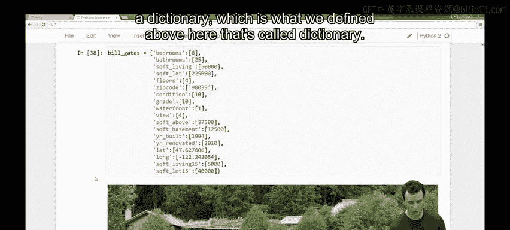
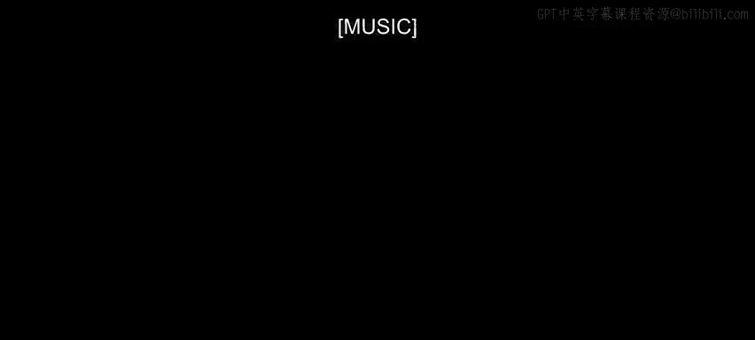

# 第一部分 37：应用模型预测两个高档房屋价格 🏠


在本节课中，我们将学习如何应用已构建的机器学习模型来预测两个高档房屋的价格。我们将看到不同复杂度的模型在面对不同特征房屋时的表现差异，并最终尝试预测比尔·盖茨的豪宅价格。

---

上一节我们介绍了如何构建和评估房屋价格预测模型。本节中，我们来看看如何将这些模型应用于具体的房屋实例进行价格预测。

## 预测第二套高档房屋

首先，我们来看第二套房屋。这套房屋在销售数据中的ID是1925069082。

以下是该房屋的具体信息：
*   房屋于2015年售出，售价为220万美元。
*   拥有5间卧室。
*   拥有4.25间浴室。
*   居住面积为4640平方英尺（约460平方米），是一套相当大的房屋。

以下是房屋的图片：


记得上一套房屋售价62万美元，而这一套售价220万美元。从图片看，它更豪华，并且位于水滨，这解释了其高昂的价格。

现在，让我们看看我们的模型对这套房产的估值预测。

首先，打印仅基于面积的模型（`sqft_model`）的预测结果。我们使用 `.predict()` 方法。

```python
sqft_model.predict(house2)
```
该模型预测价格仅为125万美元，表现不佳。

接下来，我们看看包含更多特征的进阶模型（`my_features_model`）的预测。在执行前可以思考一下：对于上一套西雅图地区较普通的房屋，多特征模型并未带来显著提升。但这套房屋非常特别，拥有水滨、大量浴室和卧室等难以仅用面积来捕捉的特征。因此，我们预期多特征模型在这里会有更好的表现。

运行多特征模型的预测：
```python
my_features_model.predict(house2)
```
模型预测价格为138万美元，虽然仍有差距，但比仅用面积的模型更接近真实价格，表现稍好一些。

---

## 预测比尔·盖茨的豪宅

为了总结，让我们来看一套更豪华的房屋——比尔·盖茨的豪宅。比尔·盖茨居住在西雅图地区，我们将尝试预测其房屋价格。

以下是比尔·盖茨房屋的特征信息（以字典形式表示）：
*   8间卧室。
*   25间浴室。
*   50,000平方英尺的居住面积（约5000平方米）。
*   4层楼。
*   包含许多其他设施。

以下是房屋的图片：



现在，让我们看看模型对比尔·盖茨房屋的价格预测。我们需要将描述房屋的字典转换为SFrame格式，因为模型接收这种格式的输入。

```python
graphlab.SFrame(bill_gates)
```
然后使用多特征模型进行预测：
```python
my_features_model.predict(graphlab.SFrame(bill_gates))
```
模型预测其价值约为300万美元。这个数字听起来很大，但实际价值可能远不止这些。


---

本节课中，我们一起学习了如何应用基于县数据构建的两个房屋价格预测模型。我们探索了数据，使用了模型，并将其应用于预测具体房屋价格的任务，甚至尝试估算了比尔·盖茨豪宅的可能价值。



