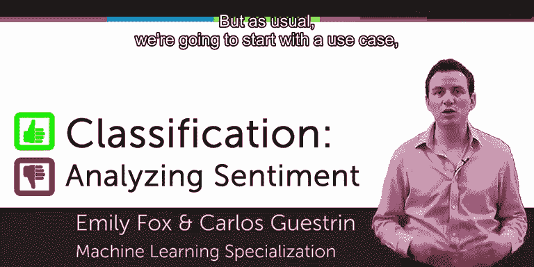
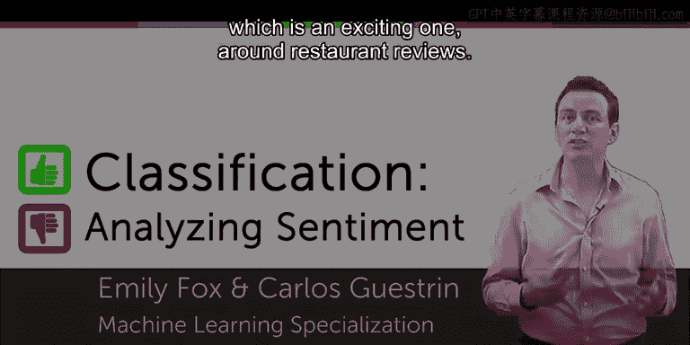

# 第一部分 38：分析评论情感：分类案例研究 📊

在本节课中，我们将要学习机器学习中的一个核心领域——分类。分类是机器学习中最常见、最实用且最直观的应用之一，例如判断邮件是否为垃圾邮件，或确定文档主题属于体育、政治还是娱乐等。本节我们将通过一个餐厅评论情感分析的案例，来具体了解分类任务的基本概念和流程。

---


上一节我们介绍了分类的基本概念，本节中我们来看看如何将分类应用于实际场景。我们将以餐厅评论的情感分析为例，展示分类任务的具体步骤。

## 分类任务概述 📝

分类是机器学习的一种方法，其目标是将数据点分配到预定义的类别中。在情感分析中，我们通常将评论分为“正面”或“负面”两类。这个过程涉及从原始文本中提取特征，并使用这些特征训练一个分类模型。

以下是分类任务的核心步骤：

1.  **数据收集**：获取带有标签的评论数据集，例如“正面”或“负面”。
2.  **特征提取**：将文本评论转化为机器学习模型可以理解的数值特征。常用方法是词袋模型。
3.  **模型训练**：使用带标签的数据训练一个分类器，例如逻辑回归或朴素贝叶斯。
4.  **模型评估**：使用测试数据评估模型的性能，常用指标包括准确率、精确率和召回率。
5.  **预测应用**：使用训练好的模型对新的、无标签的评论进行情感预测。

## 特征提取：从文本到数字 🔢

在机器学习中，模型无法直接理解文本。因此，我们需要将文本数据转换为数值特征。最常用的方法是**词袋模型**。

词袋模型将一段文本表示为一个向量，其中每个维度对应一个单词，值表示该单词在文本中出现的次数（或是否出现）。其核心思想是忽略单词的顺序和语法，只关注单词的出现情况。

**公式表示**：
假设我们的词汇表包含三个单词：`[“好吃”, “服务”, “差”]`。
评论“好吃但服务差”可以表示为向量：`[1, 1, 1]`。
评论“服务很好”可以表示为向量：`[0, 1, 0]`。

**代码示例（Python伪代码）**：
```python
from sklearn.feature_extraction.text import CountVectorizer

# 示例评论数据
reviews = [“好吃但服务差”, “服务很好”]

# 创建词袋模型转换器
vectorizer = CountVectorizer(vocabulary=[“好吃”, “服务”, “差”])

# 将文本转换为特征向量
features = vectorizer.fit_transform(reviews)
print(features.toarray())  # 输出：[[1 1 1], [0 1 0]]
```

## 模型训练与预测 🧠

提取特征后，我们就可以使用这些带标签的特征向量来训练分类模型。以逻辑回归模型为例，它通过学习特征与标签之间的关系，来预测新数据所属的类别。

**核心概念**：逻辑回归模型会为每个特征学习一个权重（`w`），并计算一个分数（`z`），最后通过Sigmoid函数将分数映射到0到1之间的概率。

**公式表示**：
`z = w1*x1 + w2*x2 + ... + wn*xn + b`
`P(正面) = 1 / (1 + e^(-z))`
其中，`x1, x2, ..., xn` 是特征值，`w1, w2, ..., wn` 是对应的权重，`b` 是偏置项。如果 `P(正面) > 0.5`，则预测为正面评论，否则为负面。



## 总结与回顾 ✅



本节课中我们一起学习了机器学习中的分类任务。我们从分类的直观概念入手，通过餐厅评论情感分析的具体案例，详细介绍了从数据准备、特征提取（词袋模型）到模型训练（逻辑回归）的完整流程。

我们了解到，分类的核心在于利用已有标签的数据，让模型学习特征与类别之间的关联，从而能够对新的未知数据进行自动归类。情感分析是分类的一个典型应用，其思路和方法可以推广到垃圾邮件过滤、新闻分类等诸多领域。掌握分类是理解更复杂机器学习模型的重要基础。