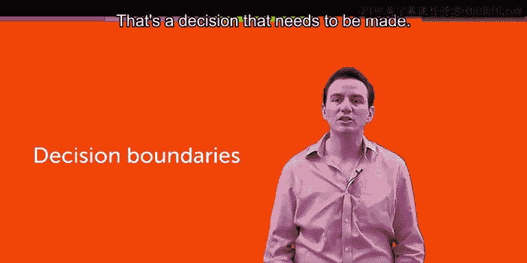
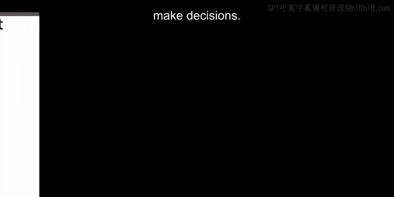
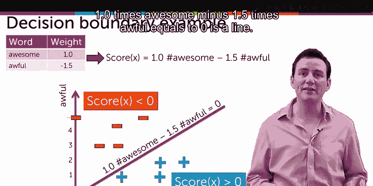
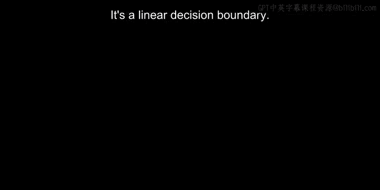
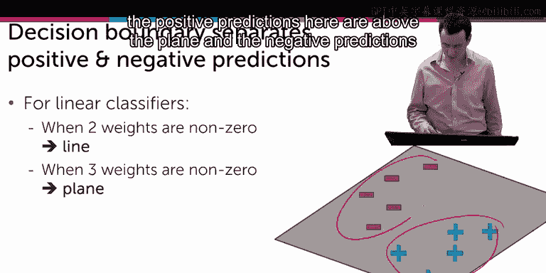

# 第一部分 42：决策边界 🧠

在本节课中，我们将要学习分类器如何做出决策，特别是线性分类器中的决策边界概念。我们将通过简单的例子和直观的图示，帮助你理解分类器是如何将数据划分为不同类别的。

---

## 分类器的决策作用

分类器的核心任务是做出决策。例如，判断一个句子是正面还是负面，或者根据一系列实验室测试、X光片和测量结果，判断患者是否患有流感或感冒等疾病。这些都需要分类器进行明确的决策。

上一节我们介绍了分类器的基本概念，本节中我们来看看分类器，特别是线性分类器，是如何具体做出这些决策的。

---

## 理解决策边界

为了理解决策边界，我们假设一个简单的场景：分类器只考虑两个具有非零权重的词。

*   “awesome”这个词具有正权重，设为 **1**。
*   “awful”这个词具有负权重，设为 **-1.5**。

在这种情况下，一个句子的得分（score）计算公式为：
**score = 1 × (句子中“awesome”的数量) - 1.5 × (句子中“awful”的数量)**

我们可以将句子在这个二维坐标系中表示出来：横轴（awesome轴）代表“awesome”的数量，纵轴（awful轴）代表“awful”的数量。

以下是几个例子在坐标系中的位置：
*   句子“The sushi was awesome, the food was awesome, but the service was awful”包含2个“awesome”和1个“awful”，其坐标为 (2, 1)。
*   一个包含3个“awful”和1个“awesome”的句子，坐标为 (1, 3)。
*   一个包含3个“awesome”和0个“awful”的句子，坐标为 (3, 0)。

现在，让我们更深入地理解如何计算句子得分，以及这对我们的决策意味着什么。

以坐标 (3, 0) 的句子为例，它有3个“awesome”，0个“awful”，其得分为正（大于0），因此被预测为正面。

实际上，在坐标系中，所有位于右下区域的点（得分大于0）都会被预测为正面。而所有位于左上区域的点（得分小于0）则被预测为负面。例如，坐标 (1, 3) 的句子得分为负，因此被标记为负面。

分隔正面预测和负面预测的，是一条特殊的线。在这条线上，得分恰好等于0，我们无法确定预测结果是正面还是负面，因此称之为**决策边界**。决策边界的一侧我们预测为正面，另一侧预测为负面。

请注意，这条决策边界的方程是 **1 × awesome - 1.5 × awful = 0**，这是一条直线。正因为决策边界是线性的，所以这类分类器被称为**线性分类器**。

---

## 决策边界的维度扩展

决策边界的作用是分隔正面预测和负面预测。在只有两个特征的情况下，我们看到决策边界是一条直线。

当我们增加特征数量时，情况会有所不同。在三维空间中，假设我们有三个具有非零权重的词，那么决策边界就变成了一个平面。虽然难以在三维图中精确绘制，但可以想象：正面预测位于平面的上方，负面预测位于平面的下方，而这个平面在空间中以某种角度倾斜。

在实际应用中，我们通常不会只有两三个非零权重的词，而是有成千上万个。在这种情况下，决策边界就变成了**超平面**——一种存在于极高维空间中的分隔面。

当然，分类器并不局限于线性的。我们可以使用更复杂的分类器，它们的决策边界不再是简单的直线或平面，而是具有更复杂的形状或弯曲的分隔面。我们将在后续的分类课程中学习更多相关内容。

---

## 总结

本节课中我们一起学习了决策边界的概念。我们了解到，线性分类器通过一个线性方程（在二维是直线，三维是平面，更高维是超平面）来划分数据点，从而做出分类决策。决策边界是分类器进行预测的核心依据，理解它有助于我们直观把握分类器的工作原理。