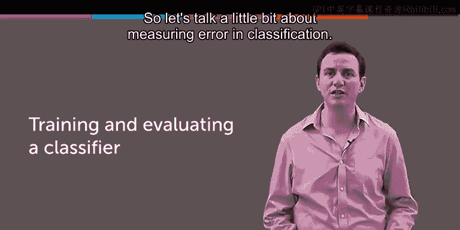
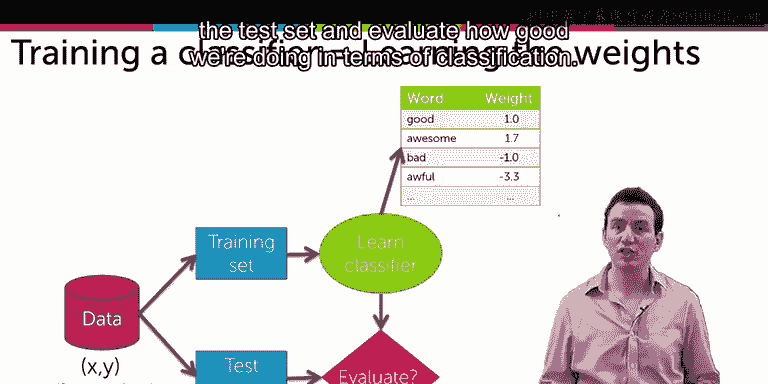
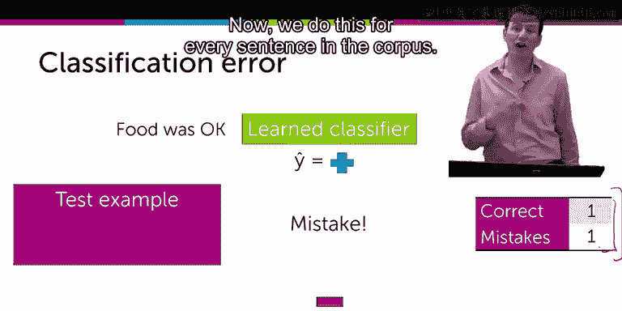
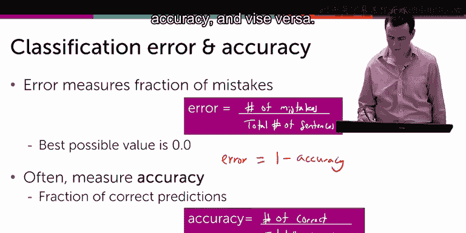

# 第一部分 43：训练与评估分类器 🧠


在本节课中，我们将学习如何训练一个分类器，并评估其性能。我们将重点讨论分类任务中的误差衡量方法，包括错误率与准确率，并通过具体例子说明如何计算这些指标。

---

在回归模型中，我们讨论了预测房价并拟合回归模型的方法，并使用平方误差来衡量误差。在分类任务中，误差的衡量方式有所不同，因为分类关注的是预测正确与错误的输入数量。因此，本节我们将详细探讨分类中的误差衡量方法。

---



## 训练与测试数据集 📊

当我学习一个分类器时，会得到一组输入数据。这些数据是标记为正面或负面情感的句子。与回归类似，我们将数据分为训练集和测试集。




我将训练集输入到正在学习的分类器中，该算法将学习单词的权重。例如，算法可能学习到“good”的权重为1.0，“awesome”为1.7，“bad”为-1.0，“awful”为-3.3。这些权重将用于对测试集中的每个元素进行评分，并评估分类效果。

---

## 分类误差的衡量方法 ⚖️

接下来，我们讨论如何衡量分类误差。我们有一组测试样例，例如“Sushi was great”是一个正面句子。我们需要统计在这些测试句子中，有多少被正确分类，有多少被错误分类。

以下是具体步骤：

首先，将句子“Sushi was great”输入到已学习的分类器中，但隐藏其真实标签。分类器预测该句子为正面（y_hat = positive），而真实标签也是正面，因此预测正确。正确分类的句子数量增加一。

其次，考虑另一个测试样例“The food was okay”，这是一个负面句子。将句子输入分类器并隐藏真实标签。分类器可能将其预测为正面，但真实标签是负面，因此出现错误。错误分类的数量增加一。

对语料库中的每个句子重复此过程，统计正确和错误分类的数量。

---

## 常见的分类质量指标 📈

以下是两种常见的分类质量衡量指标：

**错误率**衡量我们在测试样例上犯错误的比例。计算公式为：



```
错误率 = 错误分类数 / 测试句子总数
```

例如，如果有100个测试句子，犯了10个错误，则错误率为0.1或10%。最佳错误率为0，即没有错误。

**准确率**衡量正确分类的比例。计算公式为：

```
准确率 = 正确分类数 / 测试句子总数
```

与错误率不同，准确率的最佳值为1，表示所有句子都被正确分类。错误率与准确率之间存在简单关系：

```
错误率 = 1 - 准确率
```

反之亦然。

---

## 总结 ✨




本节课中，我们一起学习了如何训练分类器并评估其性能。我们介绍了分类任务中误差的衡量方法，包括错误率和准确率，并通过具体例子演示了如何计算这些指标。理解这些基本概念是进一步学习机器学习分类模型的基础。